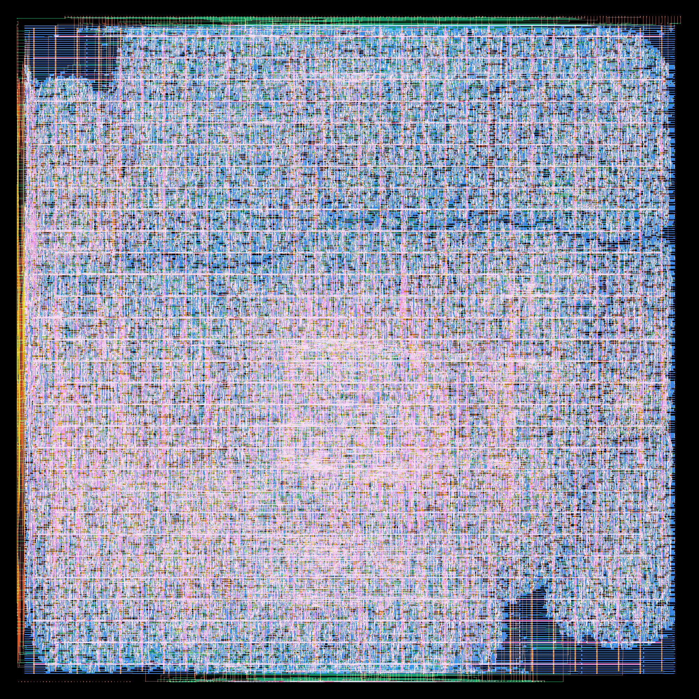
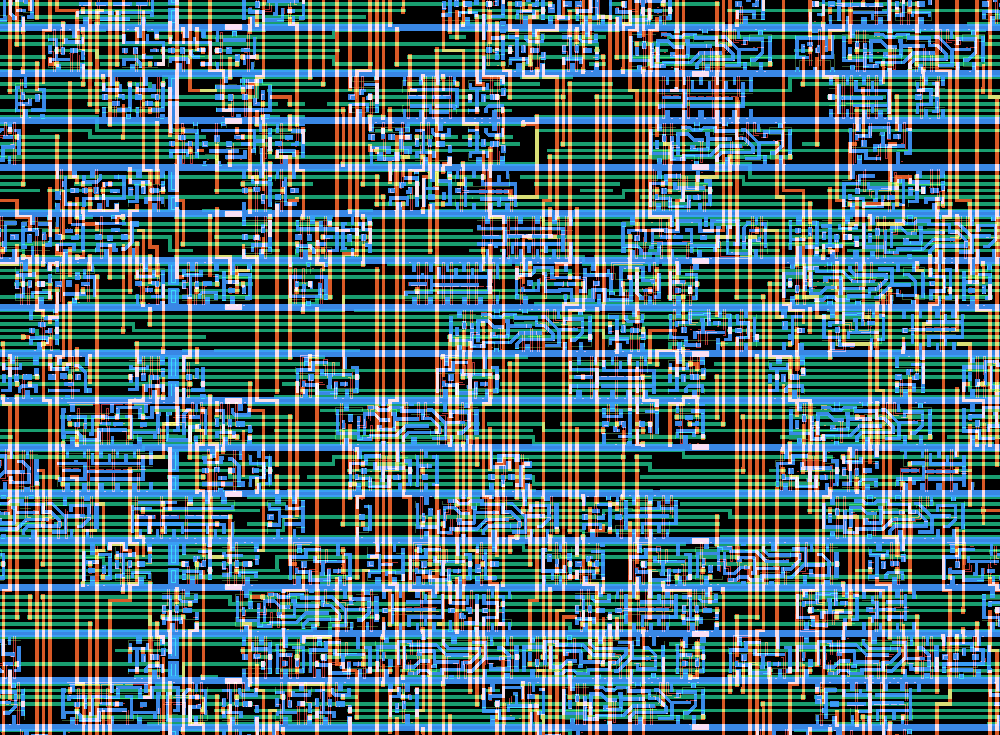

# A Weekend Project: A Branch Predictor Without SRAM on an Open 55 nm PDK, from RTL to GDSII

## Abstract

An open-source 55 nm process design kit, ICsprout55, was released under Apache 2.0 in October 2025. This write-up describes a weekend-sized project built on it: a branch prediction unit (BP55) for a six-stage in-order RV32IM core, taken from an empty directory to a routed layout using only open tools. The PDK ships no memory compiler, so every predictor table is a flip-flop array and the whole design is held to 8132 bits of state. BP55 combines a 128-entry branch target buffer, a 512-entry bimodal table, a small three-table TAGE, a 32-entry indirect target cache and an 8-entry return stack. On 21 programs (CoreMark, Embench-IoT and two custom stress tests, about 295 million instructions) it reaches 9.34 mispredictions per thousand instructions and 94.6 % direction accuracy, a 22 % speedup over a core with no prediction. The RTL matches a bit-accurate C++ model over 63.4 million lookups with zero mismatches. Placed and routed with OpenROAD, the block occupies a 0.185 mm² die with no router or antenna violations and closes timing at 6.2 ns (161 MHz) in the slow corner. The project is small on purpose, and its limits are stated plainly: no sign-off DRC or LVS, no extracted parasitics, and no integration into a real core.

## 1. Why this, and why a weekend

Open PDKs were confined to 130 nm and 180 nm for years. ICsprout55 claims to be the most advanced openly available node at its release, and it comes with standard cells, IO cells, design rules and device models. It also calls itself a preview: there is no SRAM compiler and no PLL yet.

That makes it a good target for a short, self-contained experiment. The question for the weekend was simple: can one person, with open tools only, take a non-trivial block all the way to GDSII on this kit, and what breaks along the way?

A branch predictor suits the question well. Its quality depends almost entirely on how much state it holds, and conventional designs keep that state in SRAM. Without SRAM the problem turns into a budgeting exercise: how much accuracy can be bought with flip-flops alone, and is a TAGE-style predictor still worth its complexity at that size?

The scope was fixed up front to keep the project weekend-sized:

- one block, not a processor;
- a trace-driven evaluation instead of a full core simulation;
- small embedded benchmarks that build and run in minutes;
- open tools throughout: Clang, Yosys, OpenROAD, KLayout.

## 2. The constraint that shaped everything

The smallest flip-flop in the library is 6.16 µm². With read multiplexers and write logic, one kilobit of state costs roughly 0.01 mm². The 30 to 250 Kbit that SRAM-based predictors take for granted is out of reach, so the budget was set at about 8 Kbit.

The target is a single-issue, six-stage RV32IM pipeline (IF1, IF2, ID, EX, MEM, WB). Branches resolve in EX: a misprediction costs 3 cycles, and a redirect from ID costs 2.

## 3. Architecture

| Component | Size | Bits |
|---|---|---|
| Branch target buffer (BTB) | 128 entries, direct mapped; 8-bit tag, 3-bit type, 18-bit target | 3840 |
| Bimodal base predictor | 512 × 2 bits | 1024 |
| TAGE | 3 tables × 64 entries; 7-bit tag, 3-bit counter, 1 useful bit; histories 5 / 12 / 28 | 2155 |
| Indirect target cache | 32 entries, 6-bit target history | 870 |
| Return address stack | 8 entries | 243 |
| Total | | 8132 |

Four decisions separate this design from an SRAM-based one.

**Single-cycle prediction.** The tables are small enough that BTB lookup, TAGE and target selection finish in one cycle. There is no fast-predictor-plus-override structure and no override bubble.

**Combinational history folding.** The longest history is 28 bits, so index and tag hashes are XOR trees fed directly from the history register. Recovery after a misprediction only has to restore that one register.

**Filtered history.** Only conditional branches that hit the BTB or are taken enter the history. This removes the problem of inserting history late for instructions that IF1 does not yet know are branches. Against an idealised history containing every branch, the measured loss is under 0.1 MPKI.

**What flip-flop arrays give back.** The periodic reset of the useful bits takes one cycle. Payload bits sit in the smaller non-reset flop. Training uses 92 bits of metadata captured at lookup, so no second read port is needed.

## 4. How it was built

The work went in five steps, each small enough to finish and check before starting the next.

1. **Traces.** The benchmarks were compiled to RV32IM with Clang and run on a purpose-written instruction-set simulator that logs every control-flow instruction. All 21 programs pass their own self-checks on it.
2. **Model.** The predictor was designed first as a bit-accurate, trace-driven C++ model. A sweep of 300 configurations over BTB, bimodal, TAGE and indirect-cache sizes picked the design point; 26 further runs tuned histories, tag widths and reset period.
3. **RTL.** The chosen point was written in SystemVerilog, about 270 lines in one module.
4. **Verification.** The RTL was compiled with Yosys CXXRTL and stepped against the model lookup by lookup.
5. **Implementation.** Synthesis with Yosys and ABC, place and route with OpenROAD, GDS merge and rendering with KLayout.

The metrics are MPKI (mispredictions resolved in EX per thousand instructions) and CPI including only branch-related penalty cycles.

## 5. Does it predict well?

| Configuration | Bits | MPKI | Direction accuracy | CPI |
|---|---|---|---|---|
| No prediction | 0 | 81.7 | — | 1.269 |
| BTB + bimodal | 5977 | 16.07 | 89.85 % | 1.056 |
| BTB + gshare | 9059 | 10.80 | 93.35 % | 1.041 |
| BP55 | 8132 | 9.34 | 94.60 % | 1.037 |
| TAGE, 123 Kbit (reference) | 122952 | 5.73 | 96.44 % | 1.018 |

BP55 sits below the bimodal and gshare curves at every budget in the sweep. Against gshare it has 13.5 % fewer mispredictions with 10 % fewer bits.

The honest caveat is that on a pipeline with a 3-cycle penalty this is worth only 0.4 % in CPI. TAGE earns its complexity as the penalty grows: with a 12-cycle penalty the CPI gap is 1.146 against 1.130.

Removing components one at a time shows where the bits pay off. Without the return stack MPKI rises to 10.23; without the indirect cache it rises to 10.70. These are the cheapest structures and the most efficient per bit. Delaying table updates by two branches raises MPKI only to 9.59, so training in EX is good enough.

Two limits show up per program. In `xgboost` and `qrduino`, which are dominated by data-dependent branches, even the 123 Kbit TAGE barely helps. In `xgboost`, `huffbench` and `depthconv`, BP55 is slightly behind gshare because its 64-entry tagged tables overflow.

## 6. From netlist to layout

| | Value |
|---|---|
| Die | 430.5 × 430.5 µm (0.185 mm²) |
| Utilisation | 65 % |
| Cell area (excluding fillers) | 0.114 mm² |
| Flip-flops | 8132 |
| Metal usage | MET1 rails; MET2–MET5 signals; MET4/MET5 power straps |
| Wire length / vias | 900 mm / 162,034 |
| Router violations / antenna violations | 0 / 0 |
| Power (typical corner, 167 MHz) | 33 mW |

*Figure 1. The complete routed BP55 layout (430.5 × 430.5 µm). Blue: MET1, orange: MET2, green: MET3, yellow: MET4, pink: MET5. The regular horizontal and vertical lines are the MET4/MET5 power straps; the gaps in the top-left and bottom-right corners are areas the placer left unused.*

*Figure 2. A 30 × 22 µm close-up from the middle of the core. The thick horizontal blue lines are the MET1 power rails of the standard-cell rows; between them are the cells' internal MET1 connections, with MET2 (vertical) and MET3 (horizontal) signal wires above.*

Timing was closed at a 6.2 ns clock with 0.5 ns input and 0.5 ns output budgets:

| Corner | Setup slack | Hold slack |
|---|---|---|
| Slow (1.08 V, 125 °C) | +0.10 ns | 0.00 ns |
| Typical (1.2 V, 25 °C) | +2.47 ns | +0.12 ns |
| Fast (1.32 V, −40 °C) | +3.42 ns | +0.06 ns |

That is 161 MHz in the slow corner and roughly 267 MHz in the typical one, at block level.

## 7. What went wrong, and what it taught

Most of the weekend's lessons came from the back end.

**The synthesis timing estimate was misleading.** Wire-less synthesis predicted a 2.47 ns critical path in the slow corner. After placement the same path was about 4.3 ns. Flip-flop arrays are the reason: their address lines fan out to thousands of multiplexers and need deep buffer trees. An early frequency estimate based on synthesis alone turned out to be optimistic by a wide margin.

**Clock gating did not survive place and route.** Turning write enables into clock-gating cells cut synthesis area by 16 %. The PDK's Liberty file lacks the clock-gating pin attributes for those cells, however, and OpenROAD could not balance the clock tree behind them. The layout uses the ungated netlist. As a result, 48 % of the power goes into flip-flop internal power and 30 % into the clock tree.

**Hold fixing is expensive.** The short feedback paths inside the flop arrays needed hold buffers at more than 8000 endpoints. Clock tree and repair buffers pushed cell area 17 % above the synthesis figure.

**Loosening the clock target did not close timing.** The first layout, optimised for 6.0 ns, missed by 0.10 ns in the slow corner. Re-running the whole flow with a 6.2 ns target missed by 0.15 ns: the tool optimised less against the looser target. What worked was keeping the 6.0 ns layout and checking it against 6.2 ns. In this flow it pays to optimise about 0.2 ns tighter than the clock used for sign-off.

**One self-inflicted problem.** An early run failed hold repair across nearly every flop. The cause was a constraint that applied the 0.10 ns setup uncertainty to hold checks as well.

## 8. What this project is not

- Sign-off DRC and LVS were not run. The PDK's rule decks are in Calibre format, and "zero violations" refers only to the router's own check against the LEF rules.
- Timing rests on RC estimates from global routing. There is no open parasitic-extraction rule file for this PDK.
- Slow-corner hold slack at 6.2 ns is approximately zero.
- Verification is at RTL level. The synthesised and routed netlists were not simulated, and the block was not integrated into a core.
- The workloads are small embedded programs. BTB tag aliasing never occurred, so that RTL path is untested, and the tag and target widths were chosen by assumption. The results do not carry over to large code bases.
- The PDK itself is not yet fully silicon-proven, and its maintainers state that it must not be used for volume production.

## 9. Conclusion

A weekend is enough to take a useful branch predictor from nothing to GDSII on an open 55 nm PDK: 8 Kbit of flip-flops, a 0.185 mm² die and 94.6 % direction accuracy, built entirely with open tools. The same weekend also maps the gaps in today's open flow at this node. A memory compiler would bring the largest gain; in these measurements a 123 Kbit TAGE removes a further 39 % of mispredictions. Completing the Liberty attributes of the clock-gating cells comes second and would cut both power and area. Open DRC, LVS and extraction rules are what it would take to check results like these at sign-off quality.

All sources, scripts, logs and the layout are in the project repository.

## References

1. ICsprout 55 nm Open Source PDK documentation. https://icsprout55-pdk-en.readthedocs.io/en/latest/
2. ECOS Team, "ICsprout55 PDK release" announcement, October 2025. https://website-src-mkdocs.vercel.app/en/news/20251020_icsprout55_pdk_release
3. ICsprout55 PDK repository. https://github.com/openecos-projects/icsprout55-pdk
4. A. Seznec, P. Michaud, "A case for (partially) TAgged GEometric history length branch prediction," Journal of Instruction-Level Parallelism, 2006.
5. S. McFarling, "Combining Branch Predictors," DEC WRL Technical Note TN-36, 1993.
6. EEMBC CoreMark. https://github.com/eembc/coremark
7. Embench-IoT. https://github.com/embench/embench-iot
8. T. Ajayi et al., "Toward an Open-Source Digital Flow: First Learnings from the OpenROAD Project," DAC 2019.
9. C. Wolf, "Yosys Open SYnthesis Suite." https://yosyshq.net/yosys/
