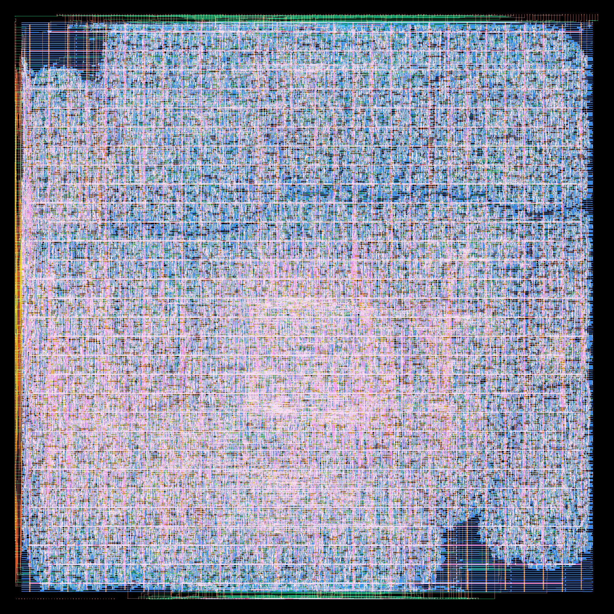

# Açık Kaynak 55 nm PDK Üzerinde SRAM'siz Bir Dallanma Tahmin Birimi: Tasarım, Doğrulama ve Fiziksel Gerçekleme

*"Fable ile Haftasonu" serisinden: Anthropic'in yapay zekâ modeli Claude Fable ile yapılan hafta sonu ölçeğinde mühendislik projeleri. Yön ve kapsam kararları insandan; tasarım, kod, koşular ve bu yazı modelden.*

## Özet

Bu çalışma, Ekim 2025'te Apache 2.0 lisansıyla yayımlanan ICsprout55 açık kaynak 55 nm süreç tasarım kiti (PDK) üzerinde, altı aşamalı sıralı bir RV32IM işlemci için dallanma tahmin biriminin (BP55) uçtan uca tasarımını sunar. PDK'da bellek derleyicisi bulunmadığından tüm tahmin tabloları flip‑flop dizileriyle kurulmuş ve durum bütçesi 8132 bitle sınırlanmıştır. Birim; 128 girişli bir dallanma hedef tamponu, 512 girişli iki bitlik taban tahminleyici, üç tablolu küçük bir TAGE, 32 girişli dolaylı hedef önbelleği ve 8 girişli dönüş adresi yığınından oluşur. CoreMark ve Embench‑IoT'u içeren 21 programlık bir kümede (yaklaşık 295 milyon komut) BP55, 1000 komut başına 9,34 yanlış tahmin ve %94,6 yön doğruluğu verir; tahminsiz çekirdeğe göre %22 hızlanma sağlar. RTL, bit‑doğru bir C++ modeline karşı 63,4 milyon aramada sıfır uyuşmazlıkla doğrulanmıştır. Tasarım tümüyle açık kaynak araçlarla (Yosys, OpenROAD, KLayout) 0,185 mm²'lik bir kalıba yerleştirilip yönlendirilmiş, yönlendirici kural ihlali ve anten ihlali olmadan GDSII üretilmiştir. Yavaş köşede blok düzeyinde 161 MHz (6,2 ns), tipik köşede yaklaşık 267 MHz elde edilmiştir. Çalışma ayrıca PDK'nın bugünkü eksiklerinin (SRAM, saat kapılama öznitelikleri, açık DRC/LVS ve parazit çıkarım kuralları) tasarım kararlarını nasıl belirlediğini belgelemektedir.

## 1. Giriş

Açık kaynak PDK'lar uzun süre 130 nm ve 180 nm düğümleriyle sınırlı kaldı. ICsprout55, yayımlandığı sırada açık olarak erişilebilen en ileri düğüm olduğunu öne sürüyor ve standart hücre kütüphanesi, IO hücreleri, tasarım kuralları ve cihaz modelleriyle birlikte geliyor. Öte yandan proje kendisini "ön sürüm" olarak tanımlıyor; bellek derleyicisi ve PLL henüz yok.

Dallanma tahmini, bu tür bir PDK'yı sınamak için elverişli bir problemdir: performansı neredeyse tümüyle durum miktarına bağlıdır ve alışılmış tasarımlar bu durumu SRAM'de tutar. SRAM yokken soru şuna dönüşür: yalnızca flip‑flop kullanarak, makul bir alan içinde ne kadar doğruluk elde edilebilir ve bu, bilinen basit tahminleyicilere göre karmaşıklığa değer mi?

Bu makalenin katkıları şunlardır:

1. Flip‑flop bütçesine göre boyutlandırılmış, tek çevrimde yanıt veren bir tahmin mimarisi ve 300 konfigürasyonluk tasarım uzayı taraması.
2. RTL ile bit‑doğru referans model arasında tam eşdeğerlik gösteren bir ko‑simülasyon.
3. Açık araçlarla RTL'den GDSII'ye tam akış ve bu akışta karşılaşılan PDK kaynaklı engellerin dökümü.

## 2. Hedef işlemci ve kısıtlar

Hedef, tek komut/çevrim çalışan altı aşamalı (IF1, IF2, ID, EX, MEM, WB) bir RV32IM çekirdeğidir. Dallanmalar EX aşamasında çözülür; yanlış tahmin 3 çevrime, ID aşamasından yapılan yeniden yönlendirme 2 çevrime mal olur.

Kütüphanedeki en küçük flip‑flop 6,16 µm²'dir. Okuma çoklayıcıları ve yazma mantığıyla birlikte 1 Kbit durum kabaca 0,01 mm² tutar. SRAM tabanlı tahminleyicilerde olağan olan 30–250 Kbit bu koşulda gerçekçi değildir; bütçe yaklaşık 8 Kbit olarak seçilmiştir.

## 3. Mimari

| Bileşen | Boyut | Bit |
|---|---|---|
| Dallanma hedef tamponu (BTB) | 128 giriş, doğrudan eşlemeli; 8 bit etiket, 3 bit tür, 18 bit hedef | 3840 |
| Taban tahminleyici | 512 × 2 bit | 1024 |
| TAGE | 3 tablo × 64 giriş; 7 bit etiket, 3 bit sayaç, 1 bit yararlılık; geçmiş 5 / 12 / 28 | 2155 |
| Dolaylı hedef önbelleği | 32 giriş, 6 bit hedef geçmişi | 870 |
| Dönüş adresi yığını | 8 giriş | 243 |
| Toplam | | 8132 |

Tasarımı SRAM tabanlı muadillerinden ayıran dört karar vardır.

**Tek çevrimlik tahmin.** Tablolar küçük olduğundan BTB, TAGE ve hedef seçimi tek çevrimde tamamlanır. İki kademeli (hızlı tahmin + geç düzeltme) yapıya ve onun eklediği boşluk çevrimine gerek kalmaz.

**Kombinasyonel geçmiş katlama.** En uzun geçmiş 28 bittir; indeks ve etiket katlamaları doğrudan geçmiş yazmacından XOR ağaçlarıyla üretilir. Yanlış tahminde yalnızca geçmiş yazmacını geri yüklemek yeterlidir.

**Süzülmüş geçmiş.** Geçmişe yalnızca BTB'de bulunan ya da alınan koşullu dallar girer. Böylece IF1'de henüz dal olduğu bilinmeyen komutlar için geç geçmiş ekleme sorunu ortadan kalkar. İdeal "her dal" geçmişine göre ölçülen kayıp 0,1 MPKI'nin altındadır.

**Flip‑flop dizisinin getirileri.** Yararlılık bitlerinin periyodik sıfırlanması tek çevrimde yapılır; yük bitleri resetsiz (daha küçük) flop'larda tutulur; eğitim, arama anında yakalanan 92 bitlik meta veriyle yapıldığı için ikinci bir okuma kapısı gerekmez.

## 4. Yöntem

İş yükü olarak CoreMark, Embench‑IoT'tan 18 program ve dolaylı atlama ile çağrı‑dönüş davranışını zorlayan iki ek program kullanılmıştır. Programlar Clang ile RV32IM'e derlenmiş, bu çalışma için yazılan bir komut kümesi simülatöründe çalıştırılarak denetim akışı izleri üretilmiştir; 21 programın tamamı kendi sonuç denetiminden geçmiştir.

Tahminleyici önce izle sürülen bit‑doğru bir C++ modelinde tasarlanmış, ardından SystemVerilog'a aktarılmıştır. RTL, Yosys'in CXXRTL arka ucuyla derlenip modelle adım adım karşılaştırılmıştır. Metrik olarak MPKI (1000 komut başına EX aşamasında çözülen yanlış tahmin) ve dallanma kaynaklı ek çevrimleri içeren CPI kullanılmıştır.

## 5. Performans sonuçları

| Konfigürasyon | Bit | MPKI | Yön doğruluğu | CPI |
|---|---|---|---|---|
| Tahmin yok | 0 | 81,7 | — | 1,269 |
| BTB + bimodal | 5977 | 16,07 | %89,85 | 1,056 |
| BTB + gshare | 9059 | 10,80 | %93,35 | 1,041 |
| BP55 | 8132 | 9,34 | %94,60 | 1,037 |
| TAGE, 123 Kbit (referans) | 122952 | 5,73 | %96,44 | 1,018 |

BP55, taranan bütün bütçelerde bimodal ve gshare eğrilerinin altında kalır. gshare'e göre %10 daha az bitle MPKI %13,5 düşüktür. Ancak üç çevrimlik cezaya sahip kısa bir boru hattında bunun CPI karşılığı yalnızca %0,4'tür; TAGE'in ek karmaşıklığı asıl olarak ceza büyüdükçe karşılığını verir (12 çevrimlik cezada CPI 1,146'ya karşı 1,130).

Bileşen çıkarma deneyleri bit başına en verimli yapıların dönüş yığını ve dolaylı hedef önbelleği olduğunu gösterir: yığın kaldırıldığında MPKI 10,23'e, önbellek kaldırıldığında 10,70'e çıkar. Tablo güncellemesinin iki dal gecikmesi MPKI'yi yalnızca 9,59'a yükseltir; yani eğitimin EX aşamasında yapılması yeterlidir.

Program bazında iki sınır belirgindir. `xgboost` ve `qrduino` gibi veriye bağımlı dallarla dolu programlarda 123 Kbit'lik TAGE bile anlamlı iyileşme sağlamaz. `xgboost`, `huffbench` ve `depthconv`'da ise BP55, 64 girişli etiketli tablolarının taşması nedeniyle gshare'in hafifçe gerisinde kalır.

## 6. Fiziksel gerçekleme

Sentez Yosys ve ABC ile, yerleştirme‑yönlendirme OpenROAD ile, GDS birleştirme KLayout ile yapılmıştır.

| | Değer |
|---|---|
| Kalıp | 430,5 × 430,5 µm (0,185 mm²) |
| Doluluk | %65 |
| Hücre alanı (dolgu hariç) | 0,114 mm² |
| Flip‑flop | 8132 |
| Metal katmanları | MET1 raylar; MET2–MET5 sinyal; MET4/MET5 güç şeritleri |
| Toplam tel uzunluğu / via | 900 mm / 162 034 |
| Yönlendirici kural ihlali / anten ihlali | 0 / 0 |
| Güç (tipik köşe, 167 MHz) | 33 mW |

| Köşe | Setup payı (6,0 ns saat) | Hold payı |
|---|---|---|
| Yavaş (1,08 V, 125 °C) | −0,10 ns | +0,02 ns |
| Tipik (1,2 V, 25 °C) | +2,26 ns | +0,12 ns |
| Hızlı (1,32 V, −40 °C) | +3,22 ns | +0,06 ns |

Layout 6,0 ns hedefiyle optimize edilmiştir ve yavaş köşede bu hedefi 0,10 ns ile kaçırır. Aynı layout 6,2 ns saatle yeniden zamanlandığında tüm köşelerde kapanır (yavaş köşe setup payı +0,10 ns, hold payı yaklaşık sıfır). Bu, blok düzeyinde yavaş köşede 161 MHz, tipik köşede yaklaşık 267 MHz'e karşılık gelir.

Saat hedefini 6,2 ns'ye gevşetip akışı baştan koşturmak ise sorunu çözmemiştir: araç gevşek hedefe göre daha az optimize etmiş ve yavaş köşede bu kez 0,15 ns açık kalmıştır. Bu akışta hedeften yaklaşık 0,2 ns sıkı optimize edip gevşek saatte imzalamak gerekmektedir.

*Şekil 1. Yönlendirilmiş BP55 yerleşiminin tamamı (430,5 × 430,5 µm). Mavi: MET1, turuncu: MET2, yeşil: MET3, sarı: MET4, pembe: MET5. Düzenli yatay ve dikey çizgiler MET4/MET5 güç şeritleridir; sol üst ve sağ alt köşelerdeki boşluklar yerleştiricinin kullanmadığı alanlardır.*

*Şekil 2. Çekirdeğin ortasından 30 × 22 µm'lik yakın plan. Kalın yatay mavi hatlar standart hücre satırlarının MET1 güç raylarıdır; aralarında hücre içi MET1 bağlantıları, üzerlerinde MET2 (dikey) ve MET3 (yatay) sinyal telleri görülür.*

Fiziksel tasarım üç öğretici sonuç vermiştir.

**Sentez tahmini yanıltıcıydı.** Telsiz sentez, yavaş köşe için 2,47 ns'lik bir kritik yol öngörmüştü. Yerleşimden sonra aynı yol yaklaşık 4,3 ns'ye çıktı. Sebep flip‑flop dizilerinin doğasıdır: adres hatları binlerce çoklayıcıyı sürer ve derin tampon ağaçları gerektirir. SRAM'siz tasarımda alan kadar zamanlama da tel yüküne duyarlıdır.

**Saat kapılama kullanılamadı.** Sentezde yazma izinlerini saat kapılama hücrelerine çevirmek alanı %16 düşürmüştü. Ancak PDK'nın Liberty dosyasında bu hücrelerin saat‑kapılama pin öznitelikleri eksiktir; OpenROAD saat ağacını bu hücrelerin arkasına dengeleyemedi. Layout saat kapılamasız netlistle tamamlandı. Sonuç olarak güç tüketiminin %48'i flop'ların iç gücünden, %30'u saat ağacından gelir.

**Hold onarımı pahalıdır.** Flop dizilerindeki kısa geri besleme yolları nedeniyle 8000'den fazla uç noktada hold tamponu gerekmiş, saat ağacı ve onarım tamponları hücre alanını sentez değerinin %17 üzerine çıkarmıştır.

## 7. Sınırlar

- İmza düzeyinde DRC ve LVS çalıştırılmamıştır: PDK'nın kural dosyaları Calibre formatındadır. Bildirilen "sıfır ihlal" yalnızca yönlendiricinin LEF kurallarına göre denetimidir.
- Zamanlama, global yönlendirme tabanlı RC tahminine dayanır; PDK için açık bir parazit çıkarım kural dosyası yoktur.
- Yavaş köşede kapanış 6,2 ns'de sağlanmaktadır; hold payı bu köşede yaklaşık sıfırdır.
- Doğrulama RTL düzeyindedir; sentezlenmiş ve yönlendirilmiş netlistler simüle edilmemiş, birim bir çekirdeğe entegre edilmemiştir.
- İş yükleri küçük gömülü programlardır. BTB etiket çakışması hiç gözlenmediğinden ilgili RTL yolu sınanmamış, etiket ve hedef genişlikleri varsayımla seçilmiştir. Sonuçlar büyük kod tabanlarına genellenemez.
- PDK'nın kendisi silikonda henüz tam doğrulanmamıştır ve seri üretim için kullanılmaması gerektiği belirtilmektedir.

## 8. Sonuç

Açık kaynak 55 nm bir PDK ile, SRAM olmadan da kullanışlı bir dallanma tahmin birimi kurulabilmektedir: 8 Kbit'lik flip‑flop bütçesi ve 0,185 mm²'lik bir kalıpla %94,6 yön doğruluğu elde edilmiş, tasarım tümüyle açık araçlarla GDSII'ye taşınmıştır. Aynı çalışma, bu düğümde açık akışın bugünkü dar boğazlarını da göstermektedir. En büyük kazanım bir bellek derleyicisinden gelecektir: ölçümlerimizde 123 Kbit'lik bir TAGE yanlış tahminleri %39 daha azaltmaktadır. İkinci sırada, saat kapılama hücrelerinin Liberty özniteliklerinin tamamlanması gelir; bu tek başına gücü ve alanı belirgin biçimde düşürür. Açık DRC/LVS ve parazit çıkarım kuralları ise sonuçların imza düzeyinde doğrulanabilmesi için gereklidir.

## Kaynaklar

1. ICsprout 55 nm Open Source PDK belgeleri. https://icsprout55-pdk-en.readthedocs.io/en/latest/
2. ECOS Team, "ICsprout55 PDK release" duyurusu, Ekim 2025. https://website-src-mkdocs.vercel.app/en/news/20251020_icsprout55_pdk_release
3. ICsprout55 PDK deposu. https://github.com/openecos-projects/icsprout55-pdk
4. A. Seznec, P. Michaud, "A case for (partially) TAgged GEometric history length branch prediction," Journal of Instruction-Level Parallelism, 2006.
5. S. McFarling, "Combining Branch Predictors," DEC WRL Technical Note TN-36, 1993.
6. EEMBC CoreMark. https://github.com/eembc/coremark
7. Embench‑IoT. https://github.com/embench/embench-iot
8. T. Ajayi ve diğerleri, "Toward an Open-Source Digital Flow: First Learnings from the OpenROAD Project," DAC 2019.
9. C. Wolf, "Yosys Open SYnthesis Suite." https://yosyshq.net/yosys/
