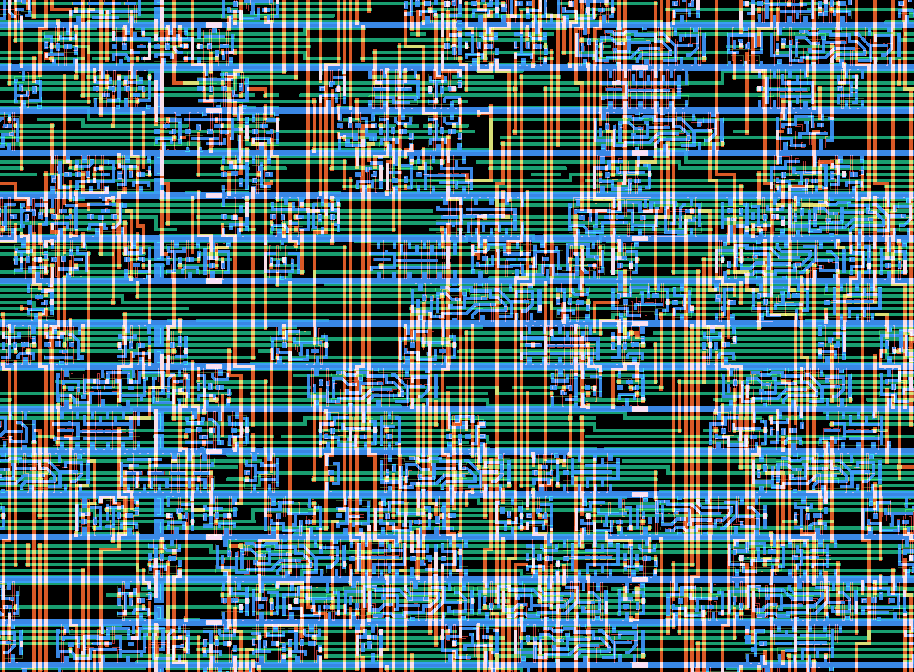

# Açık Kaynak 55 nm PDK Üzerinde SRAM'siz Bir Dallanma Tahmin Birimi: Tasarım, Doğrulama ve Fiziksel Gerçekleme

*"Fable ile Haftasonu" serisinden: Anthropic'in yapay zekâ modeli Claude Fable ile yapılan hafta sonu ölçeğinde mühendislik projeleri. Yön ve kapsam kararları insandan; tasarım, kod, koşular ve bu yazı modelden.*

## Özet

Bu çalışma, Ekim 2025'te Apache 2.0 lisansıyla yayımlanan ICsprout55 açık kaynak 55 nm süreç tasarım kiti (PDK) üzerinde, altı aşamalı sıralı bir RV32IM işlemci için dallanma tahmin biriminin (BP55) uçtan uca tasarımını sunar. PDK'da bellek derleyicisi bulunmadığından tüm tahmin tabloları flip‑flop dizileriyle kurulmuş ve durum bütçesi 8132 bitle sınırlanmıştır. Birim; 128 girişli bir dallanma hedef tamponu, 512 girişli iki bitlik taban tahminleyici, üç tablolu küçük bir TAGE, 32 girişli dolaylı hedef önbelleği ve 8 girişli dönüş adresi yığınından oluşur. CoreMark ve Embench‑IoT'u içeren 21 programlık bir kümede (yaklaşık 295 milyon komut) BP55, 1000 komut başına 9,34 yanlış tahmin ve %94,6 yön doğruluğu verir; tahminsiz çekirdeğe göre %22 hızlanma sağlar. RTL, bit‑doğru bir C++ modeline karşı 63,4 milyon aramada sıfır uyuşmazlıkla doğrulanmıştır. Tasarım tümüyle açık kaynak araçlarla (Yosys, OpenROAD, KLayout) 0,185 mm²'lik bir kalıba yerleştirilip yönlendirilmiş, yönlendirici kural ihlali ve anten ihlali olmadan GDSII üretilmiştir. Yavaş köşede blok düzeyinde 161 MHz (6,2 ns), tipik köşede yaklaşık 267 MHz elde edilmiştir. Hafta sonundan sonra tasarım bağımsız olarak gözden geçirilmiş, gerçek bir boru hattına uygun hâle getirilmiş (8523 bit) ve iki açık RISC‑V çekirdeğinin içinde ölçülmüştür: eşit bit bütçesinde komut başına çevrimi CORE‑V Wally'de, karşılaştırılan tahmincinin BTB'sinin etiketli olup olmamasına göre %0,65 ile %2,5 arasında, CVA6'da %2,3 düşürmektedir (Bölüm 7). Çalışma ayrıca PDK'nın bugünkü eksiklerinin (SRAM, saat kapılama öznitelikleri, açık DRC/LVS ve parazit çıkarım kuralları) tasarım kararlarını nasıl belirlediğini belgelemektedir.

## 1. Giriş

Açık kaynak PDK'lar uzun süre 130 nm ve 180 nm düğümleriyle sınırlı kaldı. ICsprout55, yayımlandığı sırada açık olarak erişilebilen en ileri düğüm olduğunu öne sürüyor ve standart hücre kütüphanesi, IO hücreleri, tasarım kuralları ve cihaz modelleriyle birlikte geliyor. Öte yandan proje kendisini "ön sürüm" olarak tanımlıyor; bellek derleyicisi ve PLL henüz yok.

Dallanma tahmini, bu tür bir PDK'yı sınamak için elverişli bir problemdir: performansı neredeyse tümüyle durum miktarına bağlıdır ve alışılmış tasarımlar bu durumu SRAM'de tutar. SRAM yokken soru şuna dönüşür: yalnızca flip‑flop kullanarak, makul bir alan içinde ne kadar doğruluk elde edilebilir ve bu, bilinen basit tahminleyicilere göre karmaşıklığa değer mi?

Bu makalenin katkıları şunlardır:

1. Flip‑flop bütçesine göre boyutlandırılmış, tek çevrimde yanıt veren bir tahmin mimarisi ve 300 konfigürasyonluk tasarım uzayı taraması.
2. RTL ile bit‑doğru referans model arasında tam eşdeğerlik gösteren bir ko‑simülasyon.
3. Açık araçlarla RTL'den GDSII'ye tam akış ve bu akışta karşılaşılan PDK kaynaklı engellerin dökümü.

## 2. Hedef işlemci ve kısıtlar

Hedef, tek komut/çevrim çalışan altı aşamalı (IF1, IF2, ID, EX, MEM, WB) bir RV32IM çekirdeğidir. Dallanmalar EX aşamasında çözülür; yanlış tahmin 3 çevrime, ID aşamasından yapılan yeniden yönlendirme 2 çevrime mal olur.

Kütüphanedeki en küçük flip‑flop 6,16 µm²'dir. Okuma çoklayıcıları ve yazma mantığıyla birlikte 1 Kbit durum kabaca 0,01 mm² tutar. SRAM tabanlı tahminleyicilerde olağan olan 30–250 Kbit bu koşulda gerçekçi değildir; bütçe yaklaşık 8 Kbit olarak seçilmiştir.

## 3. Mimari

| Bileşen | Boyut | Bit |
|---|---|---|
| Dallanma hedef tamponu (BTB) | 128 giriş, doğrudan eşlemeli; 8 bit etiket, 3 bit tür, 18 bit hedef | 3840 |
| Taban tahminleyici | 512 × 2 bit | 1024 |
| TAGE | 3 tablo × 64 giriş; 7 bit etiket, 3 bit sayaç, 1 bit yararlılık; geçmiş 5 / 12 / 28 | 2155 |
| Dolaylı hedef önbelleği | 32 giriş, 6 bit hedef geçmişi | 870 |
| Dönüş adresi yığını | 8 giriş | 243 |
| Toplam | | 8132 |

Tasarımı SRAM tabanlı muadillerinden ayıran dört karar vardır.

**Tek çevrimlik tahmin.** Tablolar küçük olduğundan BTB, TAGE ve hedef seçimi tek çevrimde tamamlanır. İki kademeli (hızlı tahmin + geç düzeltme) yapıya ve onun eklediği boşluk çevrimine gerek kalmaz.

**Kombinasyonel geçmiş katlama.** En uzun geçmiş 28 bittir; indeks ve etiket katlamaları doğrudan geçmiş yazmacından XOR ağaçlarıyla üretilir. Yanlış tahminde yalnızca geçmiş yazmacını geri yüklemek yeterlidir.

**Süzülmüş geçmiş.** Geçmişe yalnızca BTB'de bulunan ya da alınan koşullu dallar girer. Böylece IF1'de henüz dal olduğu bilinmeyen komutlar için geç geçmiş ekleme sorunu ortadan kalkar. İdeal "her dal" geçmişine göre ölçülen kayıp 0,1 MPKI'nin altındadır.

**Flip‑flop dizisinin getirileri.** Yararlılık bitlerinin periyodik sıfırlanması tek çevrimde yapılır; yük bitleri resetsiz (daha küçük) flop'larda tutulur; eğitim, arama anında yakalanan 92 bitlik meta veriyle yapıldığı için ikinci bir okuma kapısı gerekmez.

## 4. Yöntem

İş yükü olarak CoreMark, Embench‑IoT'tan 18 program ve dolaylı atlama ile çağrı‑dönüş davranışını zorlayan iki ek program kullanılmıştır. Programlar Clang ile RV32IM'e derlenmiş, bu çalışma için yazılan bir komut kümesi simülatöründe çalıştırılarak denetim akışı izleri üretilmiştir; 21 programın tamamı kendi sonuç denetiminden geçmiştir.

Tahminleyici önce izle sürülen bit‑doğru bir C++ modelinde tasarlanmış, ardından SystemVerilog'a aktarılmıştır. RTL, Yosys'in CXXRTL arka ucuyla derlenip modelle adım adım karşılaştırılmıştır. Metrik olarak MPKI (1000 komut başına EX aşamasında çözülen yanlış tahmin) ve dallanma kaynaklı ek çevrimleri içeren CPI kullanılmıştır.

## 5. Performans sonuçları

| Konfigürasyon | Bit | MPKI | Yön doğruluğu | CPI |
|---|---|---|---|---|
| Tahmin yok | 0 | 81,7 | — | 1,269 |
| BTB + bimodal | 5977 | 16,07 | %89,85 | 1,056 |
| BTB + gshare | 9059 | 10,80 | %93,35 | 1,041 |
| BP55 | 8132 | 9,34 | %94,60 | 1,037 |
| TAGE, 123 Kbit (referans) | 122952 | 5,73 | %96,44 | 1,018 |

BP55, yaklaşık 2,2 Kbit'in üzerindeki bütün bütçelerde bimodal ve gshare eğrilerinin altında kalır; bunun altında gshare öndedir. gshare'e göre %10 daha az bitle MPKI %13,5 düşüktür. Ancak üç çevrimlik cezaya sahip kısa bir boru hattında bunun CPI karşılığı yalnızca %0,4'tür; TAGE'in ek karmaşıklığı asıl olarak ceza büyüdükçe karşılığını verir (12 çevrimlik cezada CPI 1,146'ya karşı 1,130; bu değer 4 çevrimlik çözme yönlendirmesi varsayar; `sim/penalty_sweep.py` ile yeniden üretilir). İki çekince daha: tasarım noktası, sonuçların raporlandığı aynı 21 program üzerinde, ayrılmış bir test kümesi olmadan yaklaşık 370 yapılandırma arasından seçilmiştir ve gshare'e farkın çoğu beş programdan gelir. Ayrıca "tahminsiz" taban zayıftır: yön tahmini olmayan yalnızca BTB'li bir çekirdeğe (CPI 1,214) göre hızlanma %22 değil %17'dir.

Bileşen çıkarma deneyleri bit başına en verimli yapıların dönüş yığını ve dolaylı hedef önbelleği olduğunu gösterir: yığın kaldırıldığında MPKI 10,23'e, önbellek kaldırıldığında 10,70'e çıkar. Tablo güncellemesinin iki dal gecikmesi MPKI'yi yalnızca 9,59'a yükseltir; yani eğitimin EX aşamasında yapılması yeterlidir.

Program bazında iki sınır belirgindir. `xgboost` ve `recurse` programlarında 123 Kbit'lik TAGE bile anlamlı iyileşme sağlamaz (yanlış tahminler %7 ve %2 azalır). `xgboost`, `huffbench` ve `depthconv`'da BP55 gshare'in hafifçe gerisinde kalır; son ikisinde neden 64 girişli etiketli tabloların taşmasıdır, `xgboost`'ta ise daha büyük tablolar da yardımcı olmaz.

## 6. Fiziksel gerçekleme

Sentez Yosys ve ABC ile, yerleştirme‑yönlendirme OpenROAD ile, GDS birleştirme KLayout ile yapılmıştır.

| | Değer |
|---|---|
| Kalıp | 430,5 × 430,5 µm (0,185 mm²) |
| Doluluk | %65 |
| Hücre alanı (dolgu hariç) | 0,114 mm² |
| Flip‑flop | 8132 |
| Metal katmanları | MET1 raylar; MET2–MET5 sinyal; MET4/MET5 güç şeritleri |
| Toplam tel uzunluğu / via | 900 mm / 162 034 |
| Yönlendirici kural ihlali / anten ihlali | 0 / 0 |
| Güç (tipik köşe, 167 MHz) | 33 mW |

| Köşe | Setup payı (6,0 ns saat) | Hold payı |
|---|---|---|
| Yavaş (1,08 V, 125 °C) | −0,10 ns | +0,02 ns |
| Tipik (1,2 V, 25 °C) | +2,26 ns | +0,12 ns |
| Hızlı (1,32 V, −40 °C) | +3,22 ns | +0,06 ns |

Layout yavaş köşede 6,0 ns hedefini 0,10 ns ile kaçırır; yerleştirme günlüğü, yerleşimin daha sıkı bir 5,0 ns saatle yapıldığını gösterir. Aynı layout 6,2 ns saatle yeniden zamanlandığında tüm köşelerde kapanır (yavaş köşe setup payı +0,10 ns, hold payı yaklaşık sıfır). Bu, blok düzeyinde yavaş köşede 161 MHz, tipik köşede yaklaşık 267 MHz'e karşılık gelir.

Saat hedefini 6,2 ns'ye gevşetip akışı baştan koşturmak ise sorunu çözmemiştir: araç gevşek hedefe göre daha az optimize etmiş ve yavaş köşede bu kez 0,15 ns açık kalmıştır. Bu akışta imza saatinden daha sıkı bir hedefle optimize etmek gerekmektedir; ne kadar sıkı olması gerektiği ayrıca ölçülmemiştir.

*Şekil 1. Yönlendirilmiş BP55 yerleşiminin tamamı (430,5 × 430,5 µm). Mavi: MET1, turuncu: MET2, yeşil: MET3, sarı: MET4, pembe: MET5. Düzenli yatay ve dikey çizgiler MET4/MET5 güç şeritleridir; sol üst ve sağ alt köşelerdeki boşluklar yerleştiricinin kullanmadığı alanlardır.*

*Şekil 2. Çekirdeğin ortasından 30 × 22 µm'lik yakın plan. Kalın yatay mavi hatlar standart hücre satırlarının MET1 güç raylarıdır; aralarında hücre içi MET1 bağlantıları, üzerlerinde MET2 (dikey) ve MET3 (yatay) sinyal telleri görülür.*

Fiziksel tasarım üç öğretici sonuç vermiştir.

**Sentez tahmini yanıltıcıydı.** Telsiz sentez, yavaş köşe için 2,47 ns'lik bir kritik yol öngörmüştü (saat‑çıkış gecikmesi hariç). Yönlendirilmiş layoutta kritik yol, 0,24 ns'lik saat‑çıkış gecikmesi dahil yaklaşık 4,3 ns'dir. Sebep flip‑flop dizilerinin doğasıdır: adres hatları binlerce çoklayıcıyı sürer ve derin tampon ağaçları gerektirir. SRAM'siz tasarımda alan kadar zamanlama da tel yüküne duyarlıdır.

**Saat kapılama kullanılamadı.** Sentezde yazma izinlerini saat kapılama hücrelerine çevirmek alanı %16 düşürmüştü. Ancak PDK'nın Liberty dosyasında bu hücrelerin saat‑kapılama pin öznitelikleri eksiktir; OpenROAD saat ağacını bu hücrelerin arkasına dengeleyemedi. Layout saat kapılamasız netlistle tamamlandı. Sonuç olarak güç tüketiminin %48'i flop'ların iç gücünden, %30'u saat ağacından gelir.

**Tamponlama pahalıdır.** Saat ağacı hücreleri ve zamanlama onarım tamponları hücre alanını sentez değerinin %17 üzerine çıkarmıştır. Hold onarımı bunun küçük kısmıdır: 2.314 ihlalli uç nokta ve 363 hold tamponu; en kötüleri giriş‑flop yollarındadır.

## 7. Hafta sonundan sonra: gözden geçirme, sağlamlaştırma ve iki gerçek çekirdek

Bölüm 1–6 hafta sonu sürümünü anlatır. Sonrasında tasarım bağımsız gözden geçiricilere verilmiş, ardından gerçek çekirdeklere yerleştirilmiştir.

**Gözden geçirme.** Farklı bir Clang 18 derlemesi kullanan ikinci bir makinede sonuç tablosunun 273 satırının ve 300 yapılandırmalı taramanın 6300 satırının tamamı birebir aynı çıkmıştır. Metin denetimi, saklanan günlüklerle çelişen altı ifade bulmuş; bunlar bu metinde düzeltilmiştir. RTL incelemesi, birimin modeliyle uyuştuğunu ama arayüzünün ideal bir boru hattı varsaydığını göstermiştir.

**Sağlamlaştırma.** Duraklamayla bekletilen bir arama geçmişi ve dönüş yığınını her çevrim ilerletiyor, "dal değil" eğitim iletisi ilgisiz bir BTB girişini silebiliyor, tablolar hiç sıfırlanmıyor, eğitim ve yönlendirme iletileri seviye duyarlı çalışıyor ve 18 bitlik hedefler 1 MiB'lik bölgenin dışına çıkamıyordu. Sağlamlaştırılmış RTL'de `f_fire` girişi (durum, komut ilk getirme aşamasından çıkarken bir kez ilerler), tek çevrimlik `u_fire` ve `r_fire` iletileri, sıfırlamadan sonra 64 çevrimlik tablo temizliği ve dolaylı önbellekte tam hedefler vardır. Bedeli 391 bit (8132'den 8523'e) ve eşleme öncesinde yaklaşık %13 daha fazla mantıktır. 21 programda sonuç değişmez (9,340 MPKI, CPI 1,0367). Ko‑simülasyon artık her izin bütün kayıtlarını rastgele duraklama, boşaltma ve rastgele başlangıç durumuyla koşturur: koşu başına 294,7 milyon arama ve 353,8 milyon karşılaştırılan çıkış, dört koşuda sıfır uyuşmazlık. İki sınır açık bırakılmış ve belgelenmiştir: yönlendirme çevriminde arama ve ikiden fazla yanlış yol yığın işleminden sonra dönüş yığını onarımı.

**Fiziksel akış, ikinci geçiş.** Sentez ve yerleştirme‑yönlendirme her iki RTL sürümü için bütün günlükler saklanarak ve yeni kısıtlarla yeniden koşturulmuştur: port grubu başına giriş/çıkış bütçeleri, saat ağacı kurulduktan sonra gerçek bir flop'un saat pinine göre ölçülen giriş/çıkış gecikmeleri ve zamanlanan sıfırlama. Bu kısıtlarla hafta sonu RTL'si yavaş köşede 5,98 ns'yi, sağlamlaştırılmış RTL 6,16 ns'yi karşılar (kalıp 444 µm kare, 129.923 µm² hücre; aynı kısıtlarla hafta sonu RTL'sinden yaklaşık %7 fazla). Bu kısıtlarla hiçbir uç nokta hold onarımı gerektirmez; yani Bölüm 6'daki hold sorunu giriş/çıkış kısıtından kaynaklanıyordu. Yeni kısıtlarla denetlendiğinde Bölüm 6'daki hafta sonu layoutu 6,2 değil yaklaşık 7,0 ns'yi karşılar; 6,2 ns'lik kapanış farklı bir OpenROAD derlemesinde de yeniden üretilememiştir (6,52 ns). Saat kapılama her iki sürümde sentez alanını %16,4 azaltır; 2,47 ns'lik sentez değeri ise ABC'nin kendi tahminidir (telsiz statik zamanlama 3,85 ns verir). Her iki yeni layout PDK'nın yoğunluk kurallarına göre metal dolguyla doldurulmuş, dolgudan sonra alt sınırın altında pencere kalmamıştır. Bu geçişte zamanlama, kuplajsız toplu tel RC'sine dayanır.

**Parazitik çıkarım.** PDK'da çıkarım kural dosyası yoktur; metal ve dielektrik kalınlıkları da belgelenmemiştir. Bu nedenle OpenRCX için kural kümesi, PDK'nın verdiği bilgilerle (katman sırası, malzemeler, tabaka direnci, 0,9x küçültme) ve varsayılan bir kesitle, referans olarak küçük bir 2B alan çözücü kullanılarak üretilmiş; yönlendirilmiş layoutlar üç köşede kuplajla birlikte çıkarılmıştır. Bu parazitlerle sağlamlaştırılmış layout yavaş köşede 6,0 ns'yi 0,46 ns payla karşılar (global yönlendirme tahmini −0,42 ns verir); hafta sonu layoutunun 6,2 ns'deki payı +0,09 yerine +0,99 ns'dir. Tahminler kötümserdir, çünkü katmanlar yalnızca %18–25 dolu olduğu hâlde her tele yoğun yönlendirme kapasitansı yükler: sağlamlaştırılmış layoutta çıkarılan toplam 169 pF, tahmin edilen 238 pF'tır. Çözücü ve kurallar kapalı biçimli çözümlere karşı doğrulanmıştır; süreç verisi doğrulanmamıştır ve kapasitanstaki ±%20, yavaş köşe payını ±0,17 ns oynatır. Bütün dolgu şekillerinin topraklandığı üst sınır 0,03 ns'den az kayıp verir. Çapraz konuşma analiz edilmemiştir.

**Açık araçlarla DRC ve LVS.** PDK'nın Calibre kural dosyaları elle KLayout'a çevrilmiştir: 711 DRC denetiminin 181'i çevrilmiş, 62'si yaklaşık olarak uygulanmış, 17'sinde yalnızca ön koşul denetlenmiş, 451'i çevrilmemiştir; çevrilmeyenlerin neredeyse tamamı bu blokta bulunmayan yapılarla ilgilidir. Bu, dökümhane imza denetimi değildir; ancak yönlendiricinin kendi denetiminin göremeyeceği şeyleri bulmuştur. Hafta sonunda yayımlanan GDS çalışan bir layout değildi: birleştirme betiği standart hücreleri PDK'daki iki GDS dosyasından yanlış olanından, yönlendiricinin bağlandığı metal 2 pin şekillerini içermeyeninden almış, böylece her sinyal teli pinine değmeden üstünde bitmiştir. Doğru dosyayla yönlendirilmiş tasarım hücre düzeyinde netlistiyle eşleşir (35.945 hücre, 36.165 net); betik düzeltilmiş ve GDS yeniden üretilmiştir. Yönlendirme ve zamanlama bundan etkilenmez. Kullanılan 341 hücre türünün 326'sı transistör netlistiyle eşleşir, 15'inde küçük kütüphane tutarsızlıkları vardır. DRC, giderilmemiş gerçek ihlaller bildirir: hücre raylarından geniş güç rayları, dizi aralık kuralının altında güç ızgarası via dizileri, yönlendiricinin bıraktığı birkaç yüz aralık, hat sonu ve en küçük alan ihlali, bir çekirdek kenarında kuyu bağlantısı uzaklığı, ön uç dolgusunun olmaması ve kütüphane hücrelerinin kendi içindeki sapmalar. Yeniden üretilen GDS tekrar çıkarılmış ve eşleşmiştir; sağlamlaştırılmış layout da dolgusuz ve dolgulu olarak eşleşir (38.052 hücre, 38.314 net). Bu layoutun DRC'si aynı ihlal sınıflarını benzer sayılarda gösterir; dolgudan sonra bütün metal yoğunluk pencereleri geçer ve çevrilen anten kuralları ihlal bildirmez. Bütün bloğun düz, transistör düzeyinde LVS'si yakınsamamıştır ve iddia edilmemektedir.

**Kapı düzeyi benzetim.** Her iki RTL sürümünün sentezlenmiş ve yönlendirilmiş netlistleri, RTL'nin kendi düzeneğiyle, izlerin tamamında referans modele karşı koşturulmuştur: her birinde 294,7 milyon sorgu, 0 uyumsuzluk; sağlamlaştırılmış netlistlerde her flop rastgele bir değerden başlar. Kullanılan 551 hücre Verilator için yeniden yazılmış ve her biri PDK modeliyle karşılaştırılmıştır (2,2 milyon nokta, 0 uyumsuzluk). PDK modelleri ve bilinmeyen başlangıç durumuyla sıfırlama ve yönlendirilmiş testler geçer; sağlamlaştırılmış RTL'nin sentez netlistiyle eşdeğerliği biçimsel olarak kanıtlanmıştır. Yavaş köşe gecikmeleri işlenmiş bir koşu 6,9 ns'de geçer; bu işlevsel bir denetimdir, çünkü test düzeneği 6,0 ns'de çalışamaz ve benzetici zamanlama denetimlerini değerlendirmez.

**Saat kapılama.** Hafta sonundaki başarısız saat kapılamalı layoutun iki nedeni vardır. Asıl neden bir OpenROAD hatasıdır: kullanılan sürüm, LEF'te saat pini olarak işaretlenen sürücü pinleri yok sayar; PDK kapılama hücrelerinin çıkışını böyle işaretlediği için saat ağacı sentezi kapılanmış bütün saat netlerini atlamıştır. İkinci neden Liberty dosyasıdır: saat kapılama pin öznitelikleri ve tutucu tanımı eksiktir; bu, Yosys'in hücreleri kütüphaneden çıkarmasını engeller ve OpenSTA'nın doğrusu 13,9 mW olan gücü 54,8 mW olarak bildirmesine yol açar. İki düzeltme de depoda betik olarak bulunur ve olağan akış bunları kabul eder (`cg/setup.sh`, `cg/env.sh`); PDK dosyaları değiştirilmez. LEF için bir geçici çözüm ve yamalı Liberty ile, 1.071 kapılama hücreli sağlamlaştırılmış RTL 6,0 ns'de yerleştirilip yönlendirilmiştir; hücre alanı kapılamasız layouttan %12,4 küçüktür ve benzetimden alınan CoreMark etkinliğiyle güç 31,8 mW yerine 10,7 mW'tır. Hold için bitmiş layout üzerinde iki onarım gerekmiştir. Birincisi, 57 tamponla, bir çıkışta hızlı köşedeki 10 ps'lik açığı kapatmıştır. İkincisi kuplajlı çıkarımdan doğmuştur: çıkarım, basit tel modelinden daha fazla kurulum payı (yavaş köşede +0,493 ns) ama her köşede hold ihlali (yavaş köşede −0,112 ns) göstermiştir; ihlaller, doğrudan giriş portlarından beslenen 42 flop'tadır ve basit model bunları gizlemiştir. Aracın kendi hold onarımı bu yolları hedefleyemediğinden 96 flop girişinin her birinin önüne bir gecikme hücresi yerleştirilmiştir. Kuplajlı çıkarımla bu layoutun yavaş köşe kurulum payı +0,497 ns'dir (kapılamasız: +0,459 ns) ve hold bütün köşelerde karşılanır (+0,015 / +0,025 / +0,034 ns); bütün metal dolgu topraklanmış sayıldığında, yani üst sınırda, değerler +0,488 ns ve +0,030 / +0,032 / +0,039 ns'dir. Yönlendirilmiş netlisti, 21 programın tamamında 27,8 milyon çevrim boyunca bütün çıkışlarda RTL ile eşleşir. Layouta metal dolgu eklenmiştir (318.489 şekil; bütün metal yoğunluk pencereleri geçer); dolgulu layout hücre düzeyinde LVS'de netlistiyle eşleşir ve çevrilen DRC destesinde kapılamasız layoutla aynı ihlal sınıflarını verir. Bu layoutta saat kayması, kapılamasızdaki 0,2 ns'ye karşılık 1,2 ns'dir; çünkü saat ağacı aracı her kapılama hücresinin arkasına ayrı bir ağaç kurar ve bunları birbirine göre dengelemez. Saat ağacı sentezinden sonra eklenen bir adım, erken gelen her dalı en geç flop'a kadar gecikme hücreleriyle doldurur (1.549 hücre; yalnızca kapı açıkken anahtarlansınlar diye kapılama hücrelerinin arkasına konmuştur); tasarım yeniden yönlendirilmiş ve hold aynı yöntemle onarılmıştır (68 gecikme hücresi). Kayma 0,35 ns'ye, kuplajlı çıkarımla bütün flop'ların saat varış yayılımı 0,96'dan 0,42 ns'ye inmiştir. Bedeli alan (kapılamasıza göre %12,4 yerine %10,9 kazanç) ve güçtür (10,7 yerine 11,1 mW). Bu son layoutta kuplajlı çıkarım yavaş köşede +0,457 ns kurulum payı ve +0,032 / +0,050 / +0,037 ns hold payı verir; topraklanmış dolguyla +0,458 ns ve +0,042 / +0,056 / +0,038 ns. İşlev (27,8 milyon çevrim, 0 uyumsuzluk), dolgu (314.123 şekil), LVS ve DRC bu layoutta yinelenmiş ve aynı sonucu vermiştir. Açık kalanlar: basit tel modeli bu layoutta 0,012 ns'lik kurulum açığı gösterir, kayma hâlâ kapılamasız değerin üstündedir ve çıkarım varsayılan bir kesite dayanır.

**CORE‑V Wally** (beş aşama, RV32IM, ölçülen yanlış tahmin cezası 2 çevrim). BP55 yeni bir tahminci türü olarak eklenmiş, aynı 21 program yalnızca tahmincisi farklı on yapıda RTL benzetimiyle koşturulmuştur. Buradaki CPI önbellek ıskalarını ve load‑use beklemelerini de içerir.

| Wally yapısı | Tahminci durumu (bit) | CPI | 1000 komutta yönlendirme |
|---|---|---|---|
| Tahmin yok | 0 | 1,288 | 90,98 |
| gshare, BP55 boyutunda | 6925 | 1,169 | 31,80 |
| gshare, Wally'nin varsayılan boyutu | 39438 | 1,147 | 21,35 |
| gshare, BP55 boyutunda, çağrı sınıflandırması düzeltilmiş | 6925 | 1,160 | 27,48 |
| gshare, BP55 boyutunda, çağrı düzeltmesi ve 12 bit BTB etiketi | 8461 | 1,138 | 15,94 |
| gshare, varsayılan boyut, çağrı sınıflandırması düzeltilmiş | 39438 | 1,136 | 15,81 |
| BP55 | 8523 | 1,130 | 12,25 |

Tahminsiz çekirdeğe göre hızlanma %13,9'dur; iz modelindeki %22'nin altında kalmasının nedeni gerçek cezanın 3 değil 2 çevrim olmasıdır. Stok Wally'nin iki özelliği BP55'in farkını büyütür: bağlayıcı gevşetmesi olmadan derlenen çağrılar dönüş olarak sınıflandırılır ve BTB'sinde etiket yoktur. İkisi de sonradan ölçümle giderilmiştir (son üç satır). Sınıflandırması düzeltilmiş, kendi boyutundaki gshare'e göre BP55 %2,5 hızlıdır; bu gshare'e etiketli BTB de verildiğinde fark %0,65'e iner, yani eşit bütçedeki farkın yaklaşık dörtte üçü yalnızca etiketten gelmektedir. 4,6 kat daha fazla bite sahip, düzeltilmiş varsayılan gshare'e göre BP55 %0,5 hızlıdır. BP55 Wally'nin boru hattında komut başına 434 bit tahmin durumu taşır; gshare 264 bit taşır.

**CVA6** (`cv32a60x`, altı aşama, ölçülen ceza 5 çevrim). Birim değiştirilmeden örneklenmiştir; ön uç her ön çözülmüş komutla arama yapar ve BP55'in BTB'si ön çözücüyle uyuşmadığında onarım iletisi gönderir.

| CVA6 yapısı | Tahminci durumu (bit) | CPI | 1000 komutta yanlış tahmin |
|---|---|---|---|
| Dinamik tahmin yok | 0 | 1,615 | 50,72 |
| Stok (32 girişli BHT, 2 girişli dönüş yığını) | 162 | 1,493 | 26,69 |
| CVA6'nın kendi yapıları, BP55 bütçesinde | 8520 | 1,437 | 15,77 |
| BP55 | 8523 | 1,404 | 9,38 |

Eşit bütçede BP55 %2,3 daha düşük CPI ve %40 daha az yanlış tahmin verir; 21 programın 17'sinde daha hızlı, birinde %0,9 daha yavaştır. Birimin dışındaki maliyet burada daha büyüktür: 104 bitlik üst verinin ve 67 bitlik denetim noktasının her komutla taşınması boru hattına 2014 flip‑flop ekler. Her iki çekirdekte bütün koşular kendi sonuç denetiminden geçer ve komut sayısı komut kümesi simülatörüyle birebir aynıdır; tahminci modelinin çekirdeğin zamanlamasıyla yazılımda yeniden koşturulması RTL'nin yanlış tahmin sayısını yeniden üretir (Wally'de 3,6 milyonda 2 farkla, CVA6'da %0,03 içinde).

Bu programlarda istisna, kesme ve CSR boşaltması oluşmaz; ilgili geri yükleme yolları bağlıdır ama sınanmamıştır. Çekirdeklerin kendi regresyon kümeleri BP55'li yapıda koşturulmamıştır.

## 8. Sınırlar

- Dökümhane imza DRC ve LVS'si çalıştırılmamıştır; Bölüm 7'deki kısmi açık araç çevirisi de giderilmemiş ihlaller bildirmektedir. Ayrıntı: PDK'nın kural dosyaları Calibre formatındadır. Bildirilen "sıfır ihlal" yalnızca yönlendiricinin LEF kurallarına göre denetimidir; yönlendirici desteklemediği bazı kapsama kurallarını da atlamıştır.
- Giriş ve çıkış gecikmeleri ideal saate göre tanımlıdır; flop'lar ise yaklaşık 1,2 ns saat ağacı gecikmesi görür. 161 MHz değeri ve yavaş köşedeki sıfır hold payı giriş/çıkış yollarındadır ve bu kısıttan etkilenir; hiçbiri çekirdek içi hız için bir sınır değildir.
- CPI eşit çevrim süresinde karşılaştırılmıştır; daha basit bir tahmincinin daha hızlı saatlenip saatlenmeyeceğini görmek için gshare'in layoutu yapılmamıştır.
- Bit sayıları, her komutla birlikte taşınan üst veriyi ve denetim noktasını içermez (hafta sonu sürümünde 92 + 67 bit, sağlamlaştırmadan sonra 104 + 67). Gerçek çekirdekte bu, Wally'de 434, CVA6'da 2014 flip‑flop demektir.
- 123 Kbit'lik referans, 64 bit geçmiş ve 6 tabloyla sınırlı, büyütülmüş bir BP55'tir; SRAM tabanlı gerçek bir TAGE'in yapabileceğini olduğundan az gösterir.
- Sentez günlükleri, saat kapılamalı yerleştirme denemesi ve erken hold hatası koşusu saklanmamıştır; 2,47 ns, %16 ve erken hold ifadeleri depodan doğrulanamaz.
- Hafta sonu ko‑simülasyonu her izin ilk 300.000 dal kaydını kapsıyordu ve duraklama ile yanlış yol aramasını sınamıyordu; sağlamlaştırılmış RTL, orada sayılan iki açık sınır dışında bu boşluğu kapatır (Bölüm 7).
- Bölüm 6'daki zamanlama global yönlendirme tabanlı RC tahminine dayanır. Bölüm 7'deki çıkarım dökümhane verisine değil varsayılan bir kesite dayanır ve çapraz konuşma analizi içermez.
- Yavaş köşede kapanış 6,2 ns'de sağlanmaktadır; hold payı bu köşede yaklaşık sıfırdır.
- Bölüm 6'daki layout ve zamanlama değerleri hafta sonu RTL'sine aittir; sağlamlaştırılmış RTL ayrıca yerleştirilip yönlendirilmiştir (Bölüm 7), büyük çıktıları depoda saklanmaz, betikle yeniden üretilir. Sentezlenmiş ve yönlendirilmiş netlistler simüle edilmemiştir.
- İki çekirdekte istisna, kesme ve CSR boşaltması sınanmamıştır; ölçümler silikon değil, küçük programların RTL benzetimidir.
- İş yükleri küçük gömülü programlardır. BTB etiket çakışması hiç gözlenmediğinden ilgili RTL yolu sınanmamış, etiket ve hedef genişlikleri varsayımla seçilmiştir. Sonuçlar büyük kod tabanlarına genellenemez.
- PDK'nın kendisi silikonda henüz tam doğrulanmamıştır ve seri üretim için kullanılmaması gerektiği belirtilmektedir.

## 9. Sonuç

Açık kaynak 55 nm bir PDK ile, SRAM olmadan da kullanışlı bir dallanma tahmin birimi kurulabilmektedir: 8 Kbit'lik flip‑flop bütçesi ve 0,185 mm²'lik bir kalıpla %94,6 yön doğruluğu elde edilmiş, tasarım tümüyle açık araçlarla GDSII'ye taşınmıştır. Aynı çalışma, bu düğümde açık akışın bugünkü dar boğazlarını da göstermektedir. En büyük kazanım bir bellek derleyicisinden gelecektir: ölçümlerimizde 123 Kbit'lik bir TAGE yanlış tahminleri %39 daha azaltmaktadır. İkinci sırada, saat kapılama hücrelerinin Liberty özniteliklerinin tamamlanması gelir; bu tek başına gücü ve alanı belirgin biçimde düşürür. Açık DRC/LVS ve parazit çıkarım kuralları ise sonuçların imza düzeyinde doğrulanabilmesi için gereklidir. Hafta sonundan sonra iki gerçek çekirdeğe yerleştirilen sağlamlaştırılmış birim, eşit bit bütçesinde bir üstünlüğü korumuştur (Wally'de %0,65 ile %2,5 arası, CVA6'da %2,3); ancak bu fark küçüktür, önemli bir kısmı TAGE'den değil etiketli BTB'den gelir ve bit sayısında görünmeyen bir boru hattı durumu maliyeti vardır.

## Kaynaklar

1. ICsprout 55 nm Open Source PDK belgeleri. https://icsprout55-pdk-en.readthedocs.io/en/latest/
2. ECOS Team, "ICsprout55 PDK release" duyurusu, Ekim 2025. https://website-src-mkdocs.vercel.app/en/news/20251020_icsprout55_pdk_release
3. ICsprout55 PDK deposu. https://github.com/openecos-projects/icsprout55-pdk
4. A. Seznec, P. Michaud, "A case for (partially) TAgged GEometric history length branch prediction," Journal of Instruction-Level Parallelism, 2006.
5. S. McFarling, "Combining Branch Predictors," DEC WRL Technical Note TN-36, 1993.
6. EEMBC CoreMark. https://github.com/eembc/coremark
7. Embench‑IoT. https://github.com/embench/embench-iot
8. T. Ajayi ve diğerleri, "Toward an Open-Source Digital Flow: First Learnings from the OpenROAD Project," DAC 2019.
9. C. Wolf, "Yosys Open SYnthesis Suite." https://yosyshq.net/yosys/
