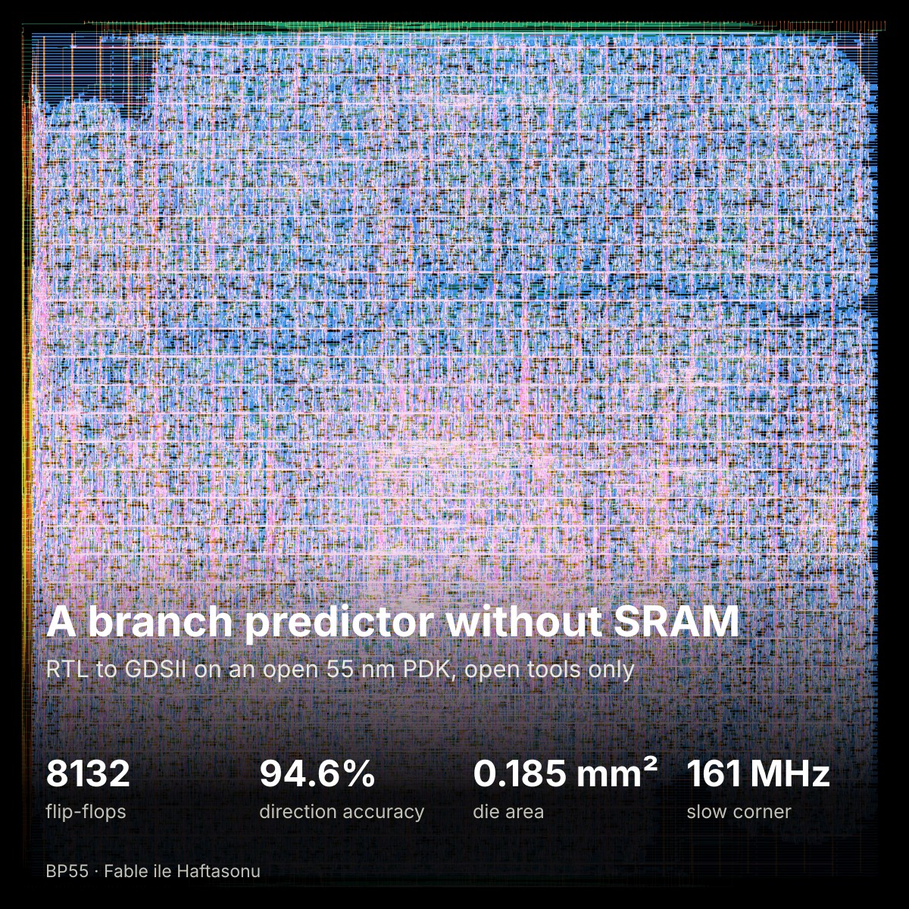
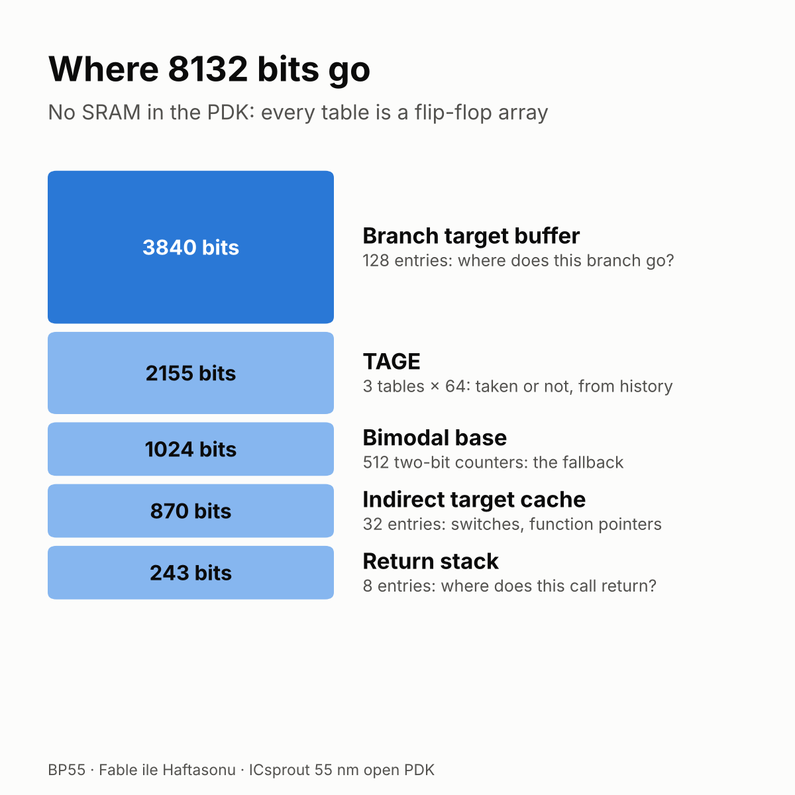
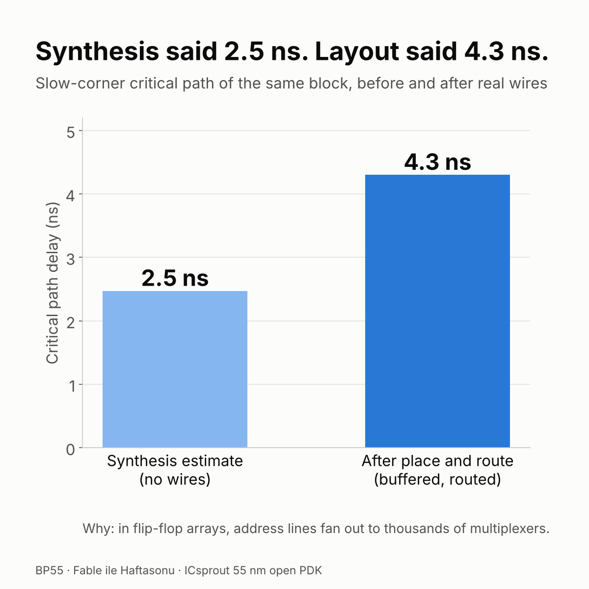

# BP55: a branch predictor without SRAM on an open 55 nm PDK

BP55 is a branch prediction unit for a six-stage in-order RV32IM core, taken from RTL to a routed GDSII layout on the open-source [ICsprout55](https://github.com/openecos-projects/icsprout55-pdk) 55 nm PDK, using open tools only.

The PDK ships no memory compiler, so every predictor table is a flip-flop array and the whole design is held to 8132 bits of state.



> **Series: "Fable ile Haftasonu" ("A Weekend with Fable").** Weekend-sized engineering projects built with Claude Fable, Anthropic's AI model, as the hands-on engineer. The direction and the decisions about scope came from a human; the design, code, runs and write-ups in this repository were produced by the model.

## Status

This is an experiment, not a product. Read [Limitations](#limitations) before relying on any number here.

| Stage | State |
|---|---|
| Architecture and design-space exploration | Done (300 configurations swept) |
| RTL | Done (`rtl/bp55.sv`, about 270 lines) |
| RTL vs. reference model co-simulation | Passes: 63.4 M lookups, 0 mismatches |
| Synthesis (Yosys + ABC) | Done |
| Place and route (OpenROAD) | Done: 0 router violations, 0 antenna violations |
| Timing closure | Closes at 6.2 ns in the slow corner |
| Sign-off DRC / LVS | **Not run** (rule decks are Calibre format) |
| Parasitic extraction | **Not run** (no open extraction rules for this PDK) |
| Gate-level simulation, integration into a core | **Not done** |

## Results at a glance

| | Value |
|---|---|
| State | 8132 flip-flops |
| Direction accuracy | 94.60 % (21 programs, about 295 M instructions) |
| Mispredictions per 1000 instructions (MPKI) | 9.34 |
| Speedup over a core with no prediction | 22 % (CPI 1.269 → 1.037) |
| Die | 430.5 × 430.5 µm (0.185 mm²), 65 % utilisation |
| Cell area, excluding fillers | 0.114 mm² |
| Clock, slow corner (1.08 V, 125 °C) | 6.2 ns (161 MHz) |
| Clock, typical corner (1.2 V, 25 °C) | about 3.7 ns (267 MHz) |
| Power, typical corner at 167 MHz | 33 mW (default switching activity) |

Compared with simpler predictors at similar budgets:

| Configuration | Bits | MPKI | Direction accuracy | CPI |
|---|---|---|---|---|
| No prediction | 0 | 81.7 | — | 1.269 |
| BTB + bimodal | 5977 | 16.07 | 89.85 % | 1.056 |
| BTB + gshare | 9059 | 10.80 | 93.35 % | 1.041 |
| **BP55** | **8132** | **9.34** | **94.60 %** | **1.037** |
| TAGE, 123 Kbit (SRAM-class reference) | 122952 | 5.73 | 96.44 % | 1.018 |

On this short pipeline the gain over gshare is small in CPI terms (0.4 %); it widens as the misprediction penalty grows.


## Architecture



| Component | Size | Bits |
|---|---|---|
| Branch target buffer | 128 entries, direct mapped; 8-bit tag, 3-bit type, 18-bit target | 3840 |
| TAGE | 3 tables × 64 entries; 7-bit tag, 3-bit counter, 1 useful bit; histories 5 / 12 / 28 | 2155 |
| Bimodal base predictor | 512 × 2 bits | 1024 |
| Indirect target cache | 32 entries, 6-bit target history | 870 |
| Return address stack | 8 entries | 243 |

Target pipeline: IF1, IF2, ID, EX, MEM, WB. Branches resolve in EX (3-cycle misprediction penalty); a redirect from ID costs 2 cycles.

Design decisions that follow from having no SRAM:

- **Single-cycle prediction.** The tables are small enough for BTB lookup, TAGE and target selection to finish in IF1. There is no override stage and no override bubble.
- **Combinational history folding.** The longest history is 28 bits, so index and tag hashes are XOR trees fed from the history register. Recovery restores one register.
- **Filtered history.** Only conditional branches that hit the BTB or are taken enter the history, which removes late history insertion for instructions IF1 does not yet know are branches. Measured cost against an ideal history: under 0.1 MPKI.
- **Metadata-based training.** 92 bits captured at lookup travel with the instruction to EX, so the tables need no second read port.

Module interface (`rtl/bp55.sv`):

| Port group | Purpose |
|---|---|
| `f_*` | Lookup in IF1, combinational from `f_pc`; speculative history and return-stack update |
| `r_*` | Redirect from ID or EX: restores the 67-bit checkpoint and applies the correct history / stack operation |
| `u_*` | Table training at EX using the lookup metadata |

## Repository layout

| Path | Contents |
|---|---|
| `rtl/` | `bp55.sv`, the synthesizable RTL |
| `sim/` | `bp_model.h` (bit-accurate C++ model), `bpsim.cc` (trace driver), `cosim.cc` (RTL vs. model), `summ.py`, sweep lists |
| `iss/` | `rvsim.c`, a minimal RV32IM instruction-set simulator that emits control-flow traces |
| `bench/` | Build script, freestanding runtime, CoreMark port and two custom stress programs |
| `syn/` | Yosys/ABC synthesis scripts and gzipped netlists |
| `pnr/` | OpenROAD scripts, constraints, logs, routed netlist, DEF, final GDSII, layout images |
| `pnr/signoff/` | Timing check of the final layout against 6.0 and 6.2 ns clocks |
| `pnr/run_6p2/` | Logs of a rerun with a 6.2 ns target (did not close; kept for reference) |
| `results/` | CSV results of all sweeps, co-simulation logs, charts |
| `linkedin/` | Square images and post drafts |
| `ARTICLE.md` | Full write-up in English |
| `MAKALE.md`, `REPORT.md` | Article and detailed engineering report in Turkish |

Large outputs are gzipped: `pnr/bp55.gds.gz` (final GDSII), `pnr/5_final.def.gz`, `pnr/5_final.v.gz`, `syn/tt_cg.v.gz`, `syn/tt_nocg.v.gz`.

Not in the repository, because they are third-party or can be regenerated: the PDK, the CoreMark and Embench-IoT sources, the branch traces (about 485 MB), compiled binaries and OpenROAD databases.

## Requirements

| Tool | Version used | Install |
|---|---|---|
| Clang + LLD with the RISC-V target | 18.1 | distribution package |
| GCC or Clang (host) | any recent | distribution package |
| Python 3 with NumPy and Matplotlib | 3.13 | `pip install numpy matplotlib` |
| Yosys | 0.71 | `pip install pyosys` |
| OpenROAD | 26Q3 | `nix build nixpkgs#openroad` |
| KLayout (Python module) | 0.30 | `pip install klayout` |

The scripts contain absolute paths under `/home/user/bp55` and a Nix store path for OpenROAD. Adjust them to your checkout before running.

## Reproducing the results

### 1. Fetch the PDK and benchmarks

```bash
git clone --depth 1 https://github.com/openecos-projects/icsprout55-pdk pdk
```

Download the RVT Liberty and GDS archives from the PDK's release page (`ics55_LLSC_H7CR_liberty.tar.bz2`, `ics55_LLSC_H7CR_gds.tar.bz2`) and unpack them under `pdk/IP/STD_cell/ics55_LLSC_H7C_V1p10C100/ics55_LLSC_H7CR/liberty` and `.../gds`.

```bash
git clone --depth 1 https://github.com/eembc/coremark bench/coremark
```

```bash
git clone --depth 1 https://github.com/embench/embench-iot bench/embench-iot
```

### 2. Build the benchmarks and generate traces

```bash
gcc -O2 -o iss/rvsim iss/rvsim.c
```

```bash
cd bench && GSF=4 CM_IT=60 ./build.sh
```

Every program should report `exit=0`. `wikisort` is skipped because it needs floating point.

### 3. Run the predictor model

```bash
cd sim && g++ -O2 -std=c++17 -o bpsim bpsim.cc
```

```bash
./bpsim BP55 LB=7 LBIM=9 LI=5 HT=6 NT=3 LT=6 TT=7 hist=5,12,28 -- ../traces/*.trc > bp55.csv && python3 summ.py bp55.csv
```

`run.sh` runs a list of configurations in parallel; `grid.txt` is the 300-configuration sweep.

### 4. Co-simulate RTL against the model

```bash
cd syn && python3 y.py "read_verilog -sv ../rtl/bp55.sv; hierarchy -top bp55; proc; flatten; opt; memory -nomap; opt; write_cxxrtl ../sim/bp55_rtl.cc"
```

```bash
cd sim && g++ -O2 -std=c++17 -I"$(python3 -c 'import pyosys,os;print(os.path.dirname(pyosys.__file__))')/share/include/backends/cxxrtl/runtime" -o cosim cosim.cc
```

```bash
./cosim 300000 0 1 ../traces/*.trc
```

Arguments: records per trace, table-update delay in branches, and whether to look up non-branch PCs as well. The run ends with `PASS` or `FAIL`.

### 5. Synthesize

Link the typical and slow Liberty files into `syn/` as `tt.lib` and `ss.lib`, then:

```bash
cd syn && ./synth.sh tt_nocg tt.lib 2500 0
```

The last argument enables clock gating (`1`) or not (`0`). The layout uses the ungated netlist; see [What went wrong](#what-went-wrong).

### 6. Place and route

```bash
cd pnr && openroad -exit 1_place.tcl && openroad -exit 2_cts.tcl && openroad -exit 3_route.tcl
```

```bash
python3 def2gds.py && python3 render.py
```

The flow takes about 40 minutes on four cores. `pnr/2_cts_route.tcl` is the first attempt and is kept for history only.

## Physical design

| | Value |
|---|---|
| Power grid | MET1 rails, MET4 vertical and MET5 horizontal straps |
| Signal routing | MET2–MET5, 900 mm of wire, 162,034 vias |
| Cells | 81,398 including fillers and taps; 2,596 clock buffers and inverters; 4,024 timing-repair buffers |
| Clock tree | about 1.2 ns insertion delay and 0.16 ns skew in the slow corner |

Timing of the final layout at a 6.2 ns clock (0.5 ns input and 0.5 ns output budgets):

| Corner | Setup slack | Hold slack |
|---|---|---|
| Slow (1.08 V, 125 °C) | +0.10 ns | 0.00 ns |
| Typical (1.2 V, 25 °C) | +2.47 ns | +0.12 ns |
| Fast (1.32 V, −40 °C) | +3.42 ns | +0.06 ns |


## What went wrong



- **The synthesis timing estimate was misleading.** Wire-less synthesis predicted 2.47 ns for the slow-corner critical path; after placement it was about 4.3 ns. In flip-flop arrays the address lines fan out to thousands of multiplexers.
- **Clock gating did not survive place and route.** It cut synthesis area by 16 %, but the PDK's Liberty file lacks the clock-gating pin attributes and OpenROAD could not balance the clock tree behind the gating cells. The layout is ungated, so 48 % of power is flip-flop internal power and 30 % is the clock tree.
- **Hold fixing is expensive.** More than 8000 endpoints needed hold buffers; cell area ended 17 % above the synthesis figure.
- **Loosening the clock target did not close timing.** The layout optimised for 6.0 ns misses that target by 0.10 ns but meets 6.2 ns. Re-running the flow with a 6.2 ns target missed by 0.15 ns.

## Limitations

- **No sign-off DRC or LVS.** "Zero violations" refers only to the router's own check against the LEF rules.
- **No extracted parasitics.** Timing uses RC estimates from global routing.
- **Slow-corner hold slack is approximately zero** at 6.2 ns.
- **RTL-level verification only.** The synthesised and routed netlists were not simulated, and the block was not integrated into a core. The co-simulation is trace-driven, so wrong-path lookups were not exercised.
- **Small embedded workloads.** BTB tag aliasing never occurred, so that RTL path is untested, and the tag and target widths were chosen by assumption. The results do not carry over to large code bases.
- **CPI covers branch penalties only**: no cache misses or load-use stalls.
- **The PDK is a preview.** Its maintainers state that it is not fully silicon-proven and must not be used for volume production.

## License

No license has been chosen for this repository yet. The PDK is Apache 2.0; CoreMark and Embench-IoT carry their own licenses and are not redistributed here.

## References

1. [ICsprout 55 nm Open Source PDK documentation](https://icsprout55-pdk-en.readthedocs.io/en/latest/)
2. A. Seznec, P. Michaud, "A case for (partially) TAgged GEometric history length branch prediction," Journal of Instruction-Level Parallelism, 2006.
3. S. McFarling, "Combining Branch Predictors," DEC WRL Technical Note TN-36, 1993.
4. [EEMBC CoreMark](https://github.com/eembc/coremark) and [Embench-IoT](https://github.com/embench/embench-iot)
5. T. Ajayi et al., "Toward an Open-Source Digital Flow: First Learnings from the OpenROAD Project," DAC 2019.
6. [Yosys Open SYnthesis Suite](https://yosyshq.net/yosys/)
