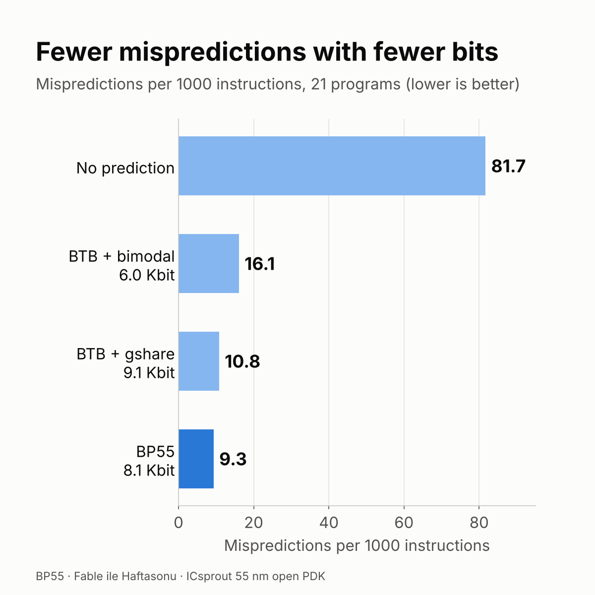
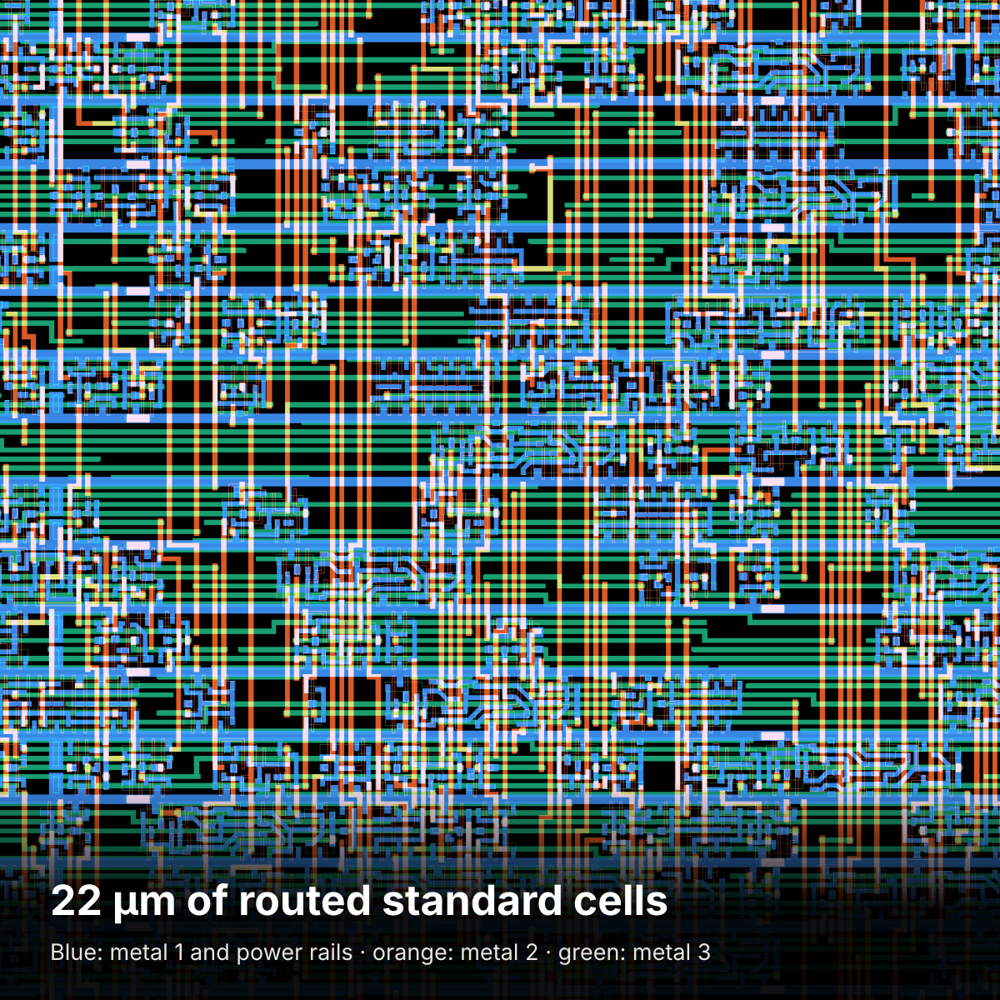
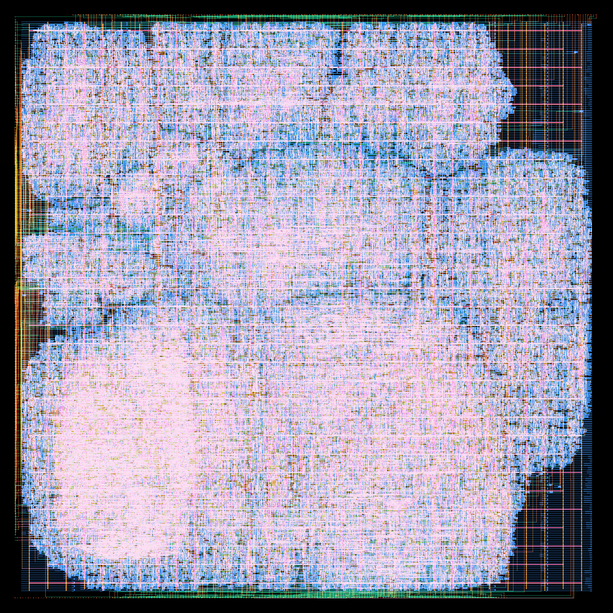

# BP55: a weekend, an open 55 nm PDK, and a branch predictor built without SRAM

*Weekend engineering blog, series "Fable ile Haftasonu" ("A Weekend with Fable").*

The question for this weekend: can a non-trivial digital block be taken from an empty directory to a routed chip layout on a brand-new open 55 nm process, using only open-source tools? And what breaks along the way?

The block is a **branch predictor** for a small RISC-V processor. The answer is "yes, mostly", and the parts that broke are the most interesting part of this post.


> **About the series.** Each post is a weekend-sized engineering project built with Claude Fable, Anthropic's AI model, as the hands-on engineer. The direction and the decisions about scope came from a human; the design, code, runs and write-ups in this repository were produced by the model.

## The short version

- **What:** BP55, a branch prediction unit for a six-stage RV32IM core, taken from RTL to GDSII on the open [ICsprout55](https://github.com/openecos-projects/icsprout55-pdk) 55 nm PDK.
- **The catch:** the PDK has no memory compiler yet, so there is no SRAM. Every table in the predictor is built from individual flip-flops, 8132 of them in total.
- **How well it predicts:** 94.6 % of branch directions correct across 21 programs, which makes the core 22 % faster than one with no prediction at all.
- **How big and how fast:** a 0.43 × 0.43 mm die that closes timing at 161 MHz in the slow corner.
- **How it was checked:** the RTL agrees with a bit-accurate C++ model on every lookup of every trace, with zero mismatches, and the numbers reproduce on a second machine.
- **What it is not:** a finished, sign-off-clean design. No foundry sign-off DRC/LVS and no foundry-calibrated parasitics. (Open-tool DRC and LVS, which found real problems including a broken GDS, extraction with an assumed cross-section, and integration into two real cores came after the weekend; see below.) See [What this project is not](#what-this-project-is-not).

If you want the long form, read [ARTICLE.md](ARTICLE.md) (English) or [MAKALE.md](MAKALE.md) (Turkish). The detailed engineering report is in [REPORT.md](REPORT.md) (Turkish).

## A two-minute background

**Why a processor needs to guess.** A processor works like an assembly line: it starts fetching the next instructions before the current one has finished. When it meets a branch (an `if`, a loop, a function return), it does not yet know which way the program will go. It can either wait, or guess and keep working. If the guess is right, no time is lost. If it is wrong, the work done on the wrong path is thrown away; on this pipeline that costs 3 clock cycles.

**What a branch predictor is.** It is the part that makes the guess. It remembers what each branch did in the past and uses that to predict what it will do next. Its quality depends almost entirely on how much it can remember.

**Why "no SRAM" matters.** Chips normally store that memory in SRAM, which is very dense. Real predictors use 30 to 250 kilobits of it. This PDK cannot generate SRAM yet, so the only storage element available is the flip-flop, which is far larger per bit: about 0.01 mm² per kilobit once the read and write logic is included. The realistic budget is therefore about 8 kilobits, and the design question becomes: how much accuracy can 8 kilobits of flip-flops buy?

A few terms used below:

| Term | Meaning |
|---|---|
| PDK | Process design kit: the files a chip factory provides so you can design for its process |
| RTL | The hardware description (here SystemVerilog) that the chip is built from |
| GDSII | The final layout file, the geometry that would be sent to the factory |
| MPKI | Mispredictions resolved in EX per 1000 instructions; lower is better. Cheaper 2-cycle corrections made in ID are not counted in MPKI, only in CPI |
| CPI | Clock cycles per instruction; lower is better. Here it counts branch penalties only |
| BTB | Branch target buffer: remembers *where* a branch goes |
| TAGE | A predictor that looks at several different lengths of branch history and picks the best match |

## What was built

BP55 is five small structures working together:


| Component | What it does | Size | Bits |
|---|---|---|---|
| Branch target buffer | Remembers that an address holds a branch and where it jumps | 128 entries, direct mapped; 8-bit tag, 3-bit type, 18-bit target | 3840 |
| TAGE | Predicts taken / not taken from the recent history of branches | 3 tables × 64 entries; 7-bit tag, 3-bit counter, 1 useful bit; histories 5 / 12 / 28 | 2155 |
| Bimodal base predictor | Simple per-branch fallback when TAGE has no match | 512 × 2 bits | 1024 |
| Indirect target cache | Predicts jumps whose target changes (function pointers, `switch`) | 32 entries, 6-bit target history | 870 |
| Return address stack | Predicts where a function returns to | 8 entries | 243 |
| **Total** | | | **8132** |

The target pipeline is IF1, IF2, ID, EX, MEM, WB. Branches resolve in EX, so a misprediction costs 3 cycles; a correction made in ID costs 2.

Having only flip-flops is a limitation, but it also allows some shortcuts that an SRAM-based design cannot take:

- **Prediction in a single cycle.** The tables are small enough that the whole lookup finishes in the first fetch stage. There is no second, slower predictor that overrides the first one, and so no bubble when they disagree.
- **Simple history hashing.** The longest history is 28 bits, so the table indexes are plain XOR trees fed from one history register. Recovering from a misprediction means restoring that one register.
- **Filtered history.** Only conditional branches that the BTB already knows, or that are taken, enter the history. This avoids having to insert history late for instructions the first stage does not yet know are branches. Measured cost against an ideal history: under 0.1 MPKI.
- **No second read port.** 92 bits captured at prediction time travel down the pipeline with the instruction, and the tables are trained from those bits in EX.

The module interface (`rtl/bp55.sv`, current hardened version; the timing contract is spelled out at the top of the file):

| Port group | Purpose |
|---|---|
| `f_pc`, `f_fire`, `f_*` outputs | Lookup in IF1, combinational from `f_pc`. The speculative history and return-stack update happens once, in the cycle `f_fire` says the instruction leaves IF1 |
| `r_fire`, `r_*` | Redirect from ID or EX: restores the 67-bit checkpoint and applies the correct history / stack operation. With no operation it is a plain restore, for traps and interrupts |
| `u_fire`, `u_*` | Table training at EX using the 104-bit lookup metadata |
| `f_busy` | High for 64 cycles after reset while the tables are cleared |

The numbers in this post up to "What went wrong" describe the original weekend version (8132 bits), which is also what the layout was made from. See [After the weekend](#after-the-weekend-review-and-hardening) for what changed since.

## How the weekend went

The work was split into five steps, each small enough to finish and check before starting the next.

1. **Traces.** 21 programs (CoreMark, Embench-IoT and two custom stress tests, about 295 million instructions) were compiled to RV32IM with Clang and run on a small purpose-written instruction-set simulator (`iss/rvsim.c`) that logs every branch and jump. The 18 Embench programs check their own results. CoreMark's check was not active in the original port (its CRCs were verified later with `bench/check_coremark.sh`), and the two custom programs have no reference value.
2. **Model.** The predictor was first written as a bit-accurate C++ model (`sim/bp_model.h`). A sweep of 300 configurations picked the design point; 26 more runs tuned history lengths, tag widths and the reset period.
3. **RTL.** The chosen point was written in SystemVerilog as a single module.
4. **Verification.** The RTL was compiled with Yosys CXXRTL and stepped against the model, lookup by lookup: 63.4 million lookups, 0 mismatches.
5. **Implementation.** Synthesis with Yosys and ABC, place and route with OpenROAD, GDS merge and rendering with KLayout.

## Does it predict well?



| Configuration | Bits | MPKI | Direction accuracy | CPI |
|---|---|---|---|---|
| No prediction | 0 | 81.7 | n/a | 1.269 |
| BTB + bimodal | 5977 | 16.07 | 89.85 % | 1.056 |
| BTB + gshare | 9059 | 10.80 | 93.35 % | 1.041 |
| **BP55** | **8132** | **9.34** | **94.60 %** | **1.037** |
| TAGE, 123 Kbit (SRAM-class reference) | 122952 | 5.73 | 96.44 % | 1.018 |

Against gshare, the usual choice at this size, BP55 makes 13.5 % fewer mispredictions with 10 % fewer bits. The sweep below shows it sitting under the bimodal and gshare curves at every budget above about 2.2 Kbit.


Three honest caveats:

- **The gain over gshare is small on this pipeline.** With a 3-cycle penalty it is worth only 0.4 % in CPI. TAGE pays for its complexity as the penalty grows: with a 12-cycle penalty the CPI is 1.130 against 1.146.
- **The cheapest structures are the most valuable per bit.** Removing the return stack raises MPKI to 10.23; removing the indirect cache raises it to 10.70.
- **Some programs are out of reach.** In `xgboost` and `recurse`, even the 123 Kbit reference barely helps (7 % and 2 % fewer mispredictions). BP55 is slightly behind gshare on `xgboost`, `huffbench` and `depthconv`; for the last two the cause is its 64-entry tagged tables overflowing, for `xgboost` larger tables do not help either.
- **The numbers come from the programs the design was tuned on.** About 370 configurations were evaluated on the same 21 programs that the results are reported on, with no held-out set, and five programs account for most of the gap to gshare. The 12-cycle figures above assume a 4-cycle decode redirect; `sim/penalty_sweep.py` reproduces them from `results/final.csv`.
- **"No prediction" is a weak baseline.** Against a BTB with no direction predictor (CPI 1.214) the speedup is 17 %, not 22 %.

## From netlist to layout

| | Value |
|---|---|
| Die | 430.5 × 430.5 µm (0.185 mm²), 65 % utilisation |
| Cell area, excluding fillers | 0.114 mm² |
| Cells | 81,398 including fillers and taps; 2,596 clock buffers and inverters; 4,024 timing-repair buffers |
| Power grid | MET1 rails, MET4 vertical and MET5 horizontal straps |
| Signal routing | MET2 to MET5, 900 mm of wire, 162,034 vias |
| Router violations / antenna violations | 0 / 0 |
| Clock tree | about 1.2 ns insertion delay and 0.16 ns skew in the slow corner |
| Power, typical corner at 167 MHz | 33 mW (default switching activity) |

Timing of the final layout at a 6.2 ns clock (0.5 ns input and 0.5 ns output budgets):

| Corner | Setup slack | Hold slack |
|---|---|---|
| Slow (1.08 V, 125 °C) | +0.10 ns | 0.00 ns |
| Typical (1.2 V, 25 °C) | +2.47 ns | +0.12 ns |
| Fast (1.32 V, −40 °C) | +3.42 ns | +0.06 ns |

That is 161 MHz in the slow corner and roughly 267 MHz in the typical one, at block level.



More renders are in `pnr/`: [the full die](pnr/layout_full.png), [a close-up](pnr/layout_zoom.png) and [the power grid](pnr/layout_pdn_m4m5.png).

## What went wrong

Most of the weekend's lessons came from the back end.


- **The synthesis timing estimate was badly optimistic.** Synthesis, which ignores wires, predicted a 2.47 ns critical path in the slow corner (clock-to-Q excluded). In the routed layout the critical path is about 4.3 ns including 0.24 ns of clock-to-Q. In flip-flop arrays the address lines fan out to thousands of multiplexers and need deep buffer trees.
- **Clock gating did not survive place and route.** It cut synthesis area by 16 %, but the PDK's Liberty file lacks the clock-gating pin attributes and OpenROAD could not balance the clock tree behind the gating cells. The layout is ungated, so 48 % of the power is flip-flop internal power and 30 % is the clock tree. (The cause turned out to be mostly an OpenROAD bug, and a gated layout was built later; see "Clock gating, made to work".)
- **Buffering is expensive.** Cell area ended 17 % above the synthesis figure. Most of that is timing-repair buffers added during placement and about 2,600 clock-tree cells. Hold repair found 2,314 violating endpoints and inserted 363 hold buffers; the worst of them are on input-to-flop paths.
- **Loosening the clock target did not close timing.** The shipped layout was placed against a tighter target than it is reported at (the placement log shows a 5.0 ns clock), misses 6.0 ns by 0.10 ns and meets 6.2 ns. Re-running the whole flow with a 6.2 ns target missed by 0.15 ns, because the tool optimised less. In this flow it pays to optimise against a tighter clock than the one you intend to check against.
- **One self-inflicted problem.** An early run failed hold repair across nearly every flop. The cause was a constraint that applied the 0.10 ns setup uncertainty to hold checks as well.

The synthesis logs, the clock-gated place-and-route run and the early failing hold run of the weekend were not kept. Synthesis was re-run afterwards with logs (see "The physical flow, done again"): the 16 % reproduces, and the 2.47 ns turns out to be ABC's own estimate. The early-hold statement still cannot be checked from this repository.

## After the weekend: review and hardening

The weekend version was then handed to independent reviewers: one for the RTL, one for the published numbers, one to reproduce everything on a second machine.

**The numbers reproduce.** On a different machine with a different build of Clang 18, all 273 rows of `results/final.csv` and all 6300 rows of the 300-configuration sweep come out identical.

**The write-up had errors.** Six statements in the first version of this post contradicted the committed logs (the hold-buffer count, what the 4.3 ns refers to, the clock the layout was placed against, and three per-program notes). They are corrected above, and the methodology caveats the audit raised are in the list below. The audit scripts are in `review/audit/`.

**The RTL matched its model, but the interface assumed an ideal pipeline.** The review (`review/rtl/`) proved with directed tests that the block would misbehave in a real core. What was fixed:

| Problem | Fix |
|---|---|
| A lookup held by a stall updated the history and return stack every cycle | `f_fire` input: state advances once, when the instruction leaves IF1 |
| A "not a branch" training message evicted an unrelated BTB entry | Eviction requires the lookup's own hit and a still-matching tag |
| Tables were never reset: X forever in 4-state simulation, random at power-up | 64-cycle clear after reset, signalled on `f_busy`; payload flops still have no reset |
| Training and redirect messages were level-sensitive and counted twice under a stall | Single-cycle `u_fire` / `r_fire` contract |
| 18-bit targets could not leave a 1 MiB region; far indirect calls mispredicted forever | Indirect cache stores full targets; the BTB does not store what it cannot represent |
| A non-branch that aliases a BTB entry cost 0 cycles in the model | The model now charges the 2-cycle decode redirect |

The cost is 391 bits (8132 to 8523, almost all in the indirect cache) and about 13 % more logic before mapping. On the 21 programs nothing changes: 9.340 MPKI, 94.60 %, CPI 1.0367, row for row, because their code fits in 32 KiB and never touches the fixed paths. On a stress run that spreads the same code so that it aliases in the BTB and crosses 1 MiB regions, MPKI drops from 10.11 to 9.53.

The co-simulation now runs every record of every trace with random stalls, flushes, non-branch training messages and random initial state: 294.7 M lookups and 353.8 M compared outputs per run, 0 mismatches in four runs (update delay 0 and 2, normal and stress address layout). Evidence is in `results/v2/`; `verif/run.sh` runs lint and the directed and X-propagation tests.


## The physical flow, done again

The layout described earlier belongs to the weekend RTL, and the review found its constraints crude and some of its logs missing. So synthesis and place and route were run again, for the weekend RTL and for the hardened one, with every log kept (`syn/run_local/`, `syn/run_v2/`, `pnr/run_*/`).

**Better constraints.** The new `pnr/bp55.sdc` gives each group of ports its own budget (for example 2.0 ns for signals that come from branch resolution in the execute stage, 0.8 ns left for the core's next-PC mux after `f_taken`), measures all IO delays from the clock pin of a real flop after the clock tree is built, so that the 1.2 ns of clock insertion delay no longer distorts them, and times the reset instead of ignoring it. The weekend constraints are kept as `pnr/bp55_legacy.sdc`.

| | Weekend layout (published) | Weekend RTL, new constraints | Hardened RTL, new constraints |
|---|---|---|---|
| Die | 430.5 × 430.5 µm | 431.9 × 431.9 µm | 444.0 × 444.0 µm |
| Cell area without fillers | 113,653 µm² | 120,852 µm² | 129,923 µm² |
| Hold-violating endpoints before repair / hold buffers | 2,314 / 363 | 0 / 0 | 0 / 0 |
| Router violations after detailed routing | 0 | 0 | 0 |
| Slow-corner setup slack at 6.0 ns | | +0.019 ns | −0.157 ns |
| Hold slack, slow / typical / fast | 0.00 / +0.12 / +0.06 ns | +0.19 / +0.08 / +0.03 ns | +0.18 / +0.07 / +0.03 ns |
| Clock period it meets in the slow corner | 6.2 ns (crude IO budgets) | 5.98 ns | 6.16 ns |
| Power, typical corner, default activity | 33 mW | 33.0 mW | 34.4 mW |

What this showed:

- **The hardened RTL costs about 7 % in cell area and 0.18 ns.** It meets 6.16 ns (162 MHz) in the slow corner; it does not meet the 6.0 ns it was run at. The critical path is the same in both versions: `f_pc` through the TAGE index hash, table read, tag compare and provider selection to `f_taken`. Paths between flops inside the block have more than 1 ns of slack; the limit is the single-cycle lookup plus the budget left for the core.
- **The hold problem of the weekend was the IO constraint.** With IO delays referenced to the real clock, no endpoint needed hold repair.
- **The weekend layout is slower than reported once the IO budgets are realistic.** Checked against the new constraints it misses 6.0 ns by 1.04 ns, about 7.0 ns. Under its own constraints it still passes at 6.2 ns.
- **The published 6.2 ns does not reproduce with a different OpenROAD.** Re-running the committed netlist with the weekend constraints on the OpenROAD build available here (December 2024) closes only at 6.52 ns.
- **The synthesis numbers reproduce.** Clock gating saves 16.4 % of area in both versions (81,840 against 97,884 µm² for the weekend RTL, 86,627 against 103,593 µm² for the hardened one). The "2.47 ns at synthesis" was ABC's internal estimate; static timing analysis of the same netlist with no wires at all gives 3.85 ns, so synthesis was less wrong than the weekend text made it look.

**Metal fill.** Both new layouts were filled with OpenROAD's `density_fill`, using shapes and spacings taken from the PDK's dummy-metal rules (`pnr/flow/fill_rules.json`). Before fill, 64 of 64 density windows on the top metal and about half of those on metal 5 were below the minimum; after fill none is, on any layer, and the difference between neighbouring windows is at most 7 points against a limit of 20. A separate geometry check on the merged GDS finds no fill shape that overlaps metal, breaks a spacing rule or has the wrong size (`8_fill_check.txt`). The fill is on the dummy datatype of each metal layer.

A later correction: the script that writes the wire parasitics (`pnr/flow/def2spef.py`) named the bits of some buses in a form the timer could not match, so about 22 % of the nets (8,112 of 37,127 on the hardened layout) were timed without wire load. Gate-level simulation work found this. With the names fixed and the three layouts re-timed, every setup slack in the table is unchanged to the picosecond, because the critical paths did not run through those nets; slow-corner hold slack moved from 0.183 to 0.209 ns on the hardened layout. The extracted-parasitics runs below already corrected the names and are not affected.

Limits of the place-and-route pass itself: timing uses resistance and capacitance computed from the routed wire lengths with the per-layer values in the LEF, with no coupling and one set of values for all corners, so the effect of fill on timing is not modelled at all. The antenna check reports nothing because the LEF files contain no antenna rules to check against. Sign-off DRC and LVS are a separate step. The clock-gated layouts are described below. The large outputs of these runs (DEF, GDS, SPEF) are not in the repository; `pnr/flow/run.sh` regenerates them, and each run directory has a `MANIFEST.txt`.

**Parasitic extraction.** The PDK has no extraction deck, and it does not document metal or dielectric thicknesses. So an extraction rule set was built from what it does document (layer order and materials, sheet resistance, the 0.9x shrink, the metal resistor model) plus an assumed cross-section: metal thickness derived from sheet resistance, textbook permittivities for the named dielectrics, and an invented spread for worst and best RC corners. A small 2D field solver (`rcx/solver/`) computes capacitance for OpenRCX's 1184 calibration patterns, OpenRCX fits its rules to that, and the routed layouts are then extracted net by net with coupling, in three corners (`rcx/`).

| Layout, constraints, clock | Slow-corner setup slack: global-route estimate | Slow-corner setup slack: extracted | Hold slack with extraction, slow / typical / fast |
|---|---|---|---|
| Weekend layout, weekend constraints, 6.2 ns | +0.09 ns | +0.99 ns | +0.17 / +0.10 / +0.05 ns |
| Weekend layout, new constraints, 6.2 ns | −1.30 ns | +0.02 ns | +0.11 / +0.08 / +0.03 ns |
| Weekend RTL re-run, new constraints, 6.0 ns | −0.16 ns | +0.52 ns | +0.10 / +0.08 / +0.03 ns |
| Hardened RTL, new constraints, 6.0 ns | −0.42 ns | +0.46 ns | +0.17 / +0.08 / +0.03 ns |

- **The estimates were pessimistic.** The global-route estimate charges every wire 0.19 fF/µm; the extracted layouts average about 0.13, because the routing layers are only 18 to 25 % full. Total wire capacitance of the hardened layout is 169 pF extracted (79 % of it coupling) against 238 pF estimated. Wire resistance is 1.6 to 1.7 times the estimate, but capacitance dominates.
- **With these parasitics the hardened layout meets 6.0 ns** in the slow corner with 0.46 ns to spare, and the weekend layout meets 6.2 ns even under the realistic IO budgets. The table of the previous subsection used a third, simpler method (lumped wire RC from the LEF values) and sits between the two columns here.
- **How far to trust it.** The machinery is checked: the solver matches closed-form results within 2 %, and the fitted rules reproduce the solver on their own patterns. The process data is not: every thickness and permittivity is an assumption. The only independent check is the capacitance in the PDK's LEF, which agrees within 2 % on metals 2 to 4 and is a third lower on metals 1 and 5. Scaling all capacitance by ±20 % moves slow-corner setup slack by ±0.17 ns, so the conclusion holds across that band, but this is not a calibrated deck.
- **Metal fill barely matters.** OpenRCX does not see fill shapes at all. Re-extracting with every fill shape tied to ground, which is an upper bound since real fill floats, raises capacitance by 1.5 % and costs 0.02 to 0.03 ns.
- **Not analysed:** crosstalk (coupling capacitance is treated as grounded in timing analysis), on-chip variation, and any 3D effect; crossing wires are approximated from 2D sections.

**DRC and LVS with open tools.** The PDK's rule decks are written for Calibre. A hand translation to KLayout is in `signoff/`, and it is not foundry sign-off. Of the 711 checks in the DRC deck, 181 are translated, 62 approximated and 17 checked only for their precondition. The other 451 are not translated; nearly all of those need layers or structures this block does not have (pads, seal ring, special devices, metals 6 to 8), and about 30 that could apply are listed in `signoff/drc/coverage.tsv`. The translation was tested with 31 layouts that each contain one deliberate violation, and on the bare standard-cell library.

- **The GDS published at the weekend was not a working layout.** The script that merges the routed wires with the standard cells (`pnr/def2gds.py`) took the cells from the wrong one of the PDK's two GDS files. The router connected to pin shapes on metal 2, with a via down to metal 1; the file that was merged has the metal 1 pins only, so in the published GDS every signal wire ended above its pin without touching it. LVS shows it at once: the layout does not match the netlist. Merged with the other file (`ics55_LLSC_H7CR_M2.gds`), the same routed design matches the routed netlist: 35,945 cells and 36,165 nets, with differences only in ports the netlist leaves unconnected. The script is fixed and every GDS was regenerated, including `pnr/bp55.gds.gz`. Routing, timing and every earlier number are unaffected; only the merged file was wrong, and the router's "0 violations" could never have seen it.
- **LVS level reached.** Each of the 341 cell types used was extracted to transistors and compared with its CDL netlist: 326 match, 13 differ in transistor width by 0.5 to 1 %, one inverter is drawn 14 % wider than its netlist says, and one NAND has its series stack in a different (logically equivalent) order. Those are library findings. For the whole block the comparison is cell-level: cells as black boxes, wiring between them extracted from the layout. A flat transistor-level comparison of the whole block did not converge in KLayout 0.28 and is not claimed.
- **DRC finds real problems the router did not.** On the weekend layout with the correct cells: the power rails drawn by the flow are 0.20 µm wide over 0.16 µm cell rails, which leaves cell metal 1 too close to them (53,308 markers); all 450 via-4 arrays of the power grid are packed tighter than the array spacing rule; the router left 126 metal 2 spacing violations, a few hundred dense line-end violations on metals 2 to 4 (the LEF has no end-of-line rules) and about 1,600 short metal 2 pin stubs below minimum area; and cells near the left core edge are up to 40 µm from a well tap against a 35 µm guideline. These need fixes in the floorplan and power-grid scripts and in the routing rules; they are not fixed here.
- **The library itself is not clean against its own deck**: metal 1 enclosure of contacts, contact-to-gate spacing (0.05 against 0.055 µm), minimum metal 1 pin area and a few others, in most cells.
- **Density.** Metal fill clears every metal density window, as reported above. Active and poly density still fail everywhere because there is no front-end fill. The metal fill also comes closer than 2.5 µm to the cell-boundary layer, which the deck treats as the chip edge.
- **Antenna.** The translated antenna rules report nothing on the weekend layout. Ratios are checked per layer, not accumulated across layers as the deck asks, so this is weaker than the real check.
- **The regenerated GDS and the hardened layout.** The regenerated `pnr/bp55.gds.gz` was extracted again and matches its netlist (35,945 cells, 36,165 nets). The hardened layout matches too, without and with fill: 38,052 cells and 38,314 nets, the fill left floating. In all three the only differences are the 37 ports the netlist leaves unconnected and the outputs of clock-tree dummy loads, which are unconnected by design. DRC on the filled hardened layout shows the same classes of violation at similar counts: 55,502 markers for cell metal 1 next to the power rails, 2,382 metal 2 minimum-area, 155 metal 2 spacing, 205, 910 and 191 dense line-end on metals 2 to 4, the same via-4 array violation in every power-grid array, and 19,573 fill shapes within 2.5 µm of the cell-boundary layer. Every metal density window passes; active density is below 20 % in 13 of 64 windows and poly in all 64. The translated antenna rules report nothing. None of these violations is fixed.
- **Not checked:** front-end rules (wells, implants, active, poly) on the hardened layout, about 30 applicable DRC rules, parasitic devices, and anything specific to Calibre.

**Gate-level simulation.** The synthesised and routed netlists were simulated against the same reference model as the RTL, with the same harness and stimulus. Files are in `gls/`.

| Netlist | Lookups | Output comparisons | Mismatches |
|---|---|---|---|
| Hardened RTL, synthesised | 294.7 M | 353.8 M | 0 |
| Hardened RTL, routed | 294.7 M | 353.8 M | 0 |
| Weekend RTL, synthesised | 294.7 M | (weekend harness) | 0 |
| Weekend RTL, routed | 294.7 M | (weekend harness) | 0 |

- **Full traces.** All 21 programs, 42.3 M branch records, with stalls, flushes and wrong-path lookups. In the hardened runs every flop starts from a random value. Three more random seeds on a shorter run also pass.
- **The comparison catches faults.** Swapping the inputs of one multiplexer in the target path produced mismatches on CoreMark, though not on two other programs, so not every gate fault is exercised by every program.
- **Cell models.** The simulator is Verilator. The PDK's cell models use table primitives and timing checks it cannot take, so each of the 551 cells used was rewritten as plain logic and compared with the original under random stimulus: 2.2 M points, 0 mismatches.
- **Unknown initial state.** With the PDK's own models in a four-state simulator and every flop starting unknown, the reset test and the directed tests pass on both hardened netlists, with the same three known-open items as the RTL.
- **Formal equivalence.** The hardened RTL and its synthesised netlist are proven equivalent on all 8,523 state bits and all outputs (8,727 comparison points, one induction step). The routed netlist and the weekend netlists have no equivalence proof.
- **With wire delays.** The routed hardened netlist passes the directed tests with slow-corner delays annotated, at a 6.9 ns clock. The testbench changes inputs and reads outputs at the clock edge, so it cannot run at 6.0 ns, and the simulator does not evaluate setup and hold checks. This run is a functional check, not a timing one.
- **Two bugs found on the way.** Yosys 0.69's CXXRTL backend drops the clock edge of a flop that has both asynchronous set and reset, so a first attempt simulated a design in which no flop ever changed; the co-simulation itself exposed it. And the parasitics script dropped 22 % of the nets, as described above.

**Clock gating, made to work.** The weekend's clock-gated layout failed, and the write-up blamed the Liberty file. That was half the story. Files are in `cg/`, `syn/run_cg/` and `pnr/run_v2_cg/`.

- **The real cause was in OpenROAD.** The version used here (v2.0-17598) ignores any driver pin that the LEF marks `USE CLOCK`, and the PDK marks the gating cells' outputs that way, correctly. Clock-tree synthesis therefore saw every gated clock net as undriven and skipped all 366 of them (`CTS-0122`), leaving no tree behind any gating cell. The failure reproduces: clock latency from 0.86 to 2.79 ns, 4,876 hold-violating endpoints, 2,425 hold buffers, setup still 0.48 ns short. OpenROAD fixed this upstream in May 2026. The workaround here is a LEF copy with that pin marked as a signal.
- **The Liberty file is incomplete too.** The ten gating cells lack the three `clock_gate_*_pin` attributes and any description of their latch. Yosys then refuses to infer them from the library, and OpenSTA's power analysis treats every gated clock as running every cycle: 54.8 mW instead of 13.9 mW on the same layout. Timing analysis does not need the attributes. `cg/patch_liberty.py` adds them without touching any timing or power table. The gap is closed inside this repository: `cg/setup.sh` writes the completed Liberty for the three corners and the LEF workaround next to the PDK without modifying it, and after `source cg/env.sh` the normal flow in `pnr/flow/` uses them. With the completed Liberty, Yosys picks the gating cells from the library by itself (366 cells, same area as naming the cell by hand) and timing reports are identical to the upstream file's. Nothing was sent upstream.
- **The gated layout, with the simple wire model.** Hardened RTL, fine-grained gating (1,071 gating cells, 8,202 of 8,523 flops gated), same constraints at 6.0 ns. The gated column is the final layout, with the clock tree balanced (see the clock-skew bullet below); its 0.012 ns setup miss in this model becomes +0.457 ns with coupled extraction:

| | Ungated | Gated, 1,071 cells, balanced clock | Gated, one cell per table (13) |
|---|---|---|---|
| Die side | 444 µm | 407 µm | 445 µm |
| Cell area | 129,923 µm² | 115,752 µm² (−10.9 %) | 132,734 µm² (+2.2 %) |
| Slow-corner setup slack | −0.157 ns | −0.012 ns | −0.395 ns |
| Hold slack, slow / typical / fast | 0.209 / 0.087 / 0.035 ns | 0.040 / 0.039 / 0.041 ns | 0.091 / 0.027 / −0.001 ns |
| Slow-corner clock skew | 0.20 ns | 0.35 ns | 0.97 ns |
| Power, typical corner, CoreMark activity | 31.8 mW | 11.1 mW | 9.1 mW |
| Router / antenna violations | 0 / 0 | 0 / 0 | 0 / 0 |

- **Power falls by about two thirds.** Activity comes from 294,000 simulated cycles each of CoreMark and of the most branch-dense program; the two give the same result within 0.2 mW. Flop power falls from 15.6 to 0.8 mW and clock-network power from 9.4 to 4.5 mW (4.1 mW before the clock tree was balanced). One caveat: OpenSTA does not read clock-network activity from the simulation, so gated clock activity is derived from the enable signals.
- **It is functionally the same design.** Every output of the gated netlists was compared with the RTL on every cycle: the routed 1,071-cell (before the hold fix) and per-table netlists over 996,108 cycles of two programs, and a synthesised 366-cell netlist over all 21 programs with stalls and flushes (27.8 M cycles), all with 0 mismatches. The gate-level co-simulation against the reference model, from random initial state, passes on the synthesised 1,071-cell netlist (9.3 M cycles, 0 mismatches). The reset test with unknown initial state passes on the routed gated netlists with the PDK's own cell models.
- **Hold fix on the first gated layout, in two steps.** This is the layout before the clock tree was balanced. First: as routed, the 1,071-cell layout missed hold by 10 ps in the fast corner on one output; a hold repair on the finished layout (`pnr/flow/5_eco_hold.tcl`) added 57 buffers and closed it. Second: coupled extraction of that layout (next bullet) showed hold violations the simple model had hidden, and 96 delay cells closed those (`pnr/flow/5_eco_delay.tcl`). Router and antenna checks report 0 after each step.
- **Coupled extraction found real hold violations, now repaired.** With OpenRCX and the rule set of the extraction section, the layout after the first repair has more setup slack than the simple model says (+0.493 ns in the slow corner) but fails hold in every corner: −0.112 / −0.047 / −0.015 ns (slow / typical / fast), on 42 flops in the slow corner, all on paths from input ports straight to a flop. OpenROAD's own repair could not be used: it works from a global-route estimate that shows these paths as met, a margin large enough to catch them selects thousands of healthy flops, and this build crashes in incremental global routing on such a change. The fix is targeted instead: one delay cell in front of each of the 96 flop inputs with less than 0.04 ns of extracted hold slack. After it, with coupled extraction: setup +0.497 / 2.077 / 2.673 ns, hold +0.015 / +0.025 / +0.034 ns. Results in `rcx/results/v2_cg2_eco2/`.
- **Clock skew cut from 1.20 to 0.35 ns.** The clock-tree tool builds a separate tree behind each gating cell and does not balance them against each other, so flops behind large gated nets (two buffer levels) got the clock up to 1.2 ns later than flops behind small ones. A new step after clock-tree synthesis (`pnr/flow/cts_balance.tcl`) pads every early branch up to the latest flop with delay cells, placed at the highest point whose whole subtree is early so that branches share them: 1,549 cells. The design was then routed again and hold-repaired the same way as before (68 delay cells, after coupled extraction showed −0.013 ns on three flops). Measured on the routed layouts: skew in the simple model 1.196 to 0.346 ns in the slow corner; spread of clock arrival over all 8,523 flops with coupled extraction 0.956 to 0.415 ns (slow) and 0.395 to 0.147 ns (fast). Hold-violating endpoints straight after clock-tree synthesis fell from 164 to 2. The cost: cell area 113,777 to 115,752 µm² (the saving against ungated goes from 12.4 % to 10.9 %), power 10.75 to 11.14 mW with CoreMark activity, and 0.04 ns less extracted setup slack. Padding behind the gating cells, where the cells only toggle while the gate is open, was chosen over padding in front of them, which balances slightly better (0.185 against 0.214 ns after clock-tree synthesis) but costs three times the power. The gating cells themselves are still clocked about 1.1 ns before their flops; that offset is how gating works and shortens the time available to the enable signals, whose worst slack is +0.671 ns.
- **Final timing with coupled extraction.** Setup +0.457 / 2.070 / 2.668 ns, hold +0.032 / +0.050 / +0.037 ns (slow / typical / fast). Results in `rcx/results/v2_cg2_bal2/`.
- **Timing with the fill in place.** OpenRCX does not see floating fill, so the bound is the same as for the ungated layouts: every fill shape tied to ground. On the final layout that gives setup +0.458 / 2.055 / 2.659 ns and hold +0.042 / +0.056 / +0.038 ns. Timing is met with and without fill.
- **Everything else was repeated on the final layout** (`pnr/run_v2_cg/gated_cg2_bal2`). Function: the routed netlist matches the RTL on every output over all 21 programs with stalls and flushes (27.8 M cycles, 0 mismatches). Power: 11.14 mW with CoreMark activity and 11.25 mW with the branch-dense program. Fill: 314,123 shapes; after fill no density window fails on any metal layer, and the fill geometry check and the router's own check report 0. LVS: the filled GDS matches its netlist at cell level (31,389 cells, 31,700 nets). Antenna: 0 on all 19 translated rules. DRC, every section of the translated deck: the same 259 rule names as on the previous gated layout and no new class: metal 1 spacing to the power rails (62,656), small metal 2 pin areas (2,821), dense line ends, fill within 2.5 µm of the boundary layer (17,673 over six layers), well-tap distance (9,577), and no active or poly fill. The rest are inside library cells, including three rules in the gating cell `ICGX2H7R`. Results in `signoff/results/v2_cg2_bal2/filled/`. This is not foundry sign-off.
- **A second balancing pass on the routed wires: the two wire models disagree.** Tried on a copy of the final layout (`pnr/run_v2_cg/gated_cg2_bal4`; the table and the bullets above stay on `gated_cg2_bal2`). The pass pads early branches against the clock arrivals of the coupled extraction (`pnr/flow/5_eco_bal.tcl`), then removes padding from branches that ended up late (`pnr/flow/5_eco_trim.tcl`): 1,417 cells added, 179 removed.
  - With coupled extraction the spread of clock arrival over all flops falls from 0.415 to 0.274 ns in the slow corner and from 0.147 to 0.120 ns in the fast one. Setup +0.491 / 2.000 / 2.618 ns, hold +0.027 / +0.049 / +0.037 ns; with grounded fill +0.492 ns and +0.038 / +0.054 / +0.038 ns.
  - With the simple wire model of the table the same layout is worse: skew 0.49 ns instead of 0.35, hold 0.000 / 0.028 / 0.039 ns, setup still −0.012 ns. The two models place the clock arrivals up to a few tenths of a nanosecond apart, so balancing against one unbalances the other; below about 0.3 ns the skew cannot be resolved without the foundry's wire data.
  - Cost: 32,627 cells and 117,544 µm² (9.5 % below ungated instead of 10.9 %), 11.35 mW with CoreMark activity instead of 11.14.
  - Two things had to be solved on the way. Legalising the new cells without freezing the existing ones moved cells all over the block (7,047 nets rerouted for 1,609 cells), which cost 0.32 ns of setup slack and left the spread at 0.387 ns. With the cells frozen, the data paths kept their slack but some branches overshot and the spread grew to 0.513 ns, until the trim step removed the excess padding (predicted 0.269 ns, measured 0.274).
  - Repeated on this layout with the same outcome: function (27.8 M cycles, 0 mismatches), fill (303,150 shapes, all density windows pass), LVS match on the filled GDS (32,627 cells, 32,938 nets), antenna 0, router 0, same DRC rule names. Details in `cg/README.md`.
- **What is left.** Clock skew is 0.35 ns against 0.2 ns ungated, and 0.42 ns between flops with coupled extraction; the second balancing pass above improves one wire model and worsens the other. Setup misses by 0.012 ns in the simple wire model. The 366-cell variant did not finish detailed routing (about 4,550 violations after three iterations, stopped). The routing log of the 1,071-cell run is incomplete because its wrapper was killed by mistake; violations were re-checked on the finished database. The hold margin with coupled extraction is 0.032 ns in the slow corner, and the extraction rests on an assumed cross-section. The antenna check is empty, as everywhere in this flow.



## BP55 inside a real core: CORE-V Wally

Everything above comes from a trace-driven model of a pipeline that does not exist. The next step was to put the hardened RTL into a real open-source core and count cycles. The first core is [CORE-V Wally](https://github.com/openhwgroup/cvw) (commit 3617f2c): scalar, five stages, branches resolved in the execute stage, and a branch predictor that lives in one module and is selected by a parameter. It was built as RV32IM without compressed instructions, which is what BP55 was designed for.

BP55 is added as one more predictor type. The same 21 programs run in RTL simulation (Verilator) on ten builds of the core that differ only in the predictor, 210 runs in all, every one passing its self-check and retiring exactly the instruction count the instruction-set simulator predicts.

| Wally build | Predictor state (bits) | CPI | Redirects per 1000 instr. | Direction mispredictions per 1000 instr. |
|---|---|---|---|---|
| No prediction | 0 | 1.288 | 90.98 | 90.98 |
| Static (backward taken) | 0 | 1.270 | 50.72 | 50.72 |
| Bimodal, BP55-sized | 6915 | 1.174 | 34.50 | 12.50 |
| Local history, BP55-sized | 7555 | 1.176 | 36.10 | 9.72 |
| gshare, BP55-sized | 6925 | 1.169 | 31.80 | 10.92 |
| gshare, Wally's default size | 39438 | 1.147 | 21.35 | 10.66 |
| gshare, BP55-sized, call classification fixed | 6925 | 1.160 | 27.48 | 10.92 |
| gshare, BP55-sized, call fix and a 12-bit BTB tag | 8461 | 1.138 | 15.94 | 10.06 |
| gshare, default size, call classification fixed | 39438 | 1.136 | 15.81 | 10.69 |
| **BP55** | **8523** | **1.130** | **12.25** | **7.48** |

Figures are pooled over all 21 programs (total cycles over total instructions); per-program tables and unweighted means are in `wally/results/summary.txt`. CPI here is the real thing, including cache misses and load-use stalls, not the branch-only CPI of the trace model.

How to read this, without flattering it:

- **The misprediction penalty in Wally is 2 cycles,** measured, not the 3 the trace model assumed. Speedup over no prediction is 13.9 %, against 22 % in the model.
- **Two quirks of stock Wally inflate BP55's lead, and both were then removed by measurement.** The benchmarks are built without linker relaxation, so every call is `auipc` + `jalr`; Wally's decoder classifies any `jalr` through the link register as a return, so each such call takes its target from the return stack and is mispredicted. That is 5.8 of the stock predictors' redirects per 1000 instructions. Separately, Wally's BTB has no tags, so at 128 entries ordinary instructions overwrite branch entries. The three extra rows of the table are gshare builds with the classification corrected to the RISC-V link-register convention, and one with a tagged BTB as well, at 8461 bits against BP55's 8523. The changes are in `wally/patches/0003-bpred-options-rashint-btbtag.patch` behind defines; stock builds compile the unchanged code.
- **Against fair baselines the lead is small.** BP55 is 2.5 % faster than the corrected gshare at its budget, but only 0.65 % faster once that gshare also has a tagged BTB: about three quarters of the equal-budget lead was simply having tags. Against Wally's default-size gshare with the call fix, which has 4.6 times as many bits, BP55 is 0.5 % faster. Against the stock builds the figures were 3.3 % and 1.4 %.
- **The same picture with relaxed linking.** Rebuilding the programs so that calls become plain `jal` gives 1.129 for BP55, 1.135 for the default gshare and 1.163 for the BP55-sized gshare (`wally/results_relax/`).
- **Direction mispredictions** fall by 30 % against the default gshare; that part does not depend on either quirk.
- **Per program,** against the corrected default gshare: BP55 wins on `interp` (4.2 %, the indirect target cache), `coremark` (1.7 %), `nettle-sha256` (1.1 %), `sglib-combined`, `statemate` and `qrduino`; loses on `nsichneu` (1.2 %, a 128-entry BTB is too small for its thousands of branches) and `xgboost` (0.2 %); and is within 0.1 % on eight programs. The large wins on `crc32` and `tarfind` against stock Wally were the call quirk.

Checks on the measurement itself:

- With no predictor, Wally's redirect count equals taken branches plus jumps in the control-flow trace, on every program.
- BP55's redirect count in Wally matches a software model of the integration (the bit-accurate predictor model with Wally's update timing) to within 2 out of 3.6 million.
- A fetch is never accepted in the cycle of a redirect, and at most one accepted wrong-path lookup precedes a redirect, so the two limits left open in the hardened RTL are not reached in this core. An assertion checked the first through all runs.
- BP55 carries 434 bits of per-instruction prediction state through Wally's pipeline (lookup metadata and checkpoint, to the execute and memory stages), which the 8523 does not include. The gshare builds carry 264.

Not exercised: traps, interrupts and CSR flushes (none occur in these programs), and BTB aliasing. Wally's own regression suite was not run on the BP55 build.

`wally/wally.sh sweep` fetches the core, applies the patches in `wally/patches/`, builds everything and runs it; `wally/wally.sh report` prints the tables.

## Second core: CVA6

[CVA6](https://github.com/openhwgroup/cva6) is the OpenHW Group's flagship core and a harder target: six stages, branches resolved in the execute stage, and a front end that predicts only after the instruction cache has returned data. The harness in `cva6/` builds the 32-bit `cv32a60x` configuration with compressed instructions off, with its own small testbench (core, one AXI memory, ELF loader, counters), and runs the same 21 programs. `rtl/bp55.sv` is copied into the build unmodified (the script byte-compares it); the CVA6 side is one patch, `cva6/patches/0005-bp55-predictor.patch`, behind a define that only the `bp55` build sets.

| CVA6 build | Predictor state (bits) | CPI | Mispredictions per 1000 instr. | direction / return / indirect |
|---|---|---|---|---|
| No dynamic prediction | 0 | 1.615 | 50.72 | 35.54 / 5.80 / 9.38 |
| Stock `cv32a60x` (32-entry BHT, no BTB, 2-entry return stack) | 162 | 1.493 | 26.69 | 16.49 / 0.82 / 9.38 |
| CVA6's own structures, enlarged (`big`) | 7464 | 1.438 | 15.90 | 12.33 / 0.46 / 3.11 |
| CVA6's own structures at BP55's budget (`big2`: 2048-entry BHT, 64-entry BTB, 8-entry return stack) | 8520 | 1.437 | 15.77 | 12.33 / 0.46 / 2.98 |
| **BP55** | 8523 | **1.404** | **9.38** | 7.48 / 0.07 / 1.82 |

Pooled over the 21 programs; all 105 runs pass and commit exactly the instruction count the instruction-set simulator gives. The measured misprediction penalty is 5 cycles, against 2 in Wally.

How it is wired: BP55 is looked up with the address of each pre-decoded instruction, and `f_fire` is "this instruction enters the instruction queue". CVA6's pre-decoder already knows what each instruction is and where direct branches go, so BP55 supplies the direction of conditional branches, the return address and the target of indirect jumps. BP55 advances its history and return stack only on BTB hits; when that disagrees with what pre-decode saw (a call, return or taken branch the BTB missed, or a hit on something that is not a branch), the front end sends a repair through `r_fire` in the next cycle. That happens 3.05 times per 1000 instructions. Execute-stage mispredictions and every other pipeline flush (exception, interrupt, `mret`, `fence`, CSR side effects, debug) restore the checkpoint of the instruction concerned.

How to read it:

- At the same bit budget BP55 has 2.3 % lower CPI and 40 % fewer mispredictions than CVA6's own predictor. It is faster on 17 of the 21 programs (largest gains: ud 12.0 %, interp 9.3 %, recurse 7.1 %, slre 4.9 %, coremark 3.3 %), ties on three, and is 0.9 % slower on statemate, whose indirect jumps fit CVA6's 64-entry BTB better than BP55's 32-entry indirect target cache.
- In Wally the equal-budget lead is 2.5 % over a gshare with an untagged BTB and 0.65 % over one with a tagged BTB. CVA6's 2.3 % sits between the two although each misprediction costs 5 cycles instead of 2: its CPI is higher for other reasons (2 KB caches in this configuration), and its pre-decoder already removes the target and branch-type mistakes that a BTB-driven front end pays for.
- The 8523 bits are not the whole cost. Carrying BP55's 104-bit metadata and 67-bit checkpoint with every instruction from the instruction queue to commit adds 2014 flip-flops of pipeline state to CVA6 (counted from the simulated model: 174 bits in each of four queue and four scoreboard entries and two pipeline registers, plus 274 bits of repair registers). CVA6's own predictors need none. A design that cared about this would keep checkpoints only for branches.
- Because pre-decode supplies every direct target, the 2304 target bits of BP55's BTB are used here only as a fallback for indirect jumps.

Checks: the assertion that `f_fire` and `r_fire` never coincide did not fire in 301 million lookups; the number of wrong-path return-stack operations before a redirect never exceeded one, so the known return-stack repair limit was not reached; and a software replay of `sim/bp_model.h` with CVA6's lookup and training order reproduces the RTL's 2,763,479 mispredictions to within 0.03 % for any training delay from one to five lookups (36 apart at three), with identical return and indirect counts in every program.

Not done: the lookup still happens after the instruction cache returns, so CVA6's one-cycle bubble on every predicted-taken instruction remains; the exception and interrupt restore paths are wired but never occur in these programs; front-end timing was not analysed. Turning compressed instructions off exposed a bug in that path of CVA6's instruction queue; the one-line fix is in `cva6/patches/`. Details are in `cva6/README.md`; `cva6/cva6.sh sweep` runs everything, `cva6/cva6.sh report` prints the tables.

## What this project is not

This is an experiment, not a product. Read this section before relying on any number above.

| Stage | State |
|---|---|
| Architecture and design-space exploration | Done (300 configurations swept) |
| RTL | Done; hardened after review (`verif/run.sh` passes) |
| RTL vs. reference model co-simulation | Passes on the full traces: 294.7 M lookups, 353.8 M output comparisons, 0 mismatches |
| Synthesis (Yosys + ABC) | Done |
| Place and route (OpenROAD) | Done: 0 router violations, 0 antenna violations |
| Timing closure | Closes at 6.2 ns in the slow corner |
| Sign-off DRC / LVS | Foundry decks **not run** (Calibre format). A partial KLayout translation was run after the weekend: violations found and listed, block matches at cell level |
| Parasitic extraction | Done after the weekend with OpenRCX rules built on an assumed cross-section; not foundry-calibrated |
| Integration into a core | Done after the weekend: CORE-V Wally and CVA6, in RTL simulation |
| Gate-level simulation | Done after the weekend: synthesised and routed netlists match the reference model on the full traces, 0 mismatches; no timing simulation at speed |

- **No sign-off DRC or LVS, and the open-tool checks are not clean.** The GDS first published here had every signal pin disconnected (fixed since), and the translated DRC reports power-grid, routing and library violations that have not been fixed. "Zero violations" refers only to the router's own check against the LEF rules, and the router skipped some enclosure rules it does not support (CT, VIA4, T4V2, RV layers). There is no metal fill. The committed `pnr/4_drt_drc.rpt` and `pnr/antenna.rpt` are empty files; the zero counts come from `pnr/3_route.log`.
- **No calibrated parasitics.** The weekend timing uses RC estimates from global routing. The later extraction rests on assumed metal and dielectric thicknesses, and there is no crosstalk or on-chip-variation analysis.
- **The IO constraints are crude.** Input and output delays are set against an ideal clock while the flops see about 1.2 ns of clock insertion delay. The 161 MHz figure and the zero slow-corner hold slack both sit on IO paths and are shaped by that; neither is a bound on the speed inside a core.
- **Frequency is not part of the comparison.** CPI is compared at equal cycle time, and no gshare was laid out to see whether a simpler predictor would clock faster.
- **The 8132 bits exclude pipeline state.** The 92-bit metadata and 67-bit checkpoint carried with each in-flight instruction are not counted.
- **The 123 Kbit reference is a scaled-up BP55,** capped at 64 bits of history and 6 tables, so it understates what an SRAM-based TAGE would do.
- **No timing simulation at speed.** The synthesised and routed netlists were simulated functionally after the weekend, and one netlist has a formal equivalence proof, but nothing checks timing in simulation. The original co-simulation covered only the first 300,000 branch records of each trace (about 15 %) and never exercised stalls or flushes; the current one covers the full traces (see below). A lookup in the same cycle as a redirect, and return-stack repair after more than two wrong-path stack operations, are still open.
- **The published GDS is of the original RTL.** The hardened version (8523 flip-flops) was placed and routed afterwards; its large outputs are regenerated by script rather than stored.
- **Small embedded workloads.** BTB tag aliasing never occurred, so that RTL path is untested, and the tag and target widths were chosen by assumption. The results do not carry over to large code bases.
- **CPI covers branch penalties only**: no cache misses or load-use stalls.
- **The PDK is a preview.** Its maintainers state that it is not fully silicon-proven and must not be used for volume production.

## What the weekend says about the open flow

A weekend is enough to get a useful branch predictor to GDSII on an open 55 nm PDK. It also shows where the open flow at this node is still thin:

1. **A memory compiler** would bring the largest gain. In these measurements a 123 Kbit TAGE removes a further 39 % of mispredictions.
2. **Complete Liberty attributes for the clock-gating cells** would let synthesis infer them and power analysis see them. (Gating itself works once an OpenROAD bug is worked around: about two thirds less power and 13 % less area.)
3. **Open DRC, LVS and extraction rules** are what it would take to check results like these at sign-off quality.

## Repository map

| Path | Contents |
|---|---|
| `rtl/` | `bp55.sv`, the synthesizable RTL |
| `sim/` | `bp_model.h` (bit-accurate C++ model), `bpsim.cc` (trace driver), `cosim.cc` (RTL vs. model), `summ.py`, sweep lists |
| `iss/` | `rvsim.c`, a minimal RV32IM instruction-set simulator that emits control-flow traces |
| `bench/` | Build script, freestanding runtime, CoreMark port and two custom stress programs |
| `syn/` | Yosys/ABC synthesis scripts and gzipped netlists |
| `pnr/` | OpenROAD scripts, constraints, logs, routed netlist, DEF, final GDSII, layout images |
| `pnr/flow/`, `pnr/run_*/` | Second-pass flow scripts (place, clock tree, route, fill, timing) and the logs and reports of each run |
| `syn/run_local/`, `syn/run_v2/` | Re-run synthesis of the weekend and hardened RTL, gated and ungated, with logs |
| `verif/`, `review/`, `results/v2/` | Directed and X-propagation tests, review evidence, hardened co-simulation logs |
| `wally/`, `cva6/` | Core integrations: patches, harness scripts and per-run results |
| `tools/` | Toolchain environment and install scripts |
| `signoff/` | KLayout translations of the DRC, antenna and LVS decks, coverage table, tests, results |
| `cg/`, `syn/run_cg/`, `pnr/run_v2_cg/` | Clock gating: Liberty and LEF patches, gated synthesis sweep, gated place-and-route runs, functional replay, power |
| `gls/` | Gate-level simulation: cell-model translation and check, Verilator co-simulation, four-state reset tests, equivalence, SDF run |
| `rcx/` | Parasitic extraction: field solver, OpenRCX rules, validation, per-layout timing results |
| `pnr/signoff/` | Timing check of the final layout against 6.0 and 6.2 ns clocks |
| `pnr/run_6p2/` | Logs of a rerun with a 6.2 ns target (did not close; kept for reference) |
| `results/` | CSV results of all sweeps, co-simulation logs, charts |
| `linkedin/` | Square images and post drafts |
| `ARTICLE.md` | Full write-up in English |
| `MAKALE.md`, `REPORT.md` | Article and detailed engineering report in Turkish |

Large outputs are gzipped: `pnr/bp55.gds.gz` (final GDSII), `pnr/5_final.def.gz`, `pnr/5_final.v.gz`, `syn/tt_cg.v.gz`, `syn/tt_nocg.v.gz`.

Not in the repository, because they are third-party or can be regenerated: the PDK, the CoreMark and Embench-IoT sources, the branch traces (about 485 MB), compiled binaries and OpenROAD databases.

## Reproducing the results

### Tools

| Tool | Version used | Install |
|---|---|---|
| Clang + LLD with the RISC-V target | 18.1 | distribution package |
| GCC or Clang (host) | any recent | distribution package |
| Python 3 with NumPy and Matplotlib | 3.13 | `pip install numpy matplotlib` |
| Yosys | 0.71 | `pip install pyosys` |
| OpenROAD | 26Q3 | `nix build nixpkgs#openroad` |
| KLayout (Python module) | 0.30 | `pip install klayout` |

The scripts contain absolute paths under `/home/user/bp55` and a Nix store path for OpenROAD. Adjust them to your checkout before running.

### 1. Fetch the PDK and benchmarks

```bash
git clone --depth 1 https://github.com/openecos-projects/icsprout55-pdk pdk
```

Download the RVT Liberty and GDS archives from the PDK's release page (`ics55_LLSC_H7CR_liberty.tar.bz2`, `ics55_LLSC_H7CR_gds.tar.bz2`) and unpack them under `pdk/IP/STD_cell/ics55_LLSC_H7C_V1p10C100/ics55_LLSC_H7CR/liberty` and `.../gds`.

```bash
git clone --depth 1 https://github.com/eembc/coremark bench/coremark
```

```bash
git clone --depth 1 https://github.com/embench/embench-iot bench/embench-iot
```

### 2. Build the benchmarks and generate traces

```bash
gcc -O2 -o iss/rvsim iss/rvsim.c
```

```bash
cd bench && GSF=4 CM_IT=60 ./build.sh
```

Every program should report `exit=0`. `wikisort` is skipped because it needs floating point.

### 3. Run the predictor model

```bash
cd sim && g++ -O2 -std=c++17 -o bpsim bpsim.cc
```

```bash
./bpsim BP55 LB=7 LBIM=9 LI=5 HT=6 NT=3 LT=6 TT=7 hist=5,12,28 -- ../traces/*.trc > bp55.csv && python3 summ.py bp55.csv
```

`run.sh` runs a list of configurations in parallel; `grid.txt` is the 300-configuration sweep.

### 4. Co-simulate RTL against the model

```bash
cd sim && YOSYS_CONFIG=$(command -v yosys-config) ./cosim.sh 0 0 1
```

The script converts the RTL to C++ with Yosys (CXXRTL), builds the co-simulator and runs one process per trace. Arguments: records per trace (0 means all of them), table-update delay in branches, whether to look up non-branch PCs as well, and optionally `1` for the stress address layout. Stalls, flushes and the seed are set through `STALL`, `FLUSH` and `SEED`. It prints one line per trace and exits non-zero on any mismatch. `verif/run.sh` runs lint and the directed and X-propagation tests.

### 5. Synthesize

Link the typical and slow Liberty files into `syn/` as `tt.lib` and `ss.lib`, then:

```bash
cd syn && ./synth.sh tt_nocg tt.lib 2500 0
```

The last argument enables clock gating (`1`) or not (`0`). The layout uses the ungated netlist; see [What went wrong](#what-went-wrong).

### 6. Place and route

```bash
cd pnr && openroad -exit 1_place.tcl && openroad -exit 2_cts.tcl && openroad -exit 3_route.tcl
```

```bash
python3 def2gds.py && python3 render.py
```

The flow takes about 40 minutes on four cores. `pnr/2_cts_route.tcl` is an earlier combined script; its log, `pnr/2_cts_route.log`, is the clock-tree log of the shipped layout. The committed `pnr/1_place.log` was produced with a 5.0 ns clock, not the 6.0 ns in the committed `pnr/bp55.sdc`, so the committed constraint file does not reproduce it exactly.

## License

No license has been chosen for this repository yet. The PDK is Apache 2.0; CoreMark and Embench-IoT carry their own licenses and are not redistributed here.

## References

1. [ICsprout 55 nm Open Source PDK documentation](https://icsprout55-pdk-en.readthedocs.io/en/latest/)
2. A. Seznec, P. Michaud, "A case for (partially) TAgged GEometric history length branch prediction," Journal of Instruction-Level Parallelism, 2006.
3. S. McFarling, "Combining Branch Predictors," DEC WRL Technical Note TN-36, 1993.
4. [EEMBC CoreMark](https://github.com/eembc/coremark) and [Embench-IoT](https://github.com/embench/embench-iot)
5. T. Ajayi et al., "Toward an Open-Source Digital Flow: First Learnings from the OpenROAD Project," DAC 2019.
6. [Yosys Open SYnthesis Suite](https://yosyshq.net/yosys/)
