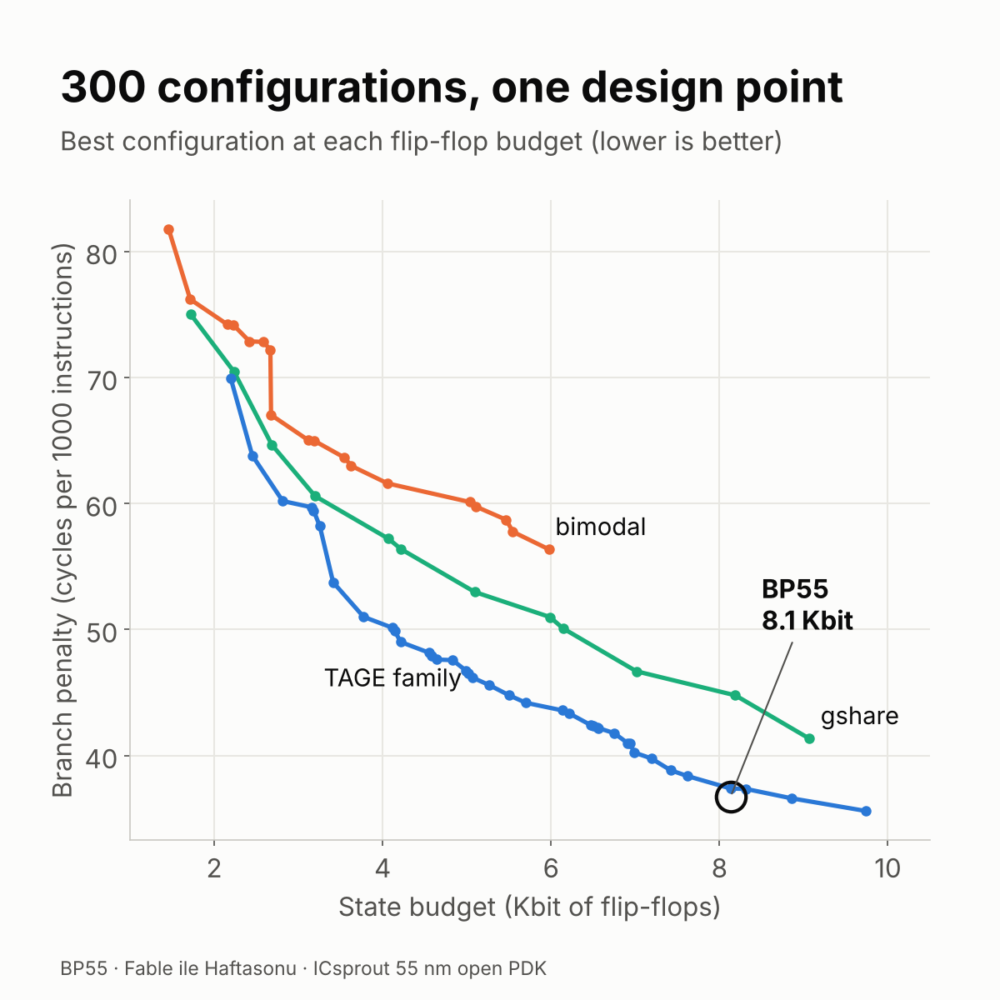

# BP55: a weekend, an open 55 nm PDK, and a branch predictor built without SRAM

*Weekend engineering blog, series "Fable ile Haftasonu" ("A Weekend with Fable").*

The question for this weekend: can a non-trivial digital block be taken from an empty directory to a routed chip layout on a brand-new open 55 nm process, using only open-source tools? And what breaks along the way?

The block is a **branch predictor** for a small RISC-V processor. The answer is "yes, mostly", and the parts that broke are the most interesting part of this post.


> **About the series.** Each post is a weekend-sized engineering project built with Claude Fable, Anthropic's AI model, as the hands-on engineer. The direction and the decisions about scope came from a human; the design, code, runs and write-ups in this repository were produced by the model.

## The short version

- **What:** BP55, a branch prediction unit for a six-stage RV32IM core, taken from RTL to GDSII on the open [ICsprout55](https://github.com/openecos-projects/icsprout55-pdk) 55 nm PDK.
- **The catch:** the PDK has no memory compiler yet, so there is no SRAM. Every table in the predictor is built from individual flip-flops, 8132 of them in total.
- **How well it predicts:** 94.6 % of branch directions correct across 21 programs, which makes the core 22 % faster than one with no prediction at all.
- **How big and how fast:** a 0.43 × 0.43 mm die that closes timing at 161 MHz in the slow corner.
- **How it was checked:** the RTL agrees with a bit-accurate C++ model on every lookup of every trace, with zero mismatches, and the numbers reproduce on a second machine.
- **What it is not:** a finished, sign-off-clean design. No sign-off DRC/LVS, no extracted parasitics, no integration into a real core. See [What this project is not](#what-this-project-is-not).

If you want the long form, read [ARTICLE.md](ARTICLE.md) (English) or [MAKALE.md](MAKALE.md) (Turkish). The detailed engineering report is in [REPORT.md](REPORT.md) (Turkish).

## A two-minute background

**Why a processor needs to guess.** A processor works like an assembly line: it starts fetching the next instructions before the current one has finished. When it meets a branch (an `if`, a loop, a function return), it does not yet know which way the program will go. It can either wait, or guess and keep working. If the guess is right, no time is lost. If it is wrong, the work done on the wrong path is thrown away; on this pipeline that costs 3 clock cycles.

**What a branch predictor is.** It is the part that makes the guess. It remembers what each branch did in the past and uses that to predict what it will do next. Its quality depends almost entirely on how much it can remember.

**Why "no SRAM" matters.** Chips normally store that memory in SRAM, which is very dense. Real predictors use 30 to 250 kilobits of it. This PDK cannot generate SRAM yet, so the only storage element available is the flip-flop, which is far larger per bit: about 0.01 mm² per kilobit once the read and write logic is included. The realistic budget is therefore about 8 kilobits, and the design question becomes: how much accuracy can 8 kilobits of flip-flops buy?

A few terms used below:

| Term | Meaning |
|---|---|
| PDK | Process design kit: the files a chip factory provides so you can design for its process |
| RTL | The hardware description (here SystemVerilog) that the chip is built from |
| GDSII | The final layout file, the geometry that would be sent to the factory |
| MPKI | Mispredictions resolved in EX per 1000 instructions; lower is better. Cheaper 2-cycle corrections made in ID are not counted in MPKI, only in CPI |
| CPI | Clock cycles per instruction; lower is better. Here it counts branch penalties only |
| BTB | Branch target buffer: remembers *where* a branch goes |
| TAGE | A predictor that looks at several different lengths of branch history and picks the best match |

## What was built

BP55 is five small structures working together:


| Component | What it does | Size | Bits |
|---|---|---|---|
| Branch target buffer | Remembers that an address holds a branch and where it jumps | 128 entries, direct mapped; 8-bit tag, 3-bit type, 18-bit target | 3840 |
| TAGE | Predicts taken / not taken from the recent history of branches | 3 tables × 64 entries; 7-bit tag, 3-bit counter, 1 useful bit; histories 5 / 12 / 28 | 2155 |
| Bimodal base predictor | Simple per-branch fallback when TAGE has no match | 512 × 2 bits | 1024 |
| Indirect target cache | Predicts jumps whose target changes (function pointers, `switch`) | 32 entries, 6-bit target history | 870 |
| Return address stack | Predicts where a function returns to | 8 entries | 243 |
| **Total** | | | **8132** |

The target pipeline is IF1, IF2, ID, EX, MEM, WB. Branches resolve in EX, so a misprediction costs 3 cycles; a correction made in ID costs 2.

Having only flip-flops is a limitation, but it also allows some shortcuts that an SRAM-based design cannot take:

- **Prediction in a single cycle.** The tables are small enough that the whole lookup finishes in the first fetch stage. There is no second, slower predictor that overrides the first one, and so no bubble when they disagree.
- **Simple history hashing.** The longest history is 28 bits, so the table indexes are plain XOR trees fed from one history register. Recovering from a misprediction means restoring that one register.
- **Filtered history.** Only conditional branches that the BTB already knows, or that are taken, enter the history. This avoids having to insert history late for instructions the first stage does not yet know are branches. Measured cost against an ideal history: under 0.1 MPKI.
- **No second read port.** 92 bits captured at prediction time travel down the pipeline with the instruction, and the tables are trained from those bits in EX.

The module interface (`rtl/bp55.sv`, current hardened version; the timing contract is spelled out at the top of the file):

| Port group | Purpose |
|---|---|
| `f_pc`, `f_fire`, `f_*` outputs | Lookup in IF1, combinational from `f_pc`. The speculative history and return-stack update happens once, in the cycle `f_fire` says the instruction leaves IF1 |
| `r_fire`, `r_*` | Redirect from ID or EX: restores the 67-bit checkpoint and applies the correct history / stack operation. With no operation it is a plain restore, for traps and interrupts |
| `u_fire`, `u_*` | Table training at EX using the 104-bit lookup metadata |
| `f_busy` | High for 64 cycles after reset while the tables are cleared |

The numbers in this post up to "What went wrong" describe the original weekend version (8132 bits), which is also what the layout was made from. See [After the weekend](#after-the-weekend-review-and-hardening) for what changed since.

## How the weekend went

The work was split into five steps, each small enough to finish and check before starting the next.

1. **Traces.** 21 programs (CoreMark, Embench-IoT and two custom stress tests, about 295 million instructions) were compiled to RV32IM with Clang and run on a small purpose-written instruction-set simulator (`iss/rvsim.c`) that logs every branch and jump. The 18 Embench programs check their own results. CoreMark's check was not active in the original port (its CRCs were verified later with `bench/check_coremark.sh`), and the two custom programs have no reference value.
2. **Model.** The predictor was first written as a bit-accurate C++ model (`sim/bp_model.h`). A sweep of 300 configurations picked the design point; 26 more runs tuned history lengths, tag widths and the reset period.
3. **RTL.** The chosen point was written in SystemVerilog as a single module.
4. **Verification.** The RTL was compiled with Yosys CXXRTL and stepped against the model, lookup by lookup: 63.4 million lookups, 0 mismatches.
5. **Implementation.** Synthesis with Yosys and ABC, place and route with OpenROAD, GDS merge and rendering with KLayout.

## Does it predict well?


| Configuration | Bits | MPKI | Direction accuracy | CPI |
|---|---|---|---|---|
| No prediction | 0 | 81.7 | n/a | 1.269 |
| BTB + bimodal | 5977 | 16.07 | 89.85 % | 1.056 |
| BTB + gshare | 9059 | 10.80 | 93.35 % | 1.041 |
| **BP55** | **8132** | **9.34** | **94.60 %** | **1.037** |
| TAGE, 123 Kbit (SRAM-class reference) | 122952 | 5.73 | 96.44 % | 1.018 |

Against gshare, the usual choice at this size, BP55 makes 13.5 % fewer mispredictions with 10 % fewer bits. The sweep below shows it sitting under the bimodal and gshare curves at every budget above about 2.2 Kbit.



Three honest caveats:

- **The gain over gshare is small on this pipeline.** With a 3-cycle penalty it is worth only 0.4 % in CPI. TAGE pays for its complexity as the penalty grows: with a 12-cycle penalty the CPI is 1.130 against 1.146.
- **The cheapest structures are the most valuable per bit.** Removing the return stack raises MPKI to 10.23; removing the indirect cache raises it to 10.70.
- **Some programs are out of reach.** In `xgboost` and `recurse`, even the 123 Kbit reference barely helps (7 % and 2 % fewer mispredictions). BP55 is slightly behind gshare on `xgboost`, `huffbench` and `depthconv`; for the last two the cause is its 64-entry tagged tables overflowing, for `xgboost` larger tables do not help either.
- **The numbers come from the programs the design was tuned on.** About 370 configurations were evaluated on the same 21 programs that the results are reported on, with no held-out set, and five programs account for most of the gap to gshare. The 12-cycle figures above assume a 4-cycle decode redirect; `sim/penalty_sweep.py` reproduces them from `results/final.csv`.
- **"No prediction" is a weak baseline.** Against a BTB with no direction predictor (CPI 1.214) the speedup is 17 %, not 22 %.

## From netlist to layout

| | Value |
|---|---|
| Die | 430.5 × 430.5 µm (0.185 mm²), 65 % utilisation |
| Cell area, excluding fillers | 0.114 mm² |
| Cells | 81,398 including fillers and taps; 2,596 clock buffers and inverters; 4,024 timing-repair buffers |
| Power grid | MET1 rails, MET4 vertical and MET5 horizontal straps |
| Signal routing | MET2 to MET5, 900 mm of wire, 162,034 vias |
| Router violations / antenna violations | 0 / 0 |
| Clock tree | about 1.2 ns insertion delay and 0.16 ns skew in the slow corner |
| Power, typical corner at 167 MHz | 33 mW (default switching activity) |

Timing of the final layout at a 6.2 ns clock (0.5 ns input and 0.5 ns output budgets):

| Corner | Setup slack | Hold slack |
|---|---|---|
| Slow (1.08 V, 125 °C) | +0.10 ns | 0.00 ns |
| Typical (1.2 V, 25 °C) | +2.47 ns | +0.12 ns |
| Fast (1.32 V, −40 °C) | +3.42 ns | +0.06 ns |

That is 161 MHz in the slow corner and roughly 267 MHz in the typical one, at block level.


More renders are in `pnr/`: [the full die](pnr/layout_full.png), [a close-up](pnr/layout_zoom.png) and [the power grid](pnr/layout_pdn_m4m5.png).

## What went wrong

Most of the weekend's lessons came from the back end.


- **The synthesis timing estimate was badly optimistic.** Synthesis, which ignores wires, predicted a 2.47 ns critical path in the slow corner (clock-to-Q excluded). In the routed layout the critical path is about 4.3 ns including 0.24 ns of clock-to-Q. In flip-flop arrays the address lines fan out to thousands of multiplexers and need deep buffer trees.
- **Clock gating did not survive place and route.** It cut synthesis area by 16 %, but the PDK's Liberty file lacks the clock-gating pin attributes and OpenROAD could not balance the clock tree behind the gating cells. The layout is ungated, so 48 % of the power is flip-flop internal power and 30 % is the clock tree.
- **Buffering is expensive.** Cell area ended 17 % above the synthesis figure. Most of that is timing-repair buffers added during placement and about 2,600 clock-tree cells. Hold repair found 2,314 violating endpoints and inserted 363 hold buffers; the worst of them are on input-to-flop paths.
- **Loosening the clock target did not close timing.** The shipped layout was placed against a tighter target than it is reported at (the placement log shows a 5.0 ns clock), misses 6.0 ns by 0.10 ns and meets 6.2 ns. Re-running the whole flow with a 6.2 ns target missed by 0.15 ns, because the tool optimised less. In this flow it pays to optimise against a tighter clock than the one you intend to check against.
- **One self-inflicted problem.** An early run failed hold repair across nearly every flop. The cause was a constraint that applied the 0.10 ns setup uncertainty to hold checks as well.

The synthesis logs, the clock-gated place-and-route run and the early failing hold run were not kept, so the 2.47 ns, 16 % and early-hold statements above cannot be checked from this repository.

## After the weekend: review and hardening

The weekend version was then handed to independent reviewers: one for the RTL, one for the published numbers, one to reproduce everything on a second machine.

**The numbers reproduce.** On a different machine with a different build of Clang 18, all 273 rows of `results/final.csv` and all 6300 rows of the 300-configuration sweep come out identical.

**The write-up had errors.** Six statements in the first version of this post contradicted the committed logs (the hold-buffer count, what the 4.3 ns refers to, the clock the layout was placed against, and three per-program notes). They are corrected above, and the methodology caveats the audit raised are in the list below. The audit scripts are in `review/audit/`.

**The RTL matched its model, but the interface assumed an ideal pipeline.** The review (`review/rtl/`) proved with directed tests that the block would misbehave in a real core. What was fixed:

| Problem | Fix |
|---|---|
| A lookup held by a stall updated the history and return stack every cycle | `f_fire` input: state advances once, when the instruction leaves IF1 |
| A "not a branch" training message evicted an unrelated BTB entry | Eviction requires the lookup's own hit and a still-matching tag |
| Tables were never reset: X forever in 4-state simulation, random at power-up | 64-cycle clear after reset, signalled on `f_busy`; payload flops still have no reset |
| Training and redirect messages were level-sensitive and counted twice under a stall | Single-cycle `u_fire` / `r_fire` contract |
| 18-bit targets could not leave a 1 MiB region; far indirect calls mispredicted forever | Indirect cache stores full targets; the BTB does not store what it cannot represent |
| A non-branch that aliases a BTB entry cost 0 cycles in the model | The model now charges the 2-cycle decode redirect |

The cost is 391 bits (8132 to 8523, almost all in the indirect cache) and about 13 % more logic before mapping. On the 21 programs nothing changes: 9.340 MPKI, 94.60 %, CPI 1.0367, row for row, because their code fits in 32 KiB and never touches the fixed paths. On a stress run that spreads the same code so that it aliases in the BTB and crosses 1 MiB regions, MPKI drops from 10.11 to 9.53.

The co-simulation now runs every record of every trace with random stalls, flushes, non-branch training messages and random initial state: 294.7 M lookups and 353.8 M compared outputs per run, 0 mismatches in four runs (update delay 0 and 2, normal and stress address layout). Evidence is in `results/v2/`; `verif/run.sh` runs lint and the directed and X-propagation tests.

Work in progress: BP55 inside CVA6 (the baseline is measured, see below), and re-running synthesis and place and route with the logs kept and better IO constraints.

## BP55 inside a real core: CORE-V Wally

Everything above comes from a trace-driven model of a pipeline that does not exist. The next step was to put the hardened RTL into a real open-source core and count cycles. The first core is [CORE-V Wally](https://github.com/openhwgroup/cvw) (commit 3617f2c): scalar, five stages, branches resolved in the execute stage, and a branch predictor that lives in one module and is selected by a parameter. It was built as RV32IM without compressed instructions, which is what BP55 was designed for.

BP55 is added as one more predictor type. The same 21 programs run in RTL simulation (Verilator) on seven builds of the core that differ only in the predictor, 147 runs in all, every one passing its self-check and retiring exactly the instruction count the instruction-set simulator predicts.

| Wally build | Predictor state (bits) | CPI | Redirects per 1000 instr. | Direction mispredictions per 1000 instr. |
|---|---|---|---|---|
| No prediction | 0 | 1.288 | 90.98 | 90.98 |
| Static (backward taken) | 0 | 1.270 | 50.72 | 50.72 |
| Bimodal, BP55-sized | 6915 | 1.174 | 34.50 | 12.50 |
| Local history, BP55-sized | 7555 | 1.176 | 36.10 | 9.72 |
| gshare, BP55-sized | 6925 | 1.169 | 31.80 | 10.92 |
| gshare, Wally's default size | 39438 | 1.147 | 21.35 | 10.66 |
| **BP55** | **8523** | **1.130** | **12.25** | **7.48** |

Figures are pooled over all 21 programs (total cycles over total instructions); per-program tables and unweighted means are in `wally/results/summary.txt`. CPI here is the real thing, including cache misses and load-use stalls, not the branch-only CPI of the trace model.

How to read this, without flattering it:

- **The misprediction penalty in Wally is 2 cycles,** measured, not the 3 the trace model assumed. Speedup over no prediction is 13.9 %, against 22 % in the model.
- **Two quirks of stock Wally inflate BP55's lead.** The benchmarks are built without linker relaxation, so every call is `auipc` + `jalr`; Wally's decoder classifies any `jalr` through the link register as a return, so each such call takes its target from the return stack and is mispredicted. That is 5.8 of the stock predictors' redirects per 1000 instructions. Separately, Wally's BTB has no tags, so at 128 entries ordinary instructions overwrite branch entries.
- **With the call quirk subtracted** (an upper-bound correction: two cycles per return-stack misprediction), BP55 is 2.3 % faster than gshare at the same budget (1.130 against 1.157) and 0.4 % slower than Wally's default gshare (1.130 against 1.135), which has 4.6 times as many bits. Uncorrected, the figures are 3.3 % and 1.4 % faster.
- **Direction mispredictions,** the part least affected by those quirks, fall by 30 % against the default gshare.
- **Per program:** BP55 beats the same-budget gshare on 20 of 21 programs and loses on `xgboost`. Against the default gshare it wins clearly on `interp` (indirect target cache), `coremark` and `nettle-sha256`, and loses on `nsichneu` and `xgboost`.

Checks on the measurement itself:

- With no predictor, Wally's redirect count equals taken branches plus jumps in the control-flow trace, on every program.
- BP55's redirect count in Wally matches a software model of the integration (the bit-accurate predictor model with Wally's update timing) to within 2 out of 3.6 million.
- A fetch is never accepted in the cycle of a redirect, and at most one accepted wrong-path lookup precedes a redirect, so the two limits left open in the hardened RTL are not reached in this core. An assertion checked the first through all runs.
- BP55 needs 412 bits of extra pipeline state in Wally (lookup metadata and checkpoint carried to the execute and memory stages) that the 8523 does not include.

Not exercised: traps, interrupts and CSR flushes (none occur in these programs), and BTB aliasing. Wally's own regression suite was not run on the BP55 build.

`wally/wally.sh sweep` fetches the core, applies the patches in `wally/patches/`, builds everything and runs it; `wally/wally.sh report` prints the tables.

## Second core: CVA6 (baseline so far)

[CVA6](https://github.com/openhwgroup/cva6) is the OpenHW Group's flagship core and a harder target: six stages, branches resolved in the execute stage, and a front end that predicts only after the instruction cache has returned data. The harness in `cva6/` builds the 32-bit `cv32a60x` configuration with compressed instructions off, with its own small testbench (core, one AXI memory, ELF loader, counters), and runs the same 21 programs. BP55 is not wired in yet; these are CVA6's own predictors, measured so that the comparison is ready.

| CVA6 build | Predictor state (bits) | CPI | Mispredictions per 1000 instr. |
|---|---|---|---|
| No dynamic prediction | 0 | 1.615 | 50.72 |
| Stock `cv32a60x` (32-entry BHT, no BTB, 2-entry return stack) | 162 | 1.493 | 26.69 |
| CVA6's own structures enlarged to about BP55's budget | 7464 | 1.438 | 15.90 |

Pooled over the 21 programs; all runs pass and commit exactly the instruction count the instruction-set simulator gives. The measured misprediction penalty is 5 cycles, against 2 in Wally, so prediction quality matters more here. Turning compressed instructions off exposed a bug in that path of CVA6's instruction queue; the one-line fix is in `cva6/patches/`. Details and the integration plan are in `cva6/README.md`; `cva6/cva6.sh sweep` runs everything.

## What this project is not

This is an experiment, not a product. Read this section before relying on any number above.

| Stage | State |
|---|---|
| Architecture and design-space exploration | Done (300 configurations swept) |
| RTL | Done; hardened after review (`verif/run.sh` passes) |
| RTL vs. reference model co-simulation | Passes on the full traces: 294.7 M lookups, 353.8 M output comparisons, 0 mismatches |
| Synthesis (Yosys + ABC) | Done |
| Place and route (OpenROAD) | Done: 0 router violations, 0 antenna violations |
| Timing closure | Closes at 6.2 ns in the slow corner |
| Sign-off DRC / LVS | **Not run** (rule decks are Calibre format) |
| Parasitic extraction | **Not run** (no open extraction rules for this PDK) |
| Gate-level simulation, integration into a core | **Not done** |

- **No sign-off DRC or LVS.** "Zero violations" refers only to the router's own check against the LEF rules, and the router skipped some enclosure rules it does not support (CT, VIA4, T4V2, RV layers). There is no metal fill. The committed `pnr/4_drt_drc.rpt` and `pnr/antenna.rpt` are empty files; the zero counts come from `pnr/3_route.log`.
- **No extracted parasitics.** Timing uses RC estimates from global routing, with one wire model for all three corners and no on-chip variation.
- **The IO constraints are crude.** Input and output delays are set against an ideal clock while the flops see about 1.2 ns of clock insertion delay. The 161 MHz figure and the zero slow-corner hold slack both sit on IO paths and are shaped by that; neither is a bound on the speed inside a core.
- **Frequency is not part of the comparison.** CPI is compared at equal cycle time, and no gshare was laid out to see whether a simpler predictor would clock faster.
- **The 8132 bits exclude pipeline state.** The 92-bit metadata and 67-bit checkpoint carried with each in-flight instruction are not counted.
- **The 123 Kbit reference is a scaled-up BP55,** capped at 64 bits of history and 6 tables, so it understates what an SRAM-based TAGE would do.
- **RTL-level verification only.** The synthesised and routed netlists were not simulated. The original co-simulation covered only the first 300,000 branch records of each trace (about 15 %) and never exercised stalls or flushes; the current one covers the full traces (see below). A lookup in the same cycle as a redirect, and return-stack repair after more than two wrong-path stack operations, are still open.
- **The layout is of the original RTL,** not the hardened one. The hardened version has 8523 flip-flops and about 13 % more logic and has not been placed and routed.
- **Small embedded workloads.** BTB tag aliasing never occurred, so that RTL path is untested, and the tag and target widths were chosen by assumption. The results do not carry over to large code bases.
- **CPI covers branch penalties only**: no cache misses or load-use stalls.
- **The PDK is a preview.** Its maintainers state that it is not fully silicon-proven and must not be used for volume production.

## What the weekend says about the open flow

A weekend is enough to get a useful branch predictor to GDSII on an open 55 nm PDK. It also shows where the open flow at this node is still thin:

1. **A memory compiler** would bring the largest gain. In these measurements a 123 Kbit TAGE removes a further 39 % of mispredictions.
2. **Complete Liberty attributes for the clock-gating cells** would cut both power and area.
3. **Open DRC, LVS and extraction rules** are what it would take to check results like these at sign-off quality.

## Repository map

| Path | Contents |
|---|---|
| `rtl/` | `bp55.sv`, the synthesizable RTL |
| `sim/` | `bp_model.h` (bit-accurate C++ model), `bpsim.cc` (trace driver), `cosim.cc` (RTL vs. model), `summ.py`, sweep lists |
| `iss/` | `rvsim.c`, a minimal RV32IM instruction-set simulator that emits control-flow traces |
| `bench/` | Build script, freestanding runtime, CoreMark port and two custom stress programs |
| `syn/` | Yosys/ABC synthesis scripts and gzipped netlists |
| `pnr/` | OpenROAD scripts, constraints, logs, routed netlist, DEF, final GDSII, layout images |
| `pnr/signoff/` | Timing check of the final layout against 6.0 and 6.2 ns clocks |
| `pnr/run_6p2/` | Logs of a rerun with a 6.2 ns target (did not close; kept for reference) |
| `results/` | CSV results of all sweeps, co-simulation logs, charts |
| `linkedin/` | Square images and post drafts |
| `ARTICLE.md` | Full write-up in English |
| `MAKALE.md`, `REPORT.md` | Article and detailed engineering report in Turkish |

Large outputs are gzipped: `pnr/bp55.gds.gz` (final GDSII), `pnr/5_final.def.gz`, `pnr/5_final.v.gz`, `syn/tt_cg.v.gz`, `syn/tt_nocg.v.gz`.

Not in the repository, because they are third-party or can be regenerated: the PDK, the CoreMark and Embench-IoT sources, the branch traces (about 485 MB), compiled binaries and OpenROAD databases.

## Reproducing the results

### Tools

| Tool | Version used | Install |
|---|---|---|
| Clang + LLD with the RISC-V target | 18.1 | distribution package |
| GCC or Clang (host) | any recent | distribution package |
| Python 3 with NumPy and Matplotlib | 3.13 | `pip install numpy matplotlib` |
| Yosys | 0.71 | `pip install pyosys` |
| OpenROAD | 26Q3 | `nix build nixpkgs#openroad` |
| KLayout (Python module) | 0.30 | `pip install klayout` |

The scripts contain absolute paths under `/home/user/bp55` and a Nix store path for OpenROAD. Adjust them to your checkout before running.

### 1. Fetch the PDK and benchmarks

```bash
git clone --depth 1 https://github.com/openecos-projects/icsprout55-pdk pdk
```

Download the RVT Liberty and GDS archives from the PDK's release page (`ics55_LLSC_H7CR_liberty.tar.bz2`, `ics55_LLSC_H7CR_gds.tar.bz2`) and unpack them under `pdk/IP/STD_cell/ics55_LLSC_H7C_V1p10C100/ics55_LLSC_H7CR/liberty` and `.../gds`.

```bash
git clone --depth 1 https://github.com/eembc/coremark bench/coremark
```

```bash
git clone --depth 1 https://github.com/embench/embench-iot bench/embench-iot
```

### 2. Build the benchmarks and generate traces

```bash
gcc -O2 -o iss/rvsim iss/rvsim.c
```

```bash
cd bench && GSF=4 CM_IT=60 ./build.sh
```

Every program should report `exit=0`. `wikisort` is skipped because it needs floating point.

### 3. Run the predictor model

```bash
cd sim && g++ -O2 -std=c++17 -o bpsim bpsim.cc
```

```bash
./bpsim BP55 LB=7 LBIM=9 LI=5 HT=6 NT=3 LT=6 TT=7 hist=5,12,28 -- ../traces/*.trc > bp55.csv && python3 summ.py bp55.csv
```

`run.sh` runs a list of configurations in parallel; `grid.txt` is the 300-configuration sweep.

### 4. Co-simulate RTL against the model

```bash
cd syn && python3 y.py "read_verilog -sv ../rtl/bp55.sv; hierarchy -top bp55; proc; flatten; opt; memory -nomap; opt; write_cxxrtl ../sim/bp55_rtl.cc"
```

```bash
cd sim && g++ -O2 -std=c++17 -I"$(python3 -c 'import pyosys,os;print(os.path.dirname(pyosys.__file__))')/share/include/backends/cxxrtl/runtime" -o cosim cosim.cc
```

```bash
./cosim 300000 0 1 ../traces/*.trc
```

Arguments: records per trace, table-update delay in branches, and whether to look up non-branch PCs as well. The run ends with `PASS` or `FAIL`.

### 5. Synthesize

Link the typical and slow Liberty files into `syn/` as `tt.lib` and `ss.lib`, then:

```bash
cd syn && ./synth.sh tt_nocg tt.lib 2500 0
```

The last argument enables clock gating (`1`) or not (`0`). The layout uses the ungated netlist; see [What went wrong](#what-went-wrong).

### 6. Place and route

```bash
cd pnr && openroad -exit 1_place.tcl && openroad -exit 2_cts.tcl && openroad -exit 3_route.tcl
```

```bash
python3 def2gds.py && python3 render.py
```

The flow takes about 40 minutes on four cores. `pnr/2_cts_route.tcl` is an earlier combined script; its log, `pnr/2_cts_route.log`, is the clock-tree log of the shipped layout. The committed `pnr/1_place.log` was produced with a 5.0 ns clock, not the 6.0 ns in the committed `pnr/bp55.sdc`, so the committed constraint file does not reproduce it exactly.

## License

No license has been chosen for this repository yet. The PDK is Apache 2.0; CoreMark and Embench-IoT carry their own licenses and are not redistributed here.

## References

1. [ICsprout 55 nm Open Source PDK documentation](https://icsprout55-pdk-en.readthedocs.io/en/latest/)
2. A. Seznec, P. Michaud, "A case for (partially) TAgged GEometric history length branch prediction," Journal of Instruction-Level Parallelism, 2006.
3. S. McFarling, "Combining Branch Predictors," DEC WRL Technical Note TN-36, 1993.
4. [EEMBC CoreMark](https://github.com/eembc/coremark) and [Embench-IoT](https://github.com/embench/embench-iot)
5. T. Ajayi et al., "Toward an Open-Source Digital Flow: First Learnings from the OpenROAD Project," DAC 2019.
6. [Yosys Open SYnthesis Suite](https://yosyshq.net/yosys/)
