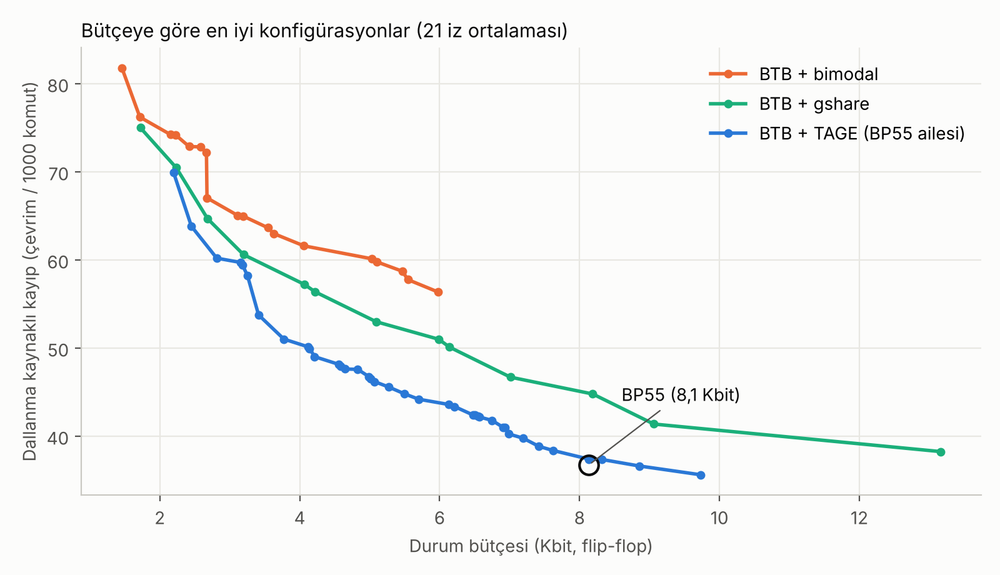
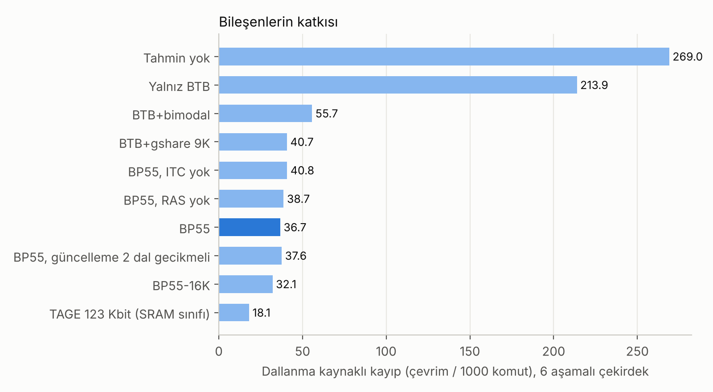
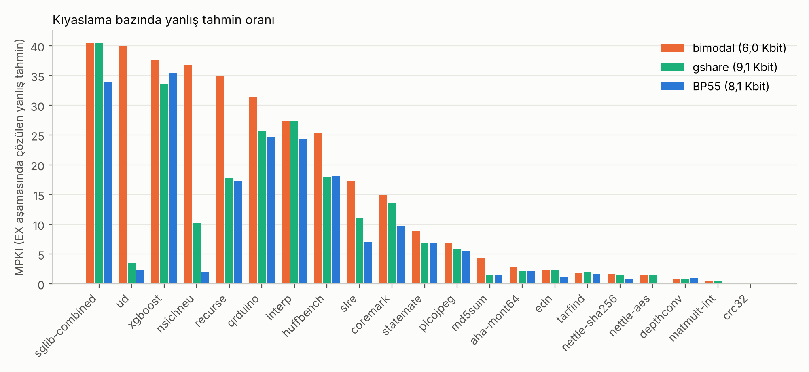

# BP55 — ICsprout 55 nm açık PDK'sı için dallanma tahmin birimi

## 1. 55 nm PDK açık mı?

Evet. **ICsprout55**, Ekim 2025'te Apache 2.0 lisansıyla yayımlandı; depo `openecos-projects/icsprout55-pdk`.
Depoyu klonlayıp içeriğini doğruladım (son commit 30 Ekim 2026):

| İçerik | Durum |
|---|---|
| Standart hücreler (`ics55_LLSC_H7C`, 7‑track, HVT/RVT/LVT) | Var: her VT için 747 hücre; Liberty (7 köşe), LEF, CDL, Verilog, GDS |
| IO kütüphanesi, DRC/LVS kuralları, cihaz modelleri | Var |
| **SRAM / bellek derleyicisi, PLL** | **Yok** (yol haritasında) |
| Olgunluk | Proje kendi belgesinde "preview release" diyor |

Tasarımı belirleyen kısıt SRAM'in olmaması: tahminleyicinin bütün tabloları flip‑flop dizisi olmak zorunda.
En küçük flop (`DFFQX0P5H7R`) 6,16 µm², yani 1 Kbit durum okuma/yazma mantığıyla birlikte yaklaşık 0,01 mm².
Bu yüzden bütçeyi ~8 Kbit'te tuttum; SRAM tabanlı tasarımlardaki 30–250 Kbit burada gerçekçi değil.

## 2. Hedef işlemci ve varsayımlar

- RV32IM, tek komut/çevrim, sıralı (in‑order), 6 aşama: IF1 · IF2 · ID · EX · MEM · WB.
- Dallanma EX'te çözülür: yanlış tahmin cezası **3 çevrim**. ID'den yeniden yönlendirme (BTB'de olmayan `jal`, tahmini alınan dal) **2 çevrim**.
- Tahmin IF1'de tek çevrimde yapılır; doğru tahmin edilen alınan dalda boşluk (bubble) yoktur.

## 3. Mimari

| Bileşen | Boyut | Bit | Görev |
|---|---|---|---|
| BTB | 128 giriş, doğrudan eşlemeli: geçerli + 8 bit etiket + 3 bit tür + 18 bit hedef | 3840 | IF1'de "bu PC dallanma mı, hedefi ne" |
| Bimodal | 512 × 2 bit | 1024 | TAGE taban tahmini |
| TAGE | 3 tablo × 64 giriş × (7 bit etiket + 3 bit sayaç + 1 bit u); geçmiş 5 / 12 / 28 | 2112 (+43 denetim) | Yön tahmini |
| ITC | 32 giriş × (geçerli + 8 bit etiket + 18 bit hedef), 6 bit hedef geçmişi | 870 | Dolaylı atlamalar (switch, fonksiyon işaretçisi) |
| RAS | 8 × 30 bit | 243 | Dönüş adresleri |
| **Toplam** | | **8132** | |

Önemli tasarım kararları:

- **Tek çevrim, override yok.** Tablolar küçük ve flop tabanlı olduğu için bütün arama tek çevrime sığıyor (bkz. §6); iki kademeli tahminleyicinin ek boşluğu ve karmaşıklığı gerekmiyor.
- **Katlanmış geçmiş kombinasyonel.** Geçmiş en fazla 28 bit olduğundan indeks/etiket katlaması doğrudan GHR'den XOR ağacıyla üretiliyor; yanlış tahminde yalnızca GHR'yi geri yüklemek yetiyor.
- **Süzülmüş geçmiş.** GHR'ye yalnızca BTB'de bulunan ya da alınan koşullu dallar girer. Bu, IF1'de bilinmeyen dallar için geç geçmiş ekleme sorununu ortadan kaldırıyor; ideal "her dal" geçmişine göre kayıp 0,1 MPKI'nin altında.
- **Flop dizisinin getirisi.** `u` bitlerinin periyodik sıfırlanması tek çevrimde yapılıyor; yük bitlerinde reset yok (küçük flop), yazma izinleri saat kapılama hücresine (ICG) çevriliyor.
- **Onarım.** Her aramada 67 bitlik denetim noktası (GHR, hedef geçmişi, RAS işaretçisi + tepe girişi) alınır; yeniden yönlendirmede geri yüklenir. Eğitim, aramada yakalanan 92 bitlik meta veriyle EX'te yapılır, ikinci okuma kapısı gerekmez.

RTL: `rtl/bp55.sv` (~270 satır). Bit‑doğru referans model: `sim/bp_model.h`.

## 4. Yöntem

1. **İş yükleri:** CoreMark, Embench‑IoT'tan 18 program, ve dolaylı atlama / çağrı‑dönüş davranışını zorlamak için yazdığım iki program (`interp`, `recurse`). Clang ile RV32IM'e derlendi.
2. **İz üretimi:** kendi yazdığım RV32IM komut kümesi simülatörü (`iss/rvsim.c`). 21 programın hepsi kendi doğrulamasından geçti. Toplam ~300 M komut, ~42 M dallanma.
3. **Model:** izle sürülen C++ simülatörü; her dal için boru hattı cezasını (0 / 2 / 3 çevrim) hesaplar. Dallanma olmayan PC'ler de BTB'ye sorulur.
4. **Tarama:** BTB / bimodal / TAGE / ITC boyutları üzerinde 300 konfigürasyon, ardından seçilen nokta çevresinde 26 ince ayar.
5. **RTL doğrulama:** Yosys CXXRTL ile RTL ↔ model ko‑simülasyonu.
6. **Sentez:** Yosys + ABC, ICsprout55 RVT Liberty.

Metrik: MPKI = 1000 komut başına EX'te çözülen yanlış tahmin. "Kayıp" = 1000 komut başına dallanma kaynaklı ek çevrim (3·yanlış tahmin + 2·ID yönlendirmesi).

## 5. Performans

### 5.1 Özet (21 izin aritmetik ortalaması)

| Konfigürasyon | Bit | MPKI | Yön doğruluğu | Kayıp (çevrim/kI) | CPI |
|---|---|---|---|---|---|
| Tahmin yok | 0 | 81,7 | — | 269,0 | 1,269 |
| Yalnız BTB (128) | 4083 | 71,0 | — | 213,9 | 1,214 |
| BTB + bimodal + RAS + ITC | 5977 | 16,07 | %89,85 | 55,7 | 1,056 |
| BTB + gshare + RAS + ITC | 9059 | 10,80 | %93,35 | 40,7 | 1,041 |
| **BP55** | **8132** | **9,34** | **%94,60** | **36,7** | **1,037** |
| BP55, 16 Kbit ölçeği | 17044 | 8,51 | %95,16 | 32,1 | 1,032 |
| TAGE, 123 Kbit (SRAM sınıfı, referans) | 122952 | 5,73 | %96,44 | 18,1 | 1,018 |

- Tahminsiz çekirdeğe göre **%22 daha hızlı** (CPI 1,269 → 1,037). Yön tahmini olmayan yalnızca BTB'li tabana (CPI 1,214) göre hızlanma %17'dir.
- Bimodal'e göre MPKI %42 düşük; gshare'e göre %10 daha az bitle MPKI %13,5 düşük.
- Kısa boru hattında gshare'e göre CPI farkı küçük (%0,4). Ceza büyüdükçe fark açılıyor: EX cezası 12 çevrim olan bir çekirdekte CPI 1,146'ya karşı 1,130 (4 çevrimlik çözme yönlendirmesi varsayımıyla; `sim/penalty_sweep.py` ile yeniden üretilir).
- Alınan dalların %90,5'i sıfır boşlukla tahmin ediliyor.



### 5.2 Bileşen katkısı

| Değişiklik | MPKI | Kayıp (çevrim/kI) |
|---|---|---|
| BP55 | 9,34 | 36,7 |
| ITC yok (−870 bit) | 10,70 | 40,8 |
| RAS yok (−243 bit) | 10,23 | 38,7 |
| BTB 64 giriş (−1920 bit) | 9,52 | 42,7 |
| Tablo güncellemesi 2 dal gecikmeli | 9,59 | 37,6 |

Güncelleme gecikmesine duyarlılık düşük, yani EX'te eğitim yeterli. Bit başına en verimli bileşen RAS, sonra ITC.



### 5.3 Kıyaslama bazında



| Program | Tahminsiz MPKI | bimodal | gshare 9K | BP55 | TAGE 123K | BP55 hızlanma (tahminsize göre) |
|---|---|---|---|---|---|---|
| coremark | 105,5 | 14,85 | 13,66 | 9,80 | 3,24 | 1,29× |
| nsichneu | 79,8 | 36,74 | 10,17 | 2,02 | 0,33 | 1,10× |
| slre | 116,5 | 17,33 | 11,13 | 7,03 | 1,34 | 1,31× |
| ud | 57,1 | 39,97 | 3,51 | 2,39 | 0,22 | 1,19× |
| huffbench | 124,5 | 25,41 | 17,96 | 18,13 | 7,97 | 1,34× |
| sglib-combined | 114,4 | 40,49 | 40,50 | 33,95 | 16,58 | 1,24× |
| qrduino | 51,7 | 31,41 | 25,77 | 24,65 | 19,40 | 1,11× |
| xgboost | 46,5 | 37,59 | 33,62 | 35,48 | 33,15 | 1,10× |
| interp | 54,2 | 27,41 | 27,39 | 24,28 | 13,06 | 1,21× |
| tarfind | 198,4 | 1,72 | 1,96 | 1,68 | 1,61 | 1,59× |

Tam tablo `results/final.csv` içinde. Gözlemler:

- `xgboost` ve `recurse` programlarında 123 Kbit TAGE bile yardımcı olmuyor (%7 ve %2 azalma); `qrduino`'da ise %21 azaltıyor. Burada kazanç tahminleyiciden değil, dalsız kodlamadan gelir.
- `xgboost`, `huffbench` ve `depthconv`'da BP55, gshare'in hafifçe gerisinde: `huffbench` ve `depthconv`'da 64 girişli etiketli tablolar taşıyor; `xgboost`'ta daha büyük tablolar da yardımcı olmuyor.
- Tasarım noktası, sonuçların raporlandığı aynı 21 programda, ayrılmış test kümesi olmadan yaklaşık 370 yapılandırma arasından seçildi; gshare'e farkın çoğu beş programdan geliyor.
- `nsichneu`'da BP55'in MPKI'si çok düşük ama CPI kaybı yüksek (129 çevrim/kI): program binlerce farklı daldan oluşuyor, 128 girişli BTB yetmiyor ve dallar ID'den yönlendiriliyor.
- Kalan yanlış tahminlerin dağılımı: koşullu %80, dolaylı atlama/çağrı %19, dönüş %1.

## 6. Fiziksel sonuçlar (ICsprout55, RVT, sentez sonrası)

| | Değer |
|---|---|
| Flip‑flop | 8132 (7920 resetsiz, 212 resetli) |
| Hücre alanı, saat kapılamasız | 97 247 µm² |
| **Hücre alanı, saat kapılamalı (364 ICG)** | **81 627 µm² ≈ 0,082 mm²** (flop %62, mantık %35, ICG %3) |
| Kritik yol, TT 1,2 V 25 °C | 1,33 ns (`f_pc` → BTB/TAGE okuma → meta) |
| Kritik yol, SS 1,08 V 125 °C | 2,47 ns (`ghr` → TAGE → `f_taken`) |

%70 yerleşim yoğunluğuyla yaklaşık 0,12 mm². Zamanlama rakamları yalnızca kombinasyonel gecikmedir: tel yükü, flop clk‑to‑Q/setup ve sonraki‑PC çoklayıcısı dahil değil.
İlk sürümde buradan SS'de 250–280 MHz, TT'de ~450 MHz tahmin etmiştim; **bu tahmin iyimserdi.** Yerleştirme‑yönlendirme sonrası rakamlar §8'da: blok düzeyinde SS'de 161 MHz (6,2 ns), TT'de ~267 MHz.

## 7. Doğrulama durumu

| Adım | Sonuç |
|---|---|
| ISS doğruluğu | 21 programın tamamı kendi sonuç denetiminden geçti |
| RTL ↔ model, anında güncelleme | 63,4 M arama (iz başına ilk 300 K dal + aradaki tüm PC'ler), **0 uyuşmazlık** |
| RTL ↔ model, 2 dal gecikmeli güncelleme | 63,4 M arama, **0 uyuşmazlık** |
| Sentez | Yosys/ABC ile hatasız eşlendi |

Yapılmayanlar ve sınırlar:

- **Kapı seviyesi simülasyon yok.** Sentezlenmiş ve yönlendirilmiş netlistler simüle edilmedi; işlevsel doğrulama RTL düzeyindedir. (Yerleştirme‑yönlendirme sonradan yapıldı, bkz. §8.)
- **Hafta sonu sürümü çekirdeğe entegre edilmedi.** Ko‑simülasyon izle sürülüyordu; yanlış yoldaki (wrong‑path) aramalar ve onarımın gerçek boru hattı zamanlaması denenmedi. Bu sonradan yapıldı: sağlamlaştırılmış RTL Wally ve CVA6'nın içinde ölçüldü (bkz. §9).
- **BTB çakışması hiç tetiklenmedi.** Programlar küçük (en fazla onlarca KB) olduğundan etiket çakışması ve "hayalet dal" yolu 0 kez çalıştı; bu RTL yolu test edilmemiş sayılmalı. Aynı nedenle 8 bit etiket ve 18 bit hedef genişliği ölçümle değil varsayımla seçildi.
- **İş yükleri gömülü sınıf.** Sonuçlar SPEC benzeri büyük kod tabanlarına taşınmaz; orada BTB ve tablo boyutları yetersiz kalır.
- CPI yalnızca dallanma kaybını içerir; önbellek ıskaları ve load‑use beklemeleri yok.

## 8. Fiziksel tasarım (yerleştirme‑yönlendirme)

Araçlar: OpenROAD 26Q3 (nixpkgs), KLayout 0.30 (DEF + hücre GDS birleştirme ve görseller). Akış: `pnr/1_place.tcl` → `pnr/2_cts_route.tcl` (yalnız saat ağacı kısmı) → `pnr/3_route.tcl` → `pnr/def2gds.py`.

| | Değer |
|---|---|
| Kalıp (die) | 430,5 × 430,5 µm = **0,185 mm²** |
| Çekirdek alanı / doluluk | 0,176 mm² / %65 (dolgu hücreleri hariç) |
| Hücre alanı (dolgu hariç) | 113 653 µm² (sentez: 97 247 µm²; fark saat ağacı, hold ve zamanlama tamponları) |
| Hücre sayısı | 81 398 (dolgu ve tap dahil); 8132 flop, 2596 saat tamponu/evirici, 4024 zamanlama onarım tamponu |
| Güç ağı | MET1 raylar, MET4 dikey + MET5 yatay şeritler (0,6 µm, 28 µm aralık) |
| Sinyal yönlendirme | MET2–MET5, toplam tel 900 mm, 162 034 via |
| Yönlendirici kural ihlali | **0** |
| Anten ihlali | **0** |
| Saat ağacı | gecikme ~1,2 ns (SS), skew ~0,16 ns |
| Güç (TT, 167 MHz, varsayılan aktivite) | 33 mW; %48 flop iç gücü, %30 saat ağacı |

Zamanlama (6,0 ns saat, giriş/çıkış bütçesi 0,5 + 0,5 ns, setup belirsizliği 0,10 ns):

| Köşe | Setup payı | Hold payı |
|---|---|---|
| SS, 1,08 V, 125 °C | **−0,10 ns** (`f_taken` çıkışı) | +0,02 ns |
| TT, 1,2 V, 25 °C | +2,26 ns | +0,12 ns |
| FF, 1,32 V, −40 °C | +3,22 ns | +0,06 ns |

Buna göre blok düzeyinde SS'de 6,2 ns (161 MHz) ile kapanıyor; TT'de ~3,7 ns (267 MHz). SS'deki kritik yol flop → çıkış yoludur ve 1,2 ns'lik saat ağacı gecikmesini içerir; çıkışı yakalayan PC flop'u aynı ağaçta olacağı için çekirdeğe gömüldüğünde bu yol kısalır.

Akış sırasında ortaya çıkanlar:

- **Saat kapılama fiziksel tasarımda kullanılamadı.** PDK Liberty dosyasında ICG hücrelerinin `clock_gate_*` pin öznitelikleri yok; OpenROAD saat ağacını ICG'lerin arkasına dengeleyemedi (saat gecikmesi 2,4 ns, kapanmayan hold ihlalleri). Layout saat kapılamasız netlistle yapıldı. Bedeli: +%19 hücre alanı ve yüksek güç (flop'lar her çevrim saatleniyor).
- **Sentez zamanlaması yanıltıcıydı.** ABC'nin telsiz 2,47 ns'lik SS tahmini (saat‑çıkış gecikmesi hariç), yönlendirilmiş layoutta saat‑çıkış gecikmesi dahil ~4,3 ns'ye çıktı: flop dizilerinin adres hatları binlerce çoklayıcıyı sürüyor ve derin tampon ağaçları gerektiriyor.
- Hold onarımı 2.314 ihlalli uç nokta buldu ve 363 hold tamponu ekledi; en kötüleri giriş‑flop yollarında. Alan artışının çoğu yerleştirme sırasındaki zamanlama onarım tamponlarından ve saat ağacı hücrelerinden geliyor.

Fiziksel tasarımın sınırları:

- **İmza (sign‑off) DRC ve LVS çalıştırılmadı.** PDK'nın kural dosyaları Calibre formatında; açık kaynak karşılığı yok. "0 ihlal" yalnızca yönlendiricinin LEF kurallarına göre denetimidir.
- **Parazit çıkarımı yok.** PDK'da OpenRCX kural dosyası bulunmadığından zamanlama, global yönlendirme tabanlı RC tahminiyle raporlandı; detaylı yönlendirme sonrası gerçek çıkarım değil.
- Layout 6,0 ns hedefini SS'de 0,10 ns ile kaçırıyor (yerleştirme günlüğü, yerleşimin 5,0 ns saatle yapıldığını gösteriyor; depodaki `bp55.sdc` 6,0 ns); **6,2 ns saatle (161 MHz) tüm köşelerde kapanıyor** (aşağıdaki "6,2 ns denemesi" bölümü). SS hold payı 6,2 ns'de de yalnızca ~0,00 ns; pay yok denecek kadar az.
- IR düşümü ve elektromigrasyon analizi yapılmadı; güç rakamı varsayılan anahtarlama aktivitesiyle.

### 6,2 ns denemesi

Saat hedefini 6,2 ns'ye gevşetip akışı baştan koşturmak sorunu **çözmedi**: araç daha gevşek hedefe göre daha az optimize etti ve SS'de yine açık kaldı.

| Koşu | SS setup payı | SS hold payı | TT setup payı | Yönlendirici / anten ihlali |
|---|---|---|---|---|
| 6,0 ns hedefiyle optimize, 6,0 ns'de denetim | −0,10 ns | +0,02 ns | +2,26 ns | 0 / 0 |
| 6,2 ns hedefiyle optimize, 6,2 ns'de denetim (`pnr/run_6p2/`) | −0,15 ns | +0,02 ns | +2,38 ns | 0 / 0 |
| **6,0 ns hedefiyle optimize, 6,2 ns'de denetim** (`pnr/signoff/`) | **+0,10 ns** | 0,00 ns | +2,47 ns | 0 / 0 |

Her iki koşuda da kalan tek ihlal `f_taken` çıkışıdır; onarım hedefin ~0,1 ns gerisinde duruyor. Bu yüzden nihai layout olarak 6,0 ns hedefiyle üretilen sürüm korundu (depodaki GDS/DEF/netlist) ve 6,2 ns saatle yeniden zamanlandı. Yeniden zamanlama, yönlendirilmiş DEF'in yerleşimi üzerinde global yönlendirmenin baştan koşturulmasıyla yapıldı; 6,0 ns'deki −0,10 ns sonucu aynen yeniden üretildi. Pratik kural: bu akışta imza saatinden daha sıkı bir hedefle optimize etmek gerekiyor; ne kadar sıkı olması gerektiği ayrıca ölçülmedi. Not: giriş/çıkış gecikmeleri ideal saate göre tanımlı, flop'lar ise ~1,2 ns saat ağacı gecikmesi görüyor; 161 MHz ve sıfır hold payı bu kısıttan etkileniyor.

Çıktılar: `pnr/bp55.gds` (son GDSII), `pnr/5_final.def`, `pnr/5_final.v`, `pnr/layout_full.png`, `pnr/layout_zoom.png`, `pnr/layout_pdn_m4m5.png`.

## 9. Hafta sonundan sonra: gözden geçirme, sağlamlaştırma, gerçek çekirdekler

§1–§8 hafta sonu sürümünü (8132 bit) anlatıyor; oradaki layout da o sürüme ait. Sonrasında yapılanlar:

**Gözden geçirme.** Bağımsız gözden geçiriciler sonuçları ikinci bir makinede yeniden üretti (`results/final.csv` 273 satır ve 300 yapılandırmalı tarama 6300 satır, birebir aynı), metinde günlüklerle çelişen altı ifade buldu (bu belgede düzeltildi; betikler `review/audit/`) ve RTL arayüzünün ideal bir boru hattı varsaydığını yönlendirilmiş testlerle gösterdi (`review/rtl/`).

**Sağlamlaştırılmış RTL (8523 bit).**

| Sorun | Düzeltme |
|---|---|
| Duraklamayla bekletilen arama geçmişi ve dönüş yığınını her çevrim güncelliyordu | `f_fire` girişi: durum, komut IF1'den çıkarken bir kez ilerler |
| "Dal değil" eğitim iletisi ilgisiz bir BTB girişini siliyordu | Silme için aramanın kendi isabeti ve hâlâ eşleşen etiket gerekir |
| Tablolar hiç sıfırlanmıyordu | Sıfırlamadan sonra 64 çevrimlik temizlik, `f_busy` ile bildirilir |
| Eğitim ve yönlendirme iletileri seviye duyarlıydı, duraklamada iki kez sayılıyordu | Tek çevrimlik `u_fire` / `r_fire` |
| 18 bitlik hedefler 1 MiB'lik bölgeden çıkamıyordu | Dolaylı önbellek tam hedef saklar; BTB temsil edemediğini saklamaz |
| BTB girişiyle çakışan dal olmayan komut modelde 0 çevrimdi | Model 2 çevrimlik kod çözme yönlendirmesini sayıyor |

Bedel 391 bit ve eşleme öncesinde yaklaşık %13 daha fazla mantık. 21 programda sonuç satır satır aynı (9,340 MPKI, %94,60, CPI 1,0367). Ko‑simülasyon artık bütün kayıtları rastgele duraklama, boşaltma ve rastgele başlangıç durumuyla koşturuyor: koşu başına 294,7 M arama, 353,8 M karşılaştırılan çıkış, dört koşuda 0 uyuşmazlık (`results/v2/`, `verif/run.sh`). Açık kalan iki sınır: yönlendirme çevriminde arama ve ikiden fazla yanlış yol yığın işleminden sonra dönüş yığını onarımı.

**Fiziksel akış, ikinci geçiş** (günlükler `syn/run_local/`, `syn/run_v2/`, `pnr/run_*/`; betikler `pnr/flow/`). Yeni `pnr/bp55.sdc`: port grubu başına bütçe, saat ağacından sonra gerçek flop saat pinine göre giriş/çıkış gecikmesi, zamanlanan sıfırlama. Eski kısıtlar `pnr/bp55_legacy.sdc`.

| | Hafta sonu layoutu (yayımlanan) | Hafta sonu RTL'si, yeni kısıt | Sağlamlaştırılmış RTL, yeni kısıt |
|---|---|---|---|
| Kalıp | 430,5² µm | 431,9² µm | 444,0² µm |
| Hücre alanı (dolgusuz) | 113.653 µm² | 120.852 µm² | 129.923 µm² |
| Hold ihlalli uç nokta / hold tamponu | 2.314 / 363 | 0 / 0 | 0 / 0 |
| 6,0 ns'de SS kurulum payı | | +0,019 ns | −0,157 ns |
| Hold payı SS / TT / FF | 0,00 / +0,12 / +0,06 | +0,19 / +0,08 / +0,03 | +0,18 / +0,07 / +0,03 |
| SS'de karşıladığı periyot | 6,2 ns (kaba G/Ç bütçesi) | 5,98 ns | 6,16 ns |
| Güç, TT, varsayılan aktivite | 33 mW | 33,0 mW | 34,4 mW |

- Sağlamlaştırma yaklaşık %7 hücre alanına ve 0,18 ns'ye mal oluyor. Kritik yol iki sürümde de aynı: `f_pc` → TAGE indeks karması → tablo okuma → etiket karşılaştırma → sağlayıcı seçimi → `f_taken`. Flop‑flop yollarında 1 ns'den fazla pay var.
- §8'deki hold sorunu G/Ç kısıtından geliyordu: yeni kısıtla hiç hold onarımı gerekmedi.
- Hafta sonu layoutu yeni kısıtla 6,0 ns'yi 1,04 ns kaçırıyor (yaklaşık 7,0 ns). Kendi kısıtıyla 6,2 ns'de hâlâ geçiyor; ama aynı netlist bu makinedeki OpenROAD (Aralık 2024) ile yeniden koşturulunca ancak 6,52 ns'de kapanıyor.
- Sentez rakamları yeniden üretildi: saat kapılama her iki sürümde alanı %16,4 düşürüyor (81.840'a karşı 97.884; 86.627'ye karşı 103.593 µm²). "Sentezde 2,47 ns" ABC'nin kendi tahminiymiş; aynı netlistin telsiz STA'sı 3,85 ns veriyor.
- Metal dolgu: OpenROAD `density_fill`, kurallar `pnr/flow/fill_rules.json`. Dolgudan önce üst metalde 64 pencerenin 64'ü, MET5'te yaklaşık yarısı alt sınırın altındaydı; dolgudan sonra hiçbir katmanda yok, komşu pencere farkı en çok 7 puan (sınır 20). Birleştirilmiş GDS üzerindeki geometri denetimi 0 ihlal veriyor.
- Sınırlar: zamanlama, yönlendirilmiş tel uzunluklarından LEF değerleriyle hesaplanan kuplajsız toplu RC'ye dayanıyor (dolgunun zamanlamaya etkisi modellenmiyor); LEF'te anten kuralı olmadığı için anten denetimi anlamsız; saat kapılamalı layoutlar aşağıda ayrıca anlatılıyor; büyük çıktılar (DEF, GDS, SPEF) depoda değil, `pnr/flow/run.sh` ile yeniden üretiliyor.

**Sonradan düzeltme (SPEF adları).** `pnr/flow/def2spef.py` bazı veri yolu bitlerini zamanlayıcının eşleştiremediği biçimde adlandırıyordu; netlerin yaklaşık %22'si (sağlamlaştırılmış layoutta 37.127 netin 8.112'si) tel yükü olmadan zamanlanmıştı. Kapı düzeyi benzetim çalışması bunu buldu. Adlar düzeltilip üç layout yeniden zamanlandığında tablodaki kurulum payları değişmedi (kritik yollar bu netlerden geçmiyor); sağlamlaştırılmış layoutta SS hold payı 0,183'ten 0,209 ns'ye çıktı. Aşağıdaki çıkarım koşuları adları zaten düzeltiyordu, etkilenmedi.

**Parazitik çıkarım** (`rcx/`). PDK'da çıkarım kuralı ve kalınlık bilgisi yok; kural kümesi PDK'nın verdikleriyle (katman sırası, malzeme, tabaka direnci, 0,9x küçültme, metal direnç modeli) ve varsayılan bir kesitle üretildi: 2B alan çözücü (`rcx/solver/`) OpenRCX'in 1184 kalibrasyon deseni için kapasitansı hesaplıyor, OpenRCX kurallarını buna oturtuyor, layoutlar üç köşede kuplajla çıkarılıyor.

| Layout, kısıt, saat | SS kurulum payı: tahmin | SS kurulum payı: çıkarım | Çıkarımla hold SS / TT / FF |
|---|---|---|---|
| Hafta sonu layoutu, eski kısıt, 6,2 ns | +0,09 | +0,99 | +0,17 / +0,10 / +0,05 |
| Hafta sonu layoutu, yeni kısıt, 6,2 ns | −1,30 | +0,02 | +0,11 / +0,08 / +0,03 |
| Hafta sonu RTL'si yeniden, yeni kısıt, 6,0 ns | −0,16 | +0,52 | +0,10 / +0,08 / +0,03 |
| Sağlamlaştırılmış RTL, yeni kısıt, 6,0 ns | −0,42 | +0,46 | +0,17 / +0,08 / +0,03 |

- Tahmin kötümsermiş: her tele 0,19 fF/µm yüklüyor, çıkarılan ortalama yaklaşık 0,13 (katmanlar %18–25 dolu). Sağlamlaştırılmış layoutta 169 pF (yüzde 79'u kuplaj) çıkarım, 238 pF tahmin. Tel direnci tahminin 1,6–1,7 katı.
- Yukarıdaki ikinci geçiş tablosu üçüncü, daha basit bir yöntemi (LEF değerleriyle toplu RC) kullanıyor ve bu iki sütunun arasında kalıyor.
- Güven: çözücü kapalı biçimli çözümlerle %2 içinde uyuşuyor, kurallar kendi desenlerinde çözücüyü yeniden üretiyor. Süreç verisi ise varsayım. Tek bağımsız denetim LEF'teki kapasitans: MET2–4'te %2 içinde, MET1 ve MET5'te üçte bir düşük. Kapasitansı ±%20 ölçeklemek SS payını ±0,17 ns oynatıyor.
- Dolgu: OpenRCX dolgu şekillerini hiç görmüyor. Bütün dolgu toprağa bağlanarak yapılan üst sınır çıkarımı kapasitansı %1,5 artırıyor, 0,02–0,03 ns kaybettiriyor.
- Yapılmayan: çapraz konuşma, yonga içi değişkenlik, 3B etki.

**Açık araçlarla DRC ve LVS** (`signoff/`; dökümhane imza denetimi değil). Calibre kural dosyaları elle KLayout'a çevrildi: 711 DRC denetiminin 181'i çevrildi, 62'si yaklaşık, 17'si yalnızca ön koşul, 451'i çevrilmedi (neredeyse hepsi bu blokta olmayan yapılar; uygulanabilecek yaklaşık 30 kural `signoff/drc/coverage.tsv` içinde). Çeviri, her biri tek bir kasıtlı ihlal içeren 31 test layoutuyla ve çıplak hücre kütüphanesiyle sınandı.

- **Hafta sonunda yayımlanan GDS çalışan bir layout değildi.** `pnr/def2gds.py` hücreleri yanlış GDS'ten (`ics55_LLSC_H7CR.gds`, yalnızca MET1 pinleri) alıyordu; yönlendirici ise LEF'teki MET2 pinlerine (VIA1 ile MET1'e inen) bağlanmıştı. Sonuç: her sinyal teli pinine değmeden bitiyordu, LVS eşleşmiyordu. `ics55_LLSC_H7CR_M2.gds` ile aynı yönlendirilmiş tasarım netlistle eşleşiyor: 35.945 hücre, 36.165 net, fark yalnızca netlistin bağlamadığı portlarda. Betik düzeltildi, bütün GDS'ler (`pnr/bp55.gds.gz` dahil) yeniden üretildi. Yönlendirme, zamanlama ve önceki rakamlar etkilenmiyor.
- **LVS düzeyi:** kullanılan 341 hücre türünün her biri transistör düzeyinde CDL'iyle karşılaştırıldı: 326 eşleşiyor, 13'ünde W %0,5–1 farklı, bir evirici netlistinden %14 geniş çizilmiş, bir NAND'de seri yığın sırası farklı (mantıksal olarak eşdeğer). Bütün blok için karşılaştırma hücre düzeyinde. Düz transistör düzeyinde blok LVS'si KLayout 0.28'de yakınsamadı.
- **DRC'nin bulduğu gerçek sorunlar** (hafta sonu layoutu, doğru hücrelerle): güç rayları 0,20 µm, hücre rayları 0,16 µm olduğundan MET1 aralık ihlali (53.308 işaret); güç ızgarasındaki 450 VIA4 dizisinin tamamı dizi aralık kuralının altında; yönlendiriciden 126 MET2 aralık, birkaç yüz hat sonu ve yaklaşık 1.600 en küçük alan ihlali; sol çekirdek kenarında kuyu bağlantısına uzaklık 40 µm'ye kadar (kılavuz 35 µm). Bunlar giderilmedi.
- Kütüphanenin kendisi de kendi kural dosyasına göre temiz değil (kontak üstü MET1 kapsaması, kontak‑kapı aralığı 0,05'e karşı 0,055 µm vb.).
- Yoğunluk: metal dolgu bütün metal pencerelerini düzeltiyor; AA ve poli yoğunluğu ön uç dolgusu olmadığı için her yerde kalıyor. Metal dolgu, kural dosyasının yonga kenarı saydığı hücre sınır katmanına 2,5 µm'den fazla yaklaşıyor.
- Anten: çevrilen kurallar ihlal bildirmiyor; oranlar katmanlar arasında biriktirilmeden denetlendi.
- **Yeniden üretilen GDS ve sağlamlaştırılmış layout:** yeniden üretilen `pnr/bp55.gds.gz` tekrar çıkarıldı ve netlistiyle eşleşiyor (35.945 hücre, 36.165 net). Sağlamlaştırılmış layout da dolgusuz ve dolgulu olarak eşleşiyor: 38.052 hücre, 38.314 net; dolgu yüzer durumda. Üçünde de fark yalnızca netlistin bağlamadığı 37 portta ve saat ağacının, çıkışı bilerek boş bırakılan sahte yük hücrelerinde. Dolgulu sağlamlaştırılmış layoutun DRC'si aynı ihlal sınıflarını benzer sayılarda veriyor: güç rayı yanındaki hücre MET1'i için 55.502 işaret, 2.382 MET2 en küçük alan, 155 MET2 aralık, metal 2–4'te 205, 910 ve 191 hat sonu, her güç ızgarası dizisinde aynı VIA4 ihlali, hücre sınır katmanına 2,5 µm'den yakın 19.573 dolgu şekli. Bütün metal yoğunluk pencereleri geçiyor; AA yoğunluğu 64 pencerenin 13'ünde, poli 64'ünde %20'nin altında. Çevrilen anten kuralları ihlal bildirmiyor. Bu ihlallerin hiçbiri giderilmedi.
- Denetlenmeyen: sağlamlaştırılmış layoutta ön uç kuralları (kuyu, implant, aktif, poli), uygulanabilir yaklaşık 30 DRC kuralı, parazitik aygıtlar.

**Saat kapılama çalışır hale getirildi** (`cg/`, `syn/run_cg/`, `pnr/run_v2_cg/`).

- **Asıl neden OpenROAD'daydı.** Kullanılan sürüm (v2.0-17598), LEF'te `USE CLOCK` işaretli sürücü pinleri yok sayıyor; PDK ICG çıkışını (ECK) doğru olarak böyle işaretliyor. CTS bu yüzden 366 kapılanmış saat netinin hepsini sürücüsüz sayıp atladı (`CTS-0122`). Hata yeniden üretildi: saat gecikmesi 0,86–2,79 ns, 4.876 hold ihlalli uç nokta, 2.425 hold tamponu, kurulum hâlâ −0,48 ns. OpenROAD bunu Mayıs 2026'da düzeltti. Buradaki geçici çözüm: ECK'yi `USE SIGNAL` yapan bir LEF kopyası (`cg/patch_lef_icg_use.py`).
- **Liberty de eksik.** On ICG hücresinde `clock_gate_*_pin` öznitelikleri ve tutucu tanımı yok. Yosys bu yüzden ICG çıkaramıyor, OpenSTA güç analizi her kapılanmış saati sürekli çalışıyor sayıyor (aynı layoutta 13,9 yerine 54,8 mW). Zamanlama analizi bu özniteliklere ihtiyaç duymuyor. `cg/patch_liberty.py` zamanlama ve güç tablolarına dokunmadan ekliyor. Eksik depo içinde kapatıldı: `cg/setup.sh` üç köşenin tamamlanmış Liberty'sini ve LEF geçici çözümünü PDK'ya dokunmadan üretiyor; `source cg/env.sh` sonrasında `pnr/flow/` içindeki olağan akış bunları kullanıyor. Tamamlanmış Liberty ile Yosys kapılama hücrelerini kütüphaneden kendisi seçiyor (366 hücre, hücre adı elle verildiğindekiyle aynı alan); zamanlama raporları özgün dosyayla aynı. Yukarı akışa bir şey gönderilmedi.
- **Sonuç** (sağlamlaştırılmış RTL, aynı kısıtlar, 6,0 ns):

| | Kapılamasız | 1.071 ICG | Tablo başına bir ICG (13) |
|---|---|---|---|
| Kalıp kenarı | 444 µm | 407 µm | 445 µm |
| Hücre alanı | 129.923 µm² | 113.398 µm² (−%12,7) | 132.734 µm² (+%2,2) |
| SS kurulum payı | −0,157 ns | +0,110 ns | −0,395 ns |
| Hold payı SS / TT / FF | 0,209 / 0,087 / 0,035 ns | 0,027 / 0,016 / −0,010 ns | 0,091 / 0,027 / −0,001 ns |
| SS saat kayması | 0,20 ns | 1,20 ns | 0,97 ns |
| Güç, TT, CoreMark etkinliği | 31,8 mW | 10,7 mW | 9,1 mW |
| Yönlendirici / anten ihlali | 0 / 0 | 0 / 0 | 0 / 0 |

- **Güç:** etkinlik, CoreMark'ın ve dal yoğunluğu en yüksek programın 294.000'er benzetim çevriminden alındı; ikisi 0,2 mW içinde aynı. Flop gücü 15,6'dan 0,8 mW'a, saat ağı gücü 9,4'ten 4,1 mW'a iniyor. Sınır: OpenSTA saat ağı etkinliğini benzetimden okumuyor; kapılanmış saatlerin etkinliği izin sinyallerinden türetiliyor.
- **İşlev:** kapılamalı netlistlerin bütün çıkışları her çevrimde RTL ile karşılaştırıldı: yönlendirilmiş 1.071 ICG'li ve tablo başına kapılamalı netlistler iki programın 996.108 çevriminde, 366 ICG'li sentez netlisti duraklama ve boşaltmalarla 21 programın tamamında (27,8 M çevrim); hepsinde 0 uyumsuzluk. Referans modele karşı, rastgele başlangıç durumundan kapı düzeyi eş benzetim 1.071 ICG'li sentez netlistinde geçiyor (9,3 M çevrim). Bilinmeyen başlangıç durumlu reset testi, PDK'nın kendi hücre modelleriyle yönlendirilmiş kapılamalı netlistlerde geçiyor.
- **Açık kalanlar:** bir çıkış FF köşesinde hold'u 10 ps ile kaçırıyor; saat kayması 0,2 yerine 1,2 ns; 366 ICG'li sürüm ayrıntılı yönlendirmeyi bitiremedi (üç yinelemede yaklaşık 4.550 ihlal, durduruldu); 1.071 ICG'li koşunun yönlendirme günlüğü, sarmalayıcı yanlışlıkla öldürüldüğü için eksik (ihlaller biten veritabanında yeniden denetlendi); kapılamalı layoutlar için GDS, dolgu, çıkarım ve DRC/LVS koşturulmadı.

**CORE‑V Wally** (cvw 3617f2c, beş aşama, RV32IM, ölçülen ceza 2 çevrim; 21 program × 10 yapı = 210 koşu, hepsi geçti, komut sayıları ISS ile aynı):

| Yapı | Durum (bit) | CPI | 1000 komutta yönlendirme | 1000 komutta yön hatası |
|---|---|---|---|---|
| Tahmin yok | 0 | 1,288 | 90,98 | 90,98 |
| Statik (geri alınır) | 0 | 1,270 | 50,72 | 50,72 |
| Bimodal, BP55 boyutunda | 6915 | 1,174 | 34,50 | 12,50 |
| Yerel geçmiş, BP55 boyutunda | 7555 | 1,176 | 36,10 | 9,72 |
| gshare, BP55 boyutunda | 6925 | 1,169 | 31,80 | 10,92 |
| gshare, varsayılan boyut | 39438 | 1,147 | 21,35 | 10,66 |
| gshare, BP55 boyutunda, çağrı düzeltilmiş (`gshare_iso_fix`) | 6925 | 1,160 | 27,48 | 10,92 |
| gshare, BP55 boyutunda, çağrı düzeltmesi + 12 bit BTB etiketi (`gshare_iso_tag`) | 8461 | 1,138 | 15,94 | 10,06 |
| gshare, varsayılan boyut, çağrı düzeltilmiş (`gshare_fix`) | 39438 | 1,136 | 15,81 | 10,69 |
| **BP55** | **8523** | **1,130** | **12,25** | **7,48** |

- Tahminsize göre hızlanma %13,9 (iz modelinde %22); çünkü gerçek ceza 3 değil 2 çevrim.
- Stok Wally'nin iki özelliği farkı büyütüyor: gevşetmesiz derlenen çağrılar (`auipc`+`jalr`) dönüş sayılıp dönüş yığınından tahmin ediliyor (stok tahmincilerde 1000 komutta 5,8 yönlendirme) ve BTB etiketsiz. İkisi de ölçümle giderildi (`wally/patches/0003-bpred-options-rashint-btbtag.patch`; stok yapılar değişmemiş kodu derliyor).
- Adil taban çizgilerine karşı: BP55, çağrısı düzeltilmiş eşit bütçeli gshare'den %2,5 hızlı; aynı gshare'e etiketli BTB verilince fark %0,65. Yani eşit bütçedeki farkın yaklaşık dörtte üçü etiketten geliyordu. Düzeltilmiş varsayılan gshare'e (4,6 kat bit) karşı %0,5 hızlı. Stok yapılara karşı rakamlar %3,3 ve %1,4 idi.
- Gevşetmeli bağlamayla (çağrılar `jal`) aynı tablo: BP55 1,129, varsayılan gshare 1,135, BP55 boyutunda gshare 1,163 (`wally/results_relax/`).
- Program bazında, düzeltilmiş varsayılan gshare'e karşı: `interp` (%4,2), `coremark` (%1,7), `nettle-sha256` (%1,1) BP55 lehine; `nsichneu` (%1,2) ve `xgboost` (%0,2) aleyhine; sekiz programda fark %0,1 içinde. Stok Wally'ye karşı `crc32` ve `tarfind` kazançları çağrı hatasından geliyordu.
- Yön hataları varsayılan gshare'e göre %30 daha az; bu kısım iki özellikten de bağımsız.
- BP55 boru hattında komut başına 434 bit tahmin durumu taşıyor; gshare 264.
- Betik: `wally/wally.sh sweep`, tablolar `wally/results/summary.txt`.

**CVA6** (742dc82, `cv32a60x`, sıkıştırılmış komutlar kapalı, ölçülen ceza 5 çevrim; 21 program × 5 yapı = 105 koşu, hepsi geçti):

| Yapı | Durum (bit) | CPI | 1000 komutta yanlış tahmin | yön / dönüş / dolaylı |
|---|---|---|---|---|
| Dinamik tahmin yok | 0 | 1,615 | 50,72 | 35,54 / 5,80 / 9,38 |
| Stok (32 girişli BHT, BTB yok, 2 girişli dönüş yığını) | 162 | 1,493 | 26,69 | 16,49 / 0,82 / 9,38 |
| Kendi yapıları büyütülmüş (`big`) | 7464 | 1,438 | 15,90 | 12,33 / 0,46 / 3,11 |
| Kendi yapıları, BP55 bütçesinde (`big2`) | 8520 | 1,437 | 15,77 | 12,33 / 0,46 / 2,98 |
| **BP55** | 8523 | **1,404** | **9,38** | 7,48 / 0,07 / 1,82 |

- Eşit bütçede %2,3 daha düşük CPI, %40 daha az yanlış tahmin; 17 programda hızlı, üçünde berabere, `statemate`'te %0,9 yavaş.
- `rtl/bp55.sv` değiştirilmeden kullanılıyor; CVA6 tarafı tek yama (`cva6/patches/0005-bp55-predictor.patch`). Ön çözücü doğrudan hedefleri zaten bildiği için BTB'nin 2304 hedef biti burada yalnızca dolaylı atlamalarda yedek.
- Üst veri ve denetim noktasını (104 + 67 bit) her komutla işleme kadar taşımak 2014 flip‑flop ekliyor; CVA6'nın kendi tahmincileri hiç eklemiyor.
- Model çapraz denetimi: `sim/bp_model.h` CVA6'nın arama ve eğitim sırasıyla koşturulduğunda RTL'nin 2.763.479 yanlış tahminini %0,03 içinde veriyor; dönüş ve dolaylı sayıları her programda aynı.
- Betik: `cva6/cva6.sh sweep`, ayrıntı `cva6/README.md`.

Her iki çekirdekte de sınanmayanlar: istisna, kesme ve CSR boşaltmaları (bu programlarda oluşmuyor), çekirdeklerin kendi regresyon kümeleri.

## 10. Yeniden üretim

```bash
cd bench && GSF=4 CM_IT=60 ./build.sh        # derle + izleri üret
cd ../sim && g++ -O2 -std=c++17 -o bpsim bpsim.cc
./bpsim BP55 LB=7 LBIM=9 LI=5 HT=6 NT=3 LT=6 TT=7 hist=5,12,28 -- ../traces/*.trc | python3 summ.py /dev/stdin
./cosim.sh 0 0 1                              # RTL ↔ model, bütün kayıtlar (yosys ve yosys-config PATH'te olmalı)
cd ../syn && ./synth.sh tt_cg tt.lib 2500 1   # sentez
cd ../syn && ./synth.sh tt_nocg tt.lib 2500 0 # layout için saat kapılamasız netlist (sonra pnr/bp55_pnr_in.v'ye temizlenir)
cd ../pnr && openroad -exit 1_place.tcl && openroad -exit 2_cts.tcl && openroad -exit 3_route.tcl
python3 def2gds.py && python3 render.py      # GDS + görseller
```

Dizinler: `rtl/` RTL · `sim/` model, sürücü, ko‑simülasyon · `iss/` RV32IM simülatörü · `bench/` iş yükleri · `syn/` sentez betikleri ve netlist · `results/` CSV, günlükler, grafikler · `pnr/` yerleştirme‑yönlendirme betikleri, DEF, GDS, görseller · `pdk/` ICsprout55 · `verif/` yönlendirilmiş ve X yayılım testleri · `review/` gözden geçirme kanıtları · `wally/`, `cva6/` çekirdek entegrasyonları ve sonuçları.

Kaynaklar: [ICsprout55 belgeleri](https://icsprout55-pdk-en.readthedocs.io/en/latest/) · [yayın duyurusu](https://website-src-mkdocs.vercel.app/en/news/20251020_icsprout55_pdk_release) · [depo](https://github.com/openecos-projects/icsprout55-pdk)
